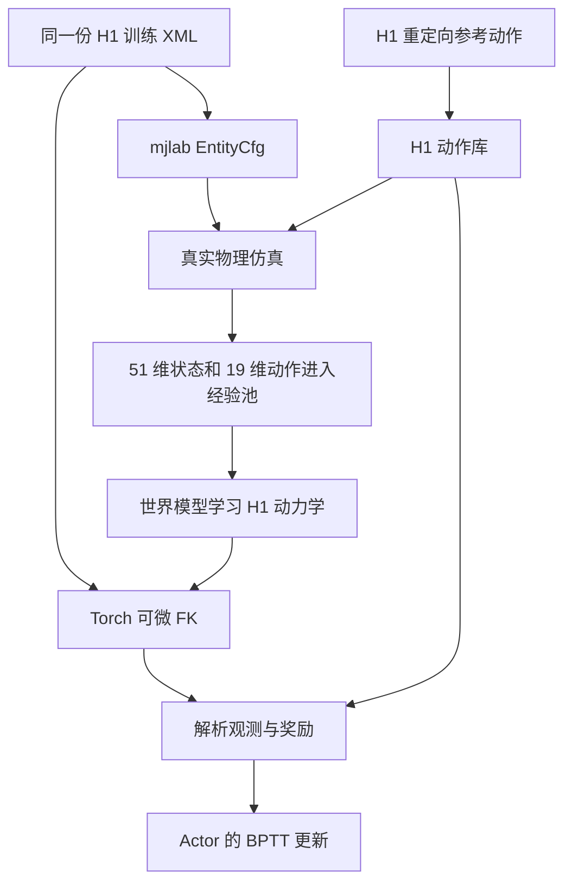

# SuperMimic 从 G1 迁移到 H1 的逐文件修改指南

适用仓库：`/home/ljp/human_learn/SuperMimic-Reproduced-main`。

本文说明如何把当前 G1 训练实现改为使用仓库 `h1_data/` 中的 H1 模型。每一步给出修改位置、修改方法、原因和检查方法。机器人按 **19 个实际关节、位置目标控制、50 Hz 策略频率**处理。

**实施进度（2026-11-05）：第 2～17 章的 H1 专用实现已接入。** 本机已配置 `.venv`（Python 3.12、mjlab、CUDA）；当前训练、世界模型、Actor/Critic、动作转换、compact 动作库和评测/播放入口均使用 H1。具体改动、真实数据来源、启动命令和实际验证结果见 [H1迁移完成与训练说明](H1迁移完成与训练说明.md)。第 18 章是未来同时支持多机器人的设计建议。下面的“原位置”指迁移前代码，行号随修改变化，应优先按函数名定位。

为了让修改步骤明确，正文采用“在独立分支或副本上形成 H1 专用版本”的方法：全仓库使用一个统一的 H1 维度定义。它不提供同一进程中 G1/H1 的动态切换。若要长期同时维护两种机器人，见第 18 节的配置化方案。

## 目录

1. [迁移时必须同时对齐的三条路径](#step-1)
2. [创建训练用 H1 资产](#step-2)
3. [建立统一维度定义](#step-3)
4. [增加 H1 模型和执行器配置](#step-4)
5. [修改训练环境](#step-5)
6. [修改仿真状态和上下文读取](#step-6)
7. [修改经验池记录器](#step-7)
8. [修改世界模型状态表示和动力学网络](#step-8)
9. [修改解析观测与奖励头](#step-9)
10. [修改 Actor 和 Critic](#step-10)
11. [修改想象训练和训练入口](#step-11)
12. [准备 H1 参考动作和转换工具](#step-12)
13. [修改动作库与 compact 缓存](#step-13)
14. [检查评测及辅助脚本](#step-14)
15. [按层验证并启动短训练](#step-15)
16. [常见错误与定位](#step-16)
17. [逐文件完成清单](#step-17)
18. [后续支持 G1 和 H1 切换](#step-18)

<a id="step-1"></a>
## 1. 迁移时必须同时对齐的三条路径

当前机器人的信息不只存在于环境配置中。至少有三条路径需要共同变成 H1：



- **真实仿真路径**：决定执行一个动作后，H1 实际变成什么状态。
- **世界模型与 FK 路径**：决定如何解释预测状态，并计算预测奖励、观测和梯度。
- **参考动作路径**：决定机器人应该模仿什么，以及每个回合从哪里开始。

只把环境机器人换成 H1，而 FK 继续加载 G1，世界模型就会使用错误的骨架解释状态。只改网络输出为 19，而经验池仍记录 29 维动作，也无法建立训练闭环。

原始入口位置：

| 路径 | 迁移前源码位置 | 迁移前行为 |
|---|---|---|
| 仿真机器人 | [tracking_env_cfg.py 第 228 行](../src/supermimic/envs/tracking_env_cfg.py#L228) | 调用 `get_g1_robot_cfg()` |
| 世界模型的 FK | [training/loop.py 第 82 行](../src/supermimic/training/loop.py#L82) | `G1Kinematics(load_g1_model())` |
| compact 动作库的 FK | [motion_library.py 第 150 行](../src/supermimic/envs/mdp/motion_library.py#L150) | 单独加载 G1 模型 |
| CSV 转换的模型 | [motion_convert.py 第 315 行](../src/supermimic/data/motion_convert.py#L315) | 默认加载 G1 |
| 批量转换 worker | [csv_to_npz_batch.py 第 25 行](../scripts/data/csv_to_npz_batch.py#L25) | 每个 worker 加载 G1 |

文中行号对应编写时的源码。应用修改后行号会移动，可用函数名定位。

<a id="step-2"></a>
## 2. 创建训练用 H1 资产

### 2.1 你提供的 H1 文件有什么特殊之处

原始文件：[h1_data/h1.xml](../h1_data/h1.xml)。该文件引用 `meshes/h1/`，这些网格在仓库中存在。

注释停用之前的 XML 含 19 个实际关节，以及一个独立的占位关节 `not_use_joint`。其 body 位于世界坐标 `z=20`，没有接在 H1 主骨架上，见 [h1.xml 第 191 行](../h1_data/h1.xml#L191)。当前该 body 已整段注释，内部的惯性、关节和结束标签都保留在注释中。

本机 MuJoCo 3.9.0 实际加载的结果为：

| 模型阶段 | nq | nv | nu | 不含 world 的 body 数 |
|---|---:|---:|---:|---:|
| 原始 h1.xml，注释停用前 | 27 | 26 | 20 | 21 |
| 清理占位 body、原执行器等后的训练资产 | 26 | 25 | 0 | 20 |
| 再由 mjlab 添加 19 个位置执行器后，预期 | 26 | 25 | 19 | 20 |

最后一行是后续验收目标，不是已经运行过的 mjlab 测试结果。

### 2.2 修改内容及原因

新资产命名为 `h1_data/h1_training.xml`，保留原文件。

| 处理 | 原位置 | 原因 |
|---|---|---|
| 注释停用 `include scene.xml` | [h1.xml 第 4 行](../h1_data/h1.xml#L4) | mjlab 环境会创建地面，避免重复地面 |
| 注释停用整个 `not_use_body` | [h1.xml 第 191 行](../h1_data/h1.xml#L191) | 防止占位关节进入状态、动作和 FK |
| 注释停用原 `<actuator>` | [h1.xml 第 198 行](../h1_data/h1.xml#L198) | 原定义是 motor；迁移后由 mjlab 配置位置执行器 |
| 注释停用原 `<sensor>` | [h1.xml 第 229 行](../h1_data/h1.xml#L229) | 本训练观测直接取仿真状态；占位关节传感器引用也不再生效 |
| 注释停用原 `<keyframe>` | [h1.xml 第 301 行](../h1_data/h1.xml#L301) | 原 qpos 含占位维度；默认姿态交给 EntityCfg |
| 给碰撞 geom 命名 | 左右脚位于 ankle body 下 | 摩擦随机化和 SimContext 需要按名称找到脚 |

保留原有质量、惯量、关节轴、关节限位和碰撞形状。`h1.urdf` 可用于核对结构，但当前训练路径使用 MuJoCo XML，不必同时改 URDF。

### 2.3 已实现的资产生成脚本

正式工具：[scripts/data/prepare_h1_asset.py](../scripts/data/prepare_h1_asset.py)。已生成资产：[h1_data/h1_training.xml](../h1_data/h1_training.xml)。

脚本的 `prepare_h1_asset()` 先保留源 XML 中已有的注释，再通过 `_comment_out()` 把仍然生效的场景引用、占位 body、执行器、传感器和关键帧改为注释。原标签与属性完整保留，不直接丢弃定义。为未命名的碰撞 geom 添加名称后，在内存中用 MuJoCo 检查尺寸和脚部名称，最后才写入训练资产。

源文件保持不变；目标已存在时停止，不覆盖手工调整后的训练资产。输出必须与源 XML 位于同一目录，以保持 `meshes/h1` 相对路径有效。该脚本是正式资产工具，不是临时测试文件。

在依赖已安装的项目环境中，从仓库根目录执行：

```bash
env -u PYTHONPATH uv run python scripts/data/prepare_h1_asset.py
```

这里 `nu=0` 是正确的。CPU FK 只需要骨架，不需要控制器；mjlab 稍后会添加执行器。脚本已用本机 MuJoCo 成功生成并检查训练资产。当前目标文件已经存在，再次运行命令会按设计拒绝覆盖；mjlab 实体构建仍需在项目环境中验收。

<a id="step-3"></a>
## 3. 建立统一维度定义

已新增 [src/supermimic/robot_dimensions.py](../src/supermimic/robot_dimensions.py)，避免多处手动填写 19、51、63 等数字。训练、数据和网络模块现在已统一导入这些定义。

```python
"""H1 专用训练版本的数据维度。"""

NJ = 19
NQ = 7 + NJ
NV = 6 + NJ
STATE_DIM = NQ + NV
FEAT_DIM = 13 + 2 * NJ
DELTA_DIM = 12 + 2 * NJ
ACT_DIM = NJ
XI_DIM = 1 + NJ + 3
OBS_DIM = 3 * NJ + 6
GOAL_FEAT_DIM = 2 * NJ + 10
REF_DIM = STATE_DIM

STATE_SIZES = (3, 4, NJ, 3, 3, NJ)
DELTA_SIZES = (3, 3, NJ, 3, 3, NJ)
OBS_TERMS = (
    ("joint_pos", NJ),
    ("joint_vel", NJ),
    ("base_ang_vel", 3),
    ("projected_gravity", 3),
    ("actions", NJ),
)
```

后续章节接入时，各模块应导入此文件中的常量，并将原来的同名赋值注释停用，保留原内容。否则后面的旧赋值可能覆盖刚导入的 H1 常量。

| 数据 | 计算方式 | G1 | H1 |
|---|---|---:|---:|
| 动作 | N | 29 | 19 |
| qpos | 7+N | 36 | 26 |
| qvel | 6+N | 35 | 25 |
| 完整状态 | 13+2N | 71 | 51 |
| 规范化状态特征 | 13+2N | 71 | 51 |
| 动力学增量 | 12+2N | 70 | 50 |
| 仿真上下文 | 1+N+3 | 33 | 23 |
| 单帧本体观测 | 3N+6 | 93 | 63 |
| 10 帧历史观测 | 10×(3N+6) | 930 | 630 |
| 单帧目标特征 | 2N+10 | 68 | 48 |
| 10 帧目标 | 10×(2N+10) | 680 | 480 |

启用 `anchor_obs` 时，目标额外增加 9 维，即 H1 的 489 维；历史本体观测仍是 630 维。

不要做全仓库数字替换。例如 `32` 既可能是想象步数、潜变量长度，也可能恰好是 H1 状态中的切片边界，这些含义不同。

<a id="step-4"></a>
## 4. 增加 H1 模型和执行器配置

已新增 [robots/__init__.py](../src/supermimic/robots/__init__.py) 与 [robots/h1.py](../src/supermimic/robots/h1.py)。下面展示核心配置；实际源码还包含明确的模型尺寸、关节类型和顺序错误提示。

### 4.1 固定并验证关节顺序

`h1.py` 的模型和名称部分可写成：

```python
from pathlib import Path

import mujoco

from supermimic.robot_dimensions import NJ, NQ, NV

H1_XML = Path(__file__).resolve().parents[3] / "h1_data/h1_training.xml"

H1_JOINT_NAMES = (
    "left_hip_yaw_joint", "left_hip_roll_joint", "left_hip_pitch_joint",
    "left_knee_joint", "left_ankle_joint",
    "right_hip_yaw_joint", "right_hip_roll_joint", "right_hip_pitch_joint",
    "right_knee_joint", "right_ankle_joint",
    "torso_joint",
    "left_shoulder_pitch_joint", "left_shoulder_roll_joint",
    "left_shoulder_yaw_joint", "left_elbow_joint",
    "right_shoulder_pitch_joint", "right_shoulder_roll_joint",
    "right_shoulder_yaw_joint", "right_elbow_joint",
)

def load_h1_model(xml_path=None):
    model = mujoco.MjModel.from_xml_path(str(xml_path or H1_XML))
    assert model.jnt_type[0] == mujoco.mjtJoint.mjJNT_FREE
    names = tuple(model.joint(i).name for i in range(1, model.njnt))
    assert names == H1_JOINT_NAMES, names
    assert (model.nq, model.nv) == (NQ, NV)
    assert len(names) == NJ
    assert all(
        model.jnt_type[i] == mujoco.mjtJoint.mjJNT_HINGE
        for i in range(1, model.njnt)
    )
    return model

def get_h1_spec():
    return mujoco.MjSpec.from_file(str(H1_XML))
```

这一路径计算适用于当前源码仓库布局。以后如果只安装 wheel，需要把 XML 和 meshes 纳入包资源，或增加明确的资产路径配置，不能再依赖仓库外层目录。

**为什么固定顺序：** 数组中的第 0 个数字没有自带“左髋偏航”的语义。只有动作、关节位置、默认姿态和参考动作都遵守同一套映射，它才表示同一个关节。原 XML 的 motor 顺序与关节树顺序不同，不能直接沿用。

### 4.2 默认姿态与动作缩放

继续在 `h1.py` 中增加：

```python
# 按 H1_JOINT_NAMES 顺序；当前源码使用用户设置的列表。
default_pos = [
    0.0, 0.0, -0.4, 0.8, -0.4,
    0.0, 0.0, -0.4, 0.8, -0.4,
    0.0,
    0.0, 0.0, 0.0, 0.0,
    0.0, 0.0, 0.0, 0.0,
]

# 初次联调采用统一缩放；后续可以按关节调整。
H1_ACTION_SCALE = {name: 0.25 for name in H1_JOINT_NAMES}
```

默认关节角取自原 XML 的 `home` 姿态。动作零点的含义为：

```text
q_target = q_default + action_scale × action
```

`action_scale=0.25` 是这里给出的初始联调选择，不是已经验证的最优 H1 参数，也不表示动作被限制在 [-1,1]；当前 Actor 输出没有末端 tanh。

默认关节角还参与 `joint_pos_rel` 观测和参考目标中的 `q_ref-q_default`。因此环境、动作库和解析观测必须使用同一份默认关节角。

### 4.3 创建位置执行器

当前保留用户已设定的 PD 列表，按 `H1_JOINT_NAMES` 顺序排列。以下与 [robots/h1.py](../src/supermimic/robots/h1.py) 一致；短训练通过不代表控制参数已经达到最优跟踪效果。

```python
stiffness = [150, 150, 150, 200, 40, 150, 150, 150, 200, 40,
             300, 100, 100, 100, 50, 100, 100, 100, 50]
damping = [2, 2, 2, 4, 2, 2, 2, 2, 4, 2, 3, 2, 2, 2, 2, 2, 2, 2, 2]
effort_limit = [200, 200, 200, 300, 40, 200, 200, 200, 300, 40,
                200, 40, 40, 18, 18, 40, 40, 18, 18]

def get_h1_robot_cfg():
    from mjlab.actuator import BuiltinPositionActuatorCfg
    from mjlab.entity import EntityArticulationInfoCfg, EntityCfg

    actuators = []
    for name, kp, kd, effort in zip(
        H1_JOINT_NAMES, stiffness, damping, effort_limit, strict=True
    ):
        actuators.append(BuiltinPositionActuatorCfg(
            target_names_expr=(name,),
            stiffness=kp,
            damping=kd,
            effort_limit=effort,
            armature=0.1,
            viscous_damping=1.0,
        ))

    return EntityCfg(
        spec_fn=get_h1_spec,
        init_state=EntityCfg.InitialStateCfg(
            pos=(0.0, 0.0, 0.98),
            joint_pos=dict(zip(H1_JOINT_NAMES, default_pos, strict=True)),
            joint_vel={".*": 0.0},
        ),
        articulation=EntityArticulationInfoCfg(
            actuators=tuple(actuators),
            soft_joint_pos_limit_factor=0.9,
        ),
    )
```

按每个关节单独添加执行器，是为了让配置顺序明确等于 `H1_JOINT_NAMES`。构建后还要核对实际执行器对应的关节顺序，不能只相信代码排列。

此示例沿用 XML 的碰撞属性，并在执行器配置中显式填入与 XML 一致的 `armature=0.1` 和 `viscous_damping=1.0`。XML 中的 `damping="1"` 是额外的关节被动阻尼，不是上面的 PD Kd；显式填写可避免依赖框架的默认覆盖行为。调参时需要把这些量一起考虑。没有复制 G1 的碰撞名称正则或执行器参数。

`BuiltinPositionActuatorCfg` 与 `EntityCfg` 的接口以仓库锁定的 mjlab 提交 `8bb2bc9e187797689ec82c78c35019afd2fd0376` 为依据：[执行器实现](https://raw.githubusercontent.com/mujocolab/mjlab/8bb2bc9e187797689ec82c78c35019afd2fd0376/src/mjlab/actuator/builtin_actuator.py)、[G1 配置工厂示例](https://raw.githubusercontent.com/mujocolab/mjlab/8bb2bc9e187797689ec82c78c35019afd2fd0376/src/mjlab/asset_zoo/robots/unitree_g1/g1_constants.py)。

<a id="step-5"></a>
## 5. 修改训练环境

修改文件：[src/supermimic/envs/tracking_env_cfg.py](../src/supermimic/envs/tracking_env_cfg.py)。

### 5.1 替换机器人配置和动作缩放

第 18 行原导入改成：

```python
from supermimic.robots.h1 import H1_ACTION_SCALE, get_h1_robot_cfg
```

第 135 行 `scale=G1_ACTION_SCALE` 改成 `scale=H1_ACTION_SCALE`。

第 228 行的 scene 改成：

```python
scene=SceneCfg(
    terrain=TerrainEntityCfg(terrain_type="plane"),
    num_envs=a.num_envs,
    entities={"robot": get_h1_robot_cfg()},
),
```

保留实体键名 `"robot"`。其他模块通过 `env.scene["robot"]` 访问它，实体键名不是机器人型号。

### 5.2 修改跟踪刚体列表

第 49 行的 `TRACKED_BODIES` 改成：

```python
TRACKED_BODIES = (
    "pelvis",
    "left_hip_roll_link", "left_knee_link", "left_ankle_link",
    "right_hip_roll_link", "right_knee_link", "right_ankle_link",
    "torso_link",
    "left_shoulder_roll_link", "left_elbow_link_ball_hand",
    "right_shoulder_roll_link", "right_elbow_link_ball_hand",
)
ANCHOR_BODY = "torso_link"
ROOT_BODY = "pelvis"
FOOT_GEOM_REGEX = r"^(left|right)_ankle_link_collision$"
```

当前 H1 没有 `left_wrist_yaw_link` 等腕部 body，也没有 G1 的 `left_ankle_roll_link`；肘部实际叫 `left_elbow_link_ball_hand`。不能只把 G1 的 body 列表复制过来。

跟踪 12 个 body 是初始选择。它们决定奖励在哪些部位比较预测和参考状态，不等于机器人只有 12 个 body。若以后要跟踪手掌末端，应定义真实的固定末端 frame/body，并同时用于参考数据和 FK；重复填写肘部 body 不会产生手掌末端。

### 5.3 检查关联配置

| 配置 | 处理 |
|---|---|
| command 的 `body_names` | 继续引用更新后的 `TRACKED_BODIES` |
| anchor 和 root | 当前 H1 仍有 `torso_link`、`pelvis`，可保留 |
| `base_com` 随机化 | 当前作用于 `torso_link`，名称仍有效 |
| `foot_friction` 随机化 | 必须匹配新的 `FOOT_GEOM_REGEX` |
| Recorder 的脚部正则 | 使用同一变量，避免与随机化作用对象不一致 |
| Viewer 的 body | `torso_link` 可保留 |
| timestep、decimation | 先保留 0.005 秒、4，策略周期仍为 0.02 秒 |

当前 `QuietSimulationCfg` 已恢复全部溢出提示。H1 联调触发了原 `ls_iterations=20` 的线搜索上限，因此提高到 50；`nconmax=35`、`njmax=250` 仍需在更大规模训练中持续观察。关节数少不代表 mesh 接触需求一定更少。

默认姿态由 EntityCfg 提供，但训练回合仍会由 `MultiClipMotionCommand` 从 H1 参考动作中采样起点。更换机器人不需要改变之前讨论的多环境起点采样原理。

<a id="step-6"></a>
## 6. 修改仿真状态和上下文读取

### 6.1 state_io.py

位置：[state_io.py 第 7 行](../src/supermimic/envs/state_io.py#L7)。

删除原来的 `STATE_DIM=36+35`、`NQ=36`、`NV=35`，改为：

```python
from supermimic.robot_dimensions import STATE_DIM, NQ, NV
```

已有 `StateIO.write()` 使用 `NQ` 分割，因此导入新常量后可以复用。保留读写时减去/加回 `env_origins` 的逻辑，保证多个环境的状态都用各自的局部原点表示。

H1 状态布局：

| 切片 | 内容 | 坐标约定 |
|---|---|---|
| `0:3` | 根位置 | 相对环境原点的世界轴方向 |
| `3:7` | 根四元数 | wxyz |
| `7:26` | 19 个关节位置 | H1 统一关节顺序 |
| `26:29` | 根线速度 | 世界坐标系 |
| `29:32` | 根角速度 | 根部坐标系 |
| `32:51` | 19 个关节速度 | H1 统一关节顺序 |

### 6.2 sim_context.py

位置：[sim_context.py 第 8 行](../src/supermimic/envs/sim_context.py#L8)。

把 `XI_DIM=33` 改为导入 `XI_DIM`。`SimContext.read()` 本身按实际 encoder bias 拼接，其他拼接逻辑可以复用。

```text
xi[..., 0:1]   脚部摩擦系数
xi[..., 1:20]  19 个关节编码器偏置
xi[..., 20:23] 躯干质心偏移
```

当前上下文只读取一个脚部 geom 的摩擦系数，前提是脚部摩擦使用共享随机值。保留环境中的 `shared_random=True`。如果以后左右脚分别随机化，必须扩展 xi 的定义，不能继续只记录一个值。

<a id="step-7"></a>
## 7. 修改经验池记录器

位置：[src/supermimic/data/recorder.py](../src/supermimic/data/recorder.py)。

增加导入：

```python
from supermimic.robot_dimensions import ACT_DIM
```

第 38 行改为：

```python
self.buffer = ReplayBuffer(
    n, int(p["capacity"]), STATE_DIM, ACT_DIM, XI_DIM, env.device
)
```

第 94 行改为：

```python
zeros_a = torch.zeros(env_ids.numel(), ACT_DIM, device=env.device)
```

`prev_s`、`prev_xi` 已按常量分配，因此第 6 节改好后会变成 51、23 维。`ReplayBuffer` 自身的构造器接受通用维度，见 [replay_buffer.py 第 38 行](../src/supermimic/data/replay_buffer.py#L38)，不必重写其环形缓存结构。

**终止行也要修改。** 如果只改普通数据行，H1 可能在第一次摔倒重置时才报动作维度不匹配。

同时把 `ReplayRecorderCfg` 默认参数中的脚部正则改成 H1 正则。训练环境虽然会显式传值，独立测试或其他调用仍可能使用默认值。

<a id="step-8"></a>
## 8. 修改世界模型状态表示和动力学网络

### 8.1 state_spec.py 的常量、切片和归一化

位置：[state_spec.py 第 40 行](../src/supermimic/world_model/state_spec.py#L40)。

删除四个旧维度常量，导入：

```python
from supermimic.robot_dimensions import (
    NJ, STATE_DIM, FEAT_DIM, DELTA_DIM, STATE_SIZES, DELTA_SIZES,
)
```

`StateSpecCfg` 中两项改为：

```python
xi_offset: tuple[float, ...] = field(
    default_factory=lambda: (0.75,) + (0.0,) * NJ + (0.0,) * 3
)
xi_scale: tuple[float, ...] = field(
    default_factory=lambda: (0.45,) + (0.01,) * NJ + (0.05,) * 3
)
```

`split()` 替换为：

```python
@staticmethod
def split(s: torch.Tensor):
    return torch.split(s, STATE_SIZES, dim=-1)
```

`integrate()` 中，在 `d = delta * self.out_scale` 后，将原来的六个固定切片替换为：

```python
dv_h, dw_b, dqd, dp_h, dth_b, dq = torch.split(d, DELTA_SIZES, dim=-1)
```

其实际布局为：

```text
dv_h  0:3    根线速度增量，heading 坐标系
dw_b  3:6    根角速度增量，根部坐标系
dqd   6:25   19 个关节速度增量
dp_h 25:28   根位置积分后的修正
dth_b 28:31  根姿态积分后的旋转修正
dq   31:50   19 个关节位置积分后的修正
```

初始化中的 `err_scale`、`out_scale`、`in_scale` 已通过 `NJ` 构造，更新 NJ 后会自动变为 50、50、51 维。尺度数值可先保留，但后续需要结合 H1 状态误差分布评估。

规范化特征的 51 维并不是原状态的原样复制，而是：

```text
根高度 1 + 去 heading 的旋转表示 6 + heading 线速度 3
+ 根部角速度 3 + 关节位置 19 + 关节速度 19
```

输出 50 维而非 51 维，是因为旋转增量用 3 维旋转向量，完整状态中的四元数用 4 维。不要把动力学输出也设成 51。

### 8.2 dynamics.py 与 WorldModel 构造函数

位置：[dynamics.py 第 34 行](../src/supermimic/world_model/dynamics.py#L34)。

导入统一常量，并修改签名：

```python
from supermimic.robot_dimensions import FEAT_DIM, ACT_DIM, XI_DIM, DELTA_DIM

# 替换 DynamicsMLP.__init__ 的签名，方法体保留。
def __init__(self, feat_dim: int = FEAT_DIM, act_dim: int = ACT_DIM,
             xi_dim: int = XI_DIM, hidden=(2048, 2048, 2048),
             out_dim: int = DELTA_DIM):
    super().__init__()
    self.mlp = MLP(feat_dim + act_dim + xi_dim, tuple(hidden), out_dim,
                   zero_last=True)
```

在 [world_model.py 第 45 行](../src/supermimic/world_model/world_model.py#L45) 同样导入上述常量，显式创建：

```python
self.dynamics = DynamicsMLP(
    feat_dim=FEAT_DIM,
    act_dim=ACT_DIM,
    xi_dim=XI_DIM,
    hidden=cfg.hidden,
    out_dim=DELTA_DIM,
)
```

修改后网络输入为 `51+19+23=93`，输出为 50。这里的 93 是 H1 动力学网络输入总长度，与原 G1 的单帧观测 93 维没有语义关系。

终止头仍根据高度误差和倾斜误差构造 4 维输入，输出一个终止 logit，不需要按关节数改尺寸。

`window_loss()` 中的多步监督逻辑、积分公式和 Adam 更新过程继续复用。世界模型需要重新学习 H1 的动力学，不能把 G1 模型权重当作尺寸修改后的可直接恢复状态。

<a id="step-9"></a>
## 9. 修改解析观测与奖励头

修改文件：[src/supermimic/world_model/heads.py](../src/supermimic/world_model/heads.py)。

### 9.1 观测布局与切片

删除原 `OBS_DIM=93` 和固定的 `OBS_TERMS`，改为：

```python
from supermimic.robot_dimensions import NJ, NQ, OBS_DIM, OBS_TERMS, STATE_SIZES
```

替换 `split_state()`：

```python
def split_state(s: torch.Tensor):
    return torch.split(s, STATE_SIZES, dim=-1)
```

在 `analytic_observation()` 中改成：

```python
bias = xi[..., 1:1 + NJ]
```

后面的拼接保持：

```text
q + bias - q_default  19
qd                   19
ang_b                 3
projected_gravity      3
prev_action           19
总计                  63
```

`flatten_history_term_major()` 会读取新的 `OBS_TERMS`，保留原排列逻辑即可。其排列是“关节位置的全部历史 → 关节速度的全部历史 → …”，不是把 10 帧完整观测逐帧直接拼接。

### 9.2 FK 输入和奖励中的关节位置

`robot_bodies()` 第 102 行改为：

```python
out = self.fk(s[..., :NQ], s[..., NQ:])
```

`reward()` 第 128 行改为：

```python
joint_pos=s_next[..., 7:NQ],
```

`soft_limits` 和 `default_joint_pos` 继续从真实环境中的 H1 取出，形状分别应为 `(19, 2)`、`(19,)`。

### 9.3 为什么奖励头也属于迁移核心

Actor 的梯度会通过“预测状态 → FK → 身体位置和姿态 → 奖励”传播。即使张量形状正确，若 FK、body 列表或参考数据不是同一套 H1 定义，Actor 仍可能在优化错误目标。

先保持原奖励公式和权重。由于 body 跟踪项对 body 求平均，12 个跟踪部位不会直接把正奖励上限按 12/14 缩小；但关节限位与动作变化惩罚按关节求和，关节数变化会影响其统计尺度。跑通后再依据各项奖励日志调节权重，不要直接按 19/29 机械缩放。

如果调整环境奖励，也同步调整 [envs/mdp/rewards.py 的 TrackingRewardCfg](../src/supermimic/envs/mdp/rewards.py)。真实环境和想象训练必须使用一致的奖励定义。

<a id="step-10"></a>
## 10. 修改 Actor 和 Critic

修改文件：[src/supermimic/policy/nets.py](../src/supermimic/policy/nets.py)。

### 10.1 常量和 goal 归一化

增加：

```python
from supermimic.robot_dimensions import (
    NJ, ACT_DIM, OBS_DIM, FEAT_DIM, XI_DIM, GOAL_FEAT_DIM,
)

GOAL_DIM = 10 * GOAL_FEAT_DIM
LATENT_DIM = 32
```

删除原 `ACT_DIM=29` 和 `GOAL_DIM=680`。`OBS_TERMS` 可以继续从 heads 导入，因为 heads 已导入统一定义。

在 `_goal_scale_vector()` 中改成：

```python
sizes = (NJ, NJ, 3, 3, 3, 1)
per_frame = torch.cat([
    torch.full((n,), 1.0 / s)
    for n, s in zip(sizes, cfg.goal_term_scale)
])
k, extra = divmod(goal_dim, GOAL_FEAT_DIM)
if extra not in (0, 9):
    raise ValueError(f"不支持的目标维度：{goal_dim}")
return torch.cat([per_frame.repeat(k), torch.ones(extra)])
```

`_obs_scale_vector()` 已使用 `OBS_TERMS` 和 `cfg.history`，不必重写。

### 10.2 Decoder

第 63 行不要继续把输入固定成 930。替换构造函数为：

```python
def __init__(self, cfg: PolicyCfg, obs_dim: int | None = None):
    super().__init__()
    obs_dim = cfg.history * OBS_DIM if obs_dim is None else obs_dim
    self.mlp = MLP(
        cfg.latent_dim + obs_dim,
        cfg.decoder_hidden,
        ACT_DIM,
        last_gain=cfg.decoder_last_gain,
    )
    self.register_buffer("scale", _obs_scale_vector(cfg))
```

默认情况下，MotionEncoder 为 `480 → 隐藏层 → 32`，Decoder 为 `630+32 → 隐藏层 → 19`。

### 10.3 Critic

把构造函数的默认 `feat_dim=71`、`xi_dim=33` 改为 `feat_dim=FEAT_DIM`、`xi_dim=XI_DIM`。目标维度仍通过 `pcfg.goal_dim` 取得。

默认输入长度：`51+480+23+4=558`。启用 anchor 目标时为 567。输出仍是一个标量价值。

隐藏层宽度和 32 维运动编码可以先沿用。32 维运动编码与 32 步想象时域是两个独立参数，不能因为数字相同而一起修改。

<a id="step-11"></a>
## 11. 修改想象训练和训练入口

### 11.1 rollout.py 的噪声向量

位置：[rollout.py 第 18 行](../src/supermimic/imagination/rollout.py#L18)。

导入 `NJ`，改为：

```python
OBS_NOISE_HALF = torch.tensor(
    [0.01] * NJ + [0.5] * NJ + [0.2] * 3
    + [0.05] * 3 + [0.0] * NJ
)
```

否则关闭噪声时可能正常，一打开想象观测噪声就出现 63 与 93 维不匹配。

`imagination/compiled.py` 调用的是公共观测和奖励函数，相关函数改好后不必重写其一步计算。迁移联调阶段可将世界模型和策略训练器的 `compile` 都设为 `None`，先排查普通执行路径，再启用编译。

### 11.2 training/loop.py 的配置同步

位置：[training/loop.py 第 31 行](../src/supermimic/training/loop.py#L31)。

导入统一常量，将初始化开头的相关配置整理为：

```python
cfg.policy.goal_dim = (
    cfg.env.future_frames * GOAL_FEAT_DIM
    + (9 if cfg.env.anchor_obs else 0)
)
cfg.policy_trainer.anchor_obs = cfg.env.anchor_obs
cfg.policy_trainer.future_frames = cfg.env.future_frames
cfg.policy_trainer.history = cfg.policy.history
```

给 `SuperMimicEnvCfgArgs(...)` 增加：

```python
history_length=cfg.policy.history,
```

原因：环境历史长度、Actor 归一化长度、想象训练历史长度需要一致；环境和想象训练的未来参考帧数也需要一致。默认全为 10 时问题可能被掩盖，改配置后才暴露。

### 11.3 training/loop.py 的 FK 和 Critic

第 14 行模型导入改成：

```python
from supermimic.robots.h1 import load_h1_model
```

第 82 行改成：

```python
fk = G1Kinematics(load_h1_model(), device=self.device)
```

此处暂时保留 `G1Kinematics` 类名。该类核心实现从模型读取骨架、轴和地址，见 [g1_fk.py 第 54 行](../src/supermimic/kinematics/g1_fk.py#L54)，可以用 H1 模型检验复用；类名不决定 FK 用哪种机器人。后续重命名应同时更新所有导入和测试。

创建 Critic 时可显式写明：

```python
self.critic = Critic(
    cfg.critic, feat_dim=FEAT_DIM, xi_dim=XI_DIM, pcfg=cfg.policy
).to(self.device)
```

### 11.4 哪些训练算法先保留

- 世界模型监督窗口 `k=8`：仍代表 8 个状态转移、9 个连续状态。
- 想象时域 `H=32`：50 Hz 下仍是 0.64 秒。
- Actor 的 BPTT、Critic 的 TD(λ)、共享参数、多环境批量更新机制：继续复用。
- Adam、折扣因子、网络隐藏层：先保留，依据 H1 实验再调整。

更少关节只直接改变空间维度，不自动规定时间跨度应该缩短。若后续改变控制频率，要同时检查状态积分 `dt`、奖励 `dt`、数据采样频率与环境 decimation。

<a id="step-12"></a>
## 12. 准备 H1 参考动作和转换工具

### 12.1 不能直接截取 G1 动作

G1 的 29 维动作删去 10 维，不会自然成为 H1 的动作。两者关节轴、骨架尺寸、默认姿态和可达范围不同。应使用针对 H1 的重定向结果，并确认与当前训练 XML 一致。

即使是“19 关节 H1 数据”，不同导出器也可能采用不同关节顺序，必须按名称映射。不要仅凭列数相等判断可用。

### 12.2 修改 motion_convert.py

位置：[src/supermimic/data/motion_convert.py](../src/supermimic/data/motion_convert.py)。

H1 专用版本可以这样处理：

1. 导入 `H1_JOINT_NAMES` 和 `load_h1_model`。
2. 将原 G1 关节元组保留为注释，使用 `H1_JOINT_NAMES`、`NUM_JOINTS = len(H1_JOINT_NAMES)`。
3. 注释仅用于 G1 的 `g1_xml_path()`、`load_g1_model()`；调用方改为明确导入 H1 loader。
4. `load_csv()` 中的关节列检查使用 `H1_JOINT_NAMES`。
5. `convert_csv_to_npz()` 的默认模型改成 `load_h1_model()`。
6. 保存 NPZ 时 `joint_names=np.array(H1_JOINT_NAMES)`。

关键原位置：

| 原位置 | 要改的内容 |
|---|---|
| 第 35 行 | G1 关节名定义 |
| 第 69 行 | G1 XML 路径与加载器 |
| 第 171 行 | 有表头 CSV 的预期关节列 |
| 第 181 行 | `7+NUM_JOINTS` 校验，保留公式但 NJ 变为 19 |
| 第 315 行 | 默认模型 |
| 第 330 行 | 输出的 joint_names |

有表头数据应按已确认的 H1 名称重排，而不是直接依赖列位置。若使用仓库现有 BONES 解析分支，还必须满足其 root 列名、单位和 Euler 角约定；不能仅因“有表头”就当作 BONES 格式。

无表头格式要求每行 26 列：

```text
root_pos xyz，单位米                    3
root_quat xyzw                        4
joint_pos，弧度，H1_JOINT_NAMES 顺序   19
```

当前转换器把 CSV 的 xyzw 转成内部 wxyz。若 H1 输入文件本来就是 wxyz，应明确修改该输入分支，避免再次错误交换。

`resample_motion()` 和 `forward_kinematics()` 主要使用数组长度和 `model.nq/nv`，可以保留，并通过 H1 数据检查。输出统一重采样到 50 Hz，重新计算关节速度、根速度和各 body 状态。

### 12.3 修改批量转换脚本

位置：[scripts/data/csv_to_npz_batch.py 第 25 行](../scripts/data/csv_to_npz_batch.py#L25)。

在 `_init_worker()` 中改为：

```python
from supermimic.robots.h1 import load_h1_model
_MODEL = load_h1_model()
```

修改完成后，若输入 CSV 符合上述约定且源频率为 30 Hz，可执行：

```bash
env -u PYTHONPATH uv run python scripts/data/csv_to_npz_batch.py \
  --input-dir data/raw/h1 \
  --output-dir data/npz/h1 \
  --input-fps 30 \
  --output-fps 50 \
  --workers 1 \
  --limit 1
```

源频率不是 30 Hz 时，要填写实际值。初次只转换一个文件，检查正确后扩大数据量。使用独立输出目录，避免脚本跳过同名旧 G1 NPZ。

### 12.4 本机已有 H1 NPZ 的适配条件

本机以下两个文件已检查过数据字段：

| 文件 | 帧数 | joint_pos | body_pos_w | fps |
|---|---:|---|---|---:|
| [default_pose_150frames.npz](/home/ljp/human_learn/whole_body/Beyondmimic_Deploy_H1_last/deploy_real/bydmimic/default_pose_150frames.npz) | 249 | `(249,19)` | `(249,20,3)` | 50 |
| [dance1_subject3_last.npz](/home/ljp/human_learn/whole_body/Beyondmimic_Deploy_H1_last/deploy_real/bydmimic/dance1_subject3_last.npz) | 1182 | `(1182,19)` | `(1182,20,3)` | 50 |

来源文件还包含关节速度、body 四元数、body 线速度和角速度，但没有 `joint_names` 和 `body_names`，不能直接输入 MotionLibrary。本次已通过配套 ONNX 元数据恢复关节顺序并重新计算 H1 FK，整理后的独立副本位于 `data/npz/h1/`；站立片段同时校正了固定根高度。转换细节见 [实施说明第 3 节](H1迁移完成与训练说明.md#3-已准备的-h1-动作)。

正确适配顺序：从原导出脚本、训练资产或 checkpoint 元数据恢复关节和 body 顺序；按名称重排 joint_pos/joint_vel；确认 pelvis 索引和四元数约定；核对训练 XML。若骨架版本或 frame 定义不同，应使用确认后的根状态、关节状态和当前 H1 模型重算 body FK。最后保存名称元数据与转换来源。

**不能仅依据当前 XML 的顺序给旧数组补上名字。** 这样可能掩盖数组本身的排列差异。

<a id="step-13"></a>
## 13. 修改动作库与 compact 缓存

修改文件：[src/supermimic/envs/mdp/motion_library.py](../src/supermimic/envs/mdp/motion_library.py)。

### 13.1 维度和拆分

注释原 `GOAL_FEAT_DIM=68`、`REF_DIM=71`，导入：

```python
from supermimic.robot_dimensions import NJ, NQ, GOAL_FEAT_DIM, REF_DIM, STATE_SIZES
```

第 173 行 `_split()` 改为：

```python
@staticmethod
def _split(r: torch.Tensor) -> RefState:
    return RefState(*torch.split(r, STATE_SIZES, dim=-1))
```

各属性切片同步修改：

| 属性 | 原切片 | 新切片 |
|---|---|---|
| `joint_pos` | `7:36` | `7:NQ` |
| `root_lin_vel_w` | `36:39` | `NQ:NQ+3` |
| `root_ang_vel_w` | `39:42` | `NQ+3:NQ+6` |
| `joint_vel` | `42:71` | `NQ+6:` |

`goal_window()` 已使用 `GOAL_FEAT_DIM` 做 reshape，常量更新后得到 48 维单帧目标。`goal_features()` 主要按实际数组拼接，可复用。

### 13.2 保留参考状态的角速度转换

动作库的 51 维 reference 与仿真状态的 51 维布局长度相同，但参考数据的根角速度存为**世界坐标系**。`ref_qpos_qvel()` 通过 `quat_apply_inverse` 把它转成 MuJoCo 根部角速度，必须保留。

当前函数已命名为 `lib.ref_state(...)`。其返回值不能不经角速度转换就当作仿真完整状态；仿真初始化应调用 `ref_qpos_qvel()`。

### 13.3 compact FK 必须换模型

第 150 行附近改为：

```python
from supermimic.robots.h1 import load_h1_model
from supermimic.kinematics.g1_fk import G1Kinematics

self._fk = G1Kinematics(load_h1_model(), device=self.device, dtype=dtype)
self._tracked_idx = self._fk.body_indices(self.body_names)
```

全量模式读取已存的 body 数据，compact 模式现场通过 FK 重建。因此第一次跑 full 模式成功，不代表 compact 模式已经适配。

### 13.4 增加数据身份与顺序校验

在每个 NPZ 加载处检查：关节数为 19、关节名称顺序等于 `H1_JOINT_NAMES`、fps 为 50、必需 body 名称全部存在、各数组帧数一致且数值有限。

迁移前只在首个文件构造 `body_idx/root_idx`。当前已经在每个文件上根据自己的 `body_names` 重新求索引。不要让后续文件偷偷沿用第一个文件的索引。

如果校验名称不一致，应先离线转换并保存重排后的文件，再训练。这样缓存、评测和训练都读同一套整理后的数据。

### 13.5 重新生成 packed library

位置：[scripts/data/build_library.py 第 23 行](../scripts/data/build_library.py#L23)。

现有拼接公式可以得到 51 维，但原保存格式没有机器人身份和关节顺序。建议在校验所有输入数据后，保存：

```python
{
    "ref": ref,
    "names": names,
    "starts": starts,
    "lengths": lengths,
    "robot": "h1",
    "joint_names": list(H1_JOINT_NAMES),
    "fps": 50.0,
    "ref_dim": REF_DIM,
}
```

构建脚本需导入 `H1_JOINT_NAMES`、`REF_DIM`；MotionLibrary 加载 `.pt` 时检查这些字段以及 `pack["ref"].shape[-1] == REF_DIM`。原代码的 NPZ 维度断言不覆盖 packed 加载分支，因此 `.pt` 分支要单独检查。

使用新的输出名，例如 `data/library/h1_compact.pt`，不要把 G1 的旧 `.pt` 重命名后继续使用。最初用少量 full NPZ 联调；其正确后，再验证同一片段的 compact 结果。

<a id="step-14"></a>
## 14. 检查评测及辅助脚本

训练入口修改不代表所有脚本自动完成迁移。按下面的用途检查：

| 文件 | 修改重点 |
|---|---|
| [eval/benchmark.py](../src/supermimic/eval/benchmark.py) | Policy 用 H1 尺寸构造；环境用 H1 配置；读取正确的 H1 数据和历史长度 |
| [scripts/play.py](../scripts/play.py) | 默认数据目录或 CLI 输入改为 H1；环境历史长度与 checkpoint 的 policy.history 一致 |
| [scripts/media/record_rollout.py](../scripts/media/record_rollout.py) | `NQ` 从统一状态定义取得；保存的 qpos 为 26 维 |
| [scripts/media/render_rollout.py](../scripts/media/render_rollout.py) | 检查 G1 XML/资源路径和 qpos 固定切片，改为 H1 场景；不能用无地面的裸资产直接代替完整渲染场景 |
| [scripts/eval_push.py](../scripts/eval_push.py) | T-pose 构造使用 H1 名称和 H1 FK，重新检查肩部目标是否在限位内 |
| [scripts/bench_imagination.py](../scripts/bench_imagination.py) | 模型加载及手写尺寸改为 H1 |
| [scripts/bench_sim_speed.py](../scripts/bench_sim_speed.py) | 随机动作和输入数据检查为 H1 |
| [scripts/diag_drift.py](../scripts/diag_drift.py) | 环境与 checkpoint、数据使用相同 H1 约定 |
| [scripts/data/filter_bones_seed.py](../scripts/data/filter_bones_seed.py) | 原过滤器按 G1 资产设计，H1 需重新检查脚部几何、限位和可行性阈值 |

本次完整迁移已同步处理过滤器、推力测试和媒体脚本；训练及评测链路的实际检查范围见实施说明。过滤阈值和策略效果仍需用更完整的 H1 数据评估。

建议在 checkpoint 配置中记录 `robot="h1"`、关节顺序和模型版本/哈希，并在加载时校验。现有 `resume` 不能自动把 G1 checkpoint 转换成 H1；启动 H1 新训练时使用新的 run_name，不传 G1 的 `--resume`。

<a id="step-15"></a>
## 15. 按层验证并启动短训练

以下命令和断言是应用修改后的验收步骤，不是本文已经执行成功的训练记录。

### 15.1 准备符合仓库要求的环境

项目依赖定义见 [pyproject.toml](../pyproject.toml)。遵循仓库的安装方式，在仓库根目录执行：

```bash
uv sync --group dev
```

不要直接把当前 base Python 3.13 的 CPU XML 加载成功，视为 Python 3.12、mjlab、MuJoCo Warp、CUDA 组合也已通过。也不应为迁就 base 环境就随意修改项目锁定的依赖版本。

### 15.2 第一级：资产、关节顺序和 FK

执行资产生成脚本，并检查裸资产 `nq=26,nv=25,nu=0`。用 `get_h1_robot_cfg().build()` 编译机器人后应为 `nu=19`；按 `model.actuator_trnid[:,0]` 查出执行器目标关节名，逐个与 `H1_JOINT_NAMES` 对照。

沿用 [tests/test_g1_fk.py](../tests/test_g1_fk.py) 的比较方法建立 H1 测试：

- 模型 fixture 改为 `load_h1_model()`。
- body 数量断言改用 `model.nbody-1`，不要继续写死 30。
- 随机生成合法 qpos/qvel，比较 Torch 和 MuJoCo 的 body 位置、四元数与速度。
- 对 FK 输出反向传播，检查关节位置和速度梯度有限且有非零项。

在 H1 专用分支中，原 G1 测试的加载器、尺寸断言和数据目录也需要同步改成 H1；不要为了通过测试而只删除断言。

### 15.3 第二级：参考数据

先播放或检查一个简单 H1 站立/缓慢动作片段。确认根高度、脚部接地、关节范围、左右侧与转动方向合理，再生成更大的动作库。

检查每个 NPZ 的名称元数据、50 Hz 频率、四元数归一化、数组形状以及有限值。分别以 full 和 compact 模式读取相同参考帧，比较目标特征、body 位置和速度。fp16 compact 模式允许量化误差，但不能出现关节或 body 对应关系错误。

### 15.4 第三级：少量环境和经验池

参考 [tests/test_env_smoke.py](../tests/test_env_smoke.py)，从 4 或 32 个环境开始。默认 10 帧历史、10 帧目标且未启用 anchor 时，检查：

```python
obs, _ = env.reset()
assert obs["policy"].shape == (env.num_envs, 630)
assert obs["goal"].shape == (env.num_envs, 480)
assert env.action_manager.total_action_dim == 19

rec = env.recorder_manager.get_term("replay")
assert rec.state_io.read().shape == (env.num_envs, 51)
assert rec.ctx.read().shape == (env.num_envs, 23)
```

用零动作检查默认位置目标响应，再用幅度较小的动作检查映射。零动作不保证参考轨迹任意姿态都能保持平衡，因此要选适合这一检查的简单参考片段。

在已采集到合法窗口后：

```python
assert rec.buffer.window_mask(8).any()
w = rec.buffer.sample_windows(32, 8)
assert w.states.shape == (9, 32, 51)
assert w.a_exec.shape == (8, 32, 19)
assert w.xi.shape == (32, 23)
```

40 个 warmup 环境步不是合法 8 步窗口存在的保证。如果每个回合都在 8 个转移之前终止，增加等待时长也不一定解决问题。先检查重置姿态、数据映射、控制器和失败原因，再检查 `window_mask(8)`；不要拼接不同回合的数据来凑窗口。

另外应构造一个已知终止位置的短回合，检查 `w.done[j]` 是否对应 `w.states[j+1]` 的终止标签。记录器同时写入末次转移和终止状态，标签对齐必须作为单独的语义检查，不能仅检查形状。

### 15.5 第四级：真实环境和解析头一致性

参考 [tests/test_analytic_heads.py](../tests/test_analytic_heads.py)。对同一个 H1 状态、参考帧、当前动作与前一个动作，比较：

1. 仿真观测与 `analytic_observation()`；关闭随机观测噪声后比较。
2. 各个奖励项及总奖励；保持相同 dt 和参考目标时刻。
3. 根高度与倾斜终止判定。

需要特别确认前一个动作是干净动作还是带执行噪声的动作：沿用仓库约定，观测和动作变化惩罚使用干净动作，动力学监督使用实际执行的带噪声动作。

### 15.6 第五级：单次世界模型更新和 Actor/Critic 更新

先关闭编译，检查单次世界模型损失和梯度有限，再检查完整 32 步想象中的形状：

```text
states   (33, B, 51)
actions  (32, B, 19)
rewards  (32, B)
goals    (33, B, 480)   # anchor_obs=False
e_root   (33, B, 4)
xi       (B, 23)
```

Actor 更新仍是：冻结世界模型和 Critic 的参数，用同一份 Actor 参数生成这 32 步，计算奖励和末端价值，通过 BPTT 更新 Actor。随后按原训练器流程更新 Critic。迁移改变的是模型所描述的机器人和向量尺寸，算法过程不需要另写一个 PPO。

检查 Actor 参数在更新后发生变化、世界模型参数在 Actor 阶段没有被优化器修改。冻结参数不应把整个预测过程放入 `torch.no_grad()`，否则会切断 Actor 所需的输入梯度。

### 15.7 用明确配置执行短训练

为避免初次联调时命令行布尔开关混淆，可临时增加 `scripts/train_h1_smoke.py`。以下完整脚本在上述迁移和一份有效 H1 NPZ 完成后使用：

```python
from pathlib import Path

from supermimic.config import TrainConfig
from supermimic.training.loop import Trainer

def main():
    cfg = TrainConfig()
    cfg.run_name = "h1_smoke"
    cfg.data.npz_dir = Path("data/npz/h1")
    cfg.data.limit = 1
    cfg.env.num_envs = 32
    cfg.env.replay_capacity = 128
    cfg.env.obs_noise = False
    cfg.env.reset_noise = False
    cfg.env.domain_randomization = False
    cfg.env.action_noise_std = 0.0
    cfg.env.compact_library = False
    cfg.env.anchor_obs = False
    cfg.wm_trainer.batch_size = 64
    cfg.wm_trainer.batches_per_update = 1
    cfg.wm_trainer.compile = None
    cfg.policy_trainer.batch_size = 32
    cfg.policy_trainer.critic_epochs = 1
    cfg.policy_trainer.critic_minibatches = 1
    cfg.policy_trainer.obs_noise = False
    cfg.policy_trainer.compile = None
    cfg.schedule.total_iterations = 100
    cfg.schedule.checkpoint_interval = 100
    cfg.resume = None
    Trainer(cfg).run()

if __name__ == "__main__":
    main()
```

执行：

```bash
env -u PYTHONPATH uv run python scripts/train_h1_smoke.py
```

100 次迭代用于检查训练链路，不能用于判断 H1 是否已经学会动作。运行成功后，重新加载生成的 checkpoint 验证策略尺寸与执行路径，再逐项恢复观测噪声、执行噪声、随机重置、域随机化与编译，最后增加数据量、环境数和训练批量。

训练参数可恢复为原始默认，但数据目录和 run_name 必须指向 H1：

```bash
env -u PYTHONPATH uv run sm-train \
  --run-name h1_train \
  --data.npz-dir data/npz/h1 \
  --env.num-envs 4096 \
  --policy-trainer.batch-size 4096
```

是否使用 4096 个环境和 4096 条想象轨迹，应由显存与吞吐测试决定。新策略先在仿真评测；本文不涵盖硬件部署接口改造。

<a id="step-16"></a>
## 16. 常见错误与定位

| 现象 | 优先检查 |
|---|---|
| nq=27、nv=26 | 占位 joint/body 未清理，或 loader 仍读取原 XML |
| 执行器超过 19 个 | 原 motor 未删除，又追加了位置执行器 |
| 找不到脚部 geom | 训练 XML 未命名碰撞体，或正则仍匹配 G1 |
| 找不到 wrist/ankle_roll body | TRACKED_BODIES 仍用 G1 名称 |
| 51 与 71 维不匹配 | StateSpec、MotionLibrary、StateIO 或 packed 数据仍有旧布局 |
| 63 与 93 维不匹配 | 解析观测、历史布局或噪声向量遗漏 |
| 630 与 930 维不匹配 | Decoder 输入或观测 scale 仍为 G1 |
| 480 与 680 维不匹配 | loop.py 的乘数、goal scale、目标帧数没有同步 |
| 第一次摔倒时才报 19/29 维错误 | recorder.py 的终止行 zeros_a |
| full 模式正常、compact 错误 | compact FK 仍加载 G1，或 packed 库沿用旧数据 |
| 动作尺寸正确但关节动错 | 关节、执行器、数据数组的名称映射不一致 |
| 高度或姿态明显不对 | 单位、根坐标、四元数顺序、参考资产版本 |
| BPTT 出现 NaN 或无梯度 | FK、四元数运算、无效初始状态、错误切片或误用 no_grad |
| 训练回报和想象奖励不一致 | 两边的奖励、dt、参考时刻、body 列表或动作噪声约定 |
| warmup 后采样报无合法窗口 | 回合过短、数据未填满或窗口逻辑；检查 window_mask |
| 旧 checkpoint 加载 size mismatch | 加载了 G1 或不一致的 H1 历史/目标配置 |

不要以“成功画出 H1”或“没有维度异常”作为全部完成标准。真正需要验证的是物理状态、参考状态、解析奖励和网络输入的语义一致。

<a id="step-17"></a>
## 17. 逐文件完成清单

这份清单按本次 H1 专用实现标记；详细验证结果见实施说明。

| 状态 | 文件或模块 | 必须处理的内容 |
|---|---|---|
| [x] | 新增 `h1_data/h1_training.xml` | 独立训练资产、19 实际关节；停用定义均保留为注释 |
| [x] | 新增 `scripts/data/prepare_h1_asset.py` | 可复现地生成并检查资产，不覆盖已有文件 |
| [x] | 新增 `robot_dimensions.py` | 尺寸、拆分长度与观测项定义已接入训练模块 |
| [x] | 新增 `robots/__init__.py`、`robots/h1.py` | loader、顺序、姿态、配置代码完成；mjlab 实体已验证 |
| [x] | `envs/tracking_env_cfg.py` | H1 配置、动作 scale、12 个跟踪 body、脚部正则 |
| [x] | `envs/state_io.py` | NQ、NV、STATE_DIM |
| [x] | `envs/sim_context.py` | XI_DIM、脚摩擦读取 |
| [x] | `data/recorder.py` | 缓存动作维度、终止 zeros_a、默认脚部正则 |
| [x] | `world_model/state_spec.py` | NJ、状态/增量拆分、xi 归一化 |
| [x] | `world_model/dynamics.py` | 动力学输入输出尺寸 |
| [x] | `world_model/world_model.py` | 显式传入尺寸 |
| [x] | `world_model/heads.py` | 观测布局、bias 切片、FK 输入、关节奖励切片 |
| [x] | `policy/nets.py` | goal scale、Decoder、Critic |
| [x] | `imagination/rollout.py` | 观测噪声向量 |
| [x] | `training/loop.py` | goal_dim、历史/目标同步、H1 FK、Critic 参数 |
| [x] | `data/motion_convert.py` | H1 CSV 布局、loader、名称元数据 |
| [x] | `scripts/data/csv_to_npz_batch.py` | worker 加载 H1 |
| [x] | `envs/mdp/motion_library.py` | 状态布局、属性切片、compact FK、逐文件数据校验 |
| [x] | `scripts/data/build_library.py` | H1 元数据、维度检查、新输出文件 |
| [x] | H1 NPZ 数据 | 名称/顺序/坐标约定确认，50 Hz，正确 FK |
| [x] | FK 和解析头测试 | 与 MuJoCo/环境一致，梯度有限 |
| [x] | 环境与经验池测试 | shape、重置终止、连续窗口、标签时序 |
| [x] | 单次完整训练更新 | WM、Actor、Critic 更新成功 |
| [x] | checkpoint 加载与评测 | H1 身份和形状检查，重新加载可运行 |

迁移后的搜索建议：

```bash
rg -n 'load_g1_model|G1_JOINT_NAMES|get_g1_robot_cfg|G1_ACTION_SCALE' src scripts tests
rg -n '\b(29|36|35|71|70|93|930|680|68|33)\b' src scripts tests
```

逐条判断搜索结果。注释、旧实验说明、通用数学常数和新布局中的合法边界数字不能机械替换。暂时保留 `G1Kinematics` 类名也不表示仍使用 G1 资产，关键是传入的模型。

<a id="step-18"></a>
## 18. 后续支持 G1 和 H1 切换

本文的统一常量方案适合先理解和跑通 H1 专用分支。如果以后需要通过配置切换机器人，应把这些信息放入一个 RobotSpec：

```text
robot_name
joint_names
tracked_body_names / root_body / anchor_body / foot_geom_regex
xml_path / entity_cfg_factory
default_joint_pos / action_scale / actuator parameters
由 joint_names 长度推导的数据维度
```

然后让环境、数据转换、MotionLibrary、StateSpec、解析头、Policy、Critic、记录器显式接收同一个 spec。历史长度和目标帧数仍属于训练/策略配置，不混入机器人固有尺寸。

RobotSpec 的身份和关节顺序需要写入 NPZ、packed library 与 checkpoint，并在加载时验证。评测和播放也要从 checkpoint 还原相同机器人配置。不能只在环境中添加一个 `robot="h1"` 字段，而其他模块仍读取全局 G1/H1 常量。

## 验证记录

早期资产阶段验证了原 XML 的关节、body 和停用定义；现在已安装完整项目环境并完成 H1 训练链路接入。CPU FK、GPU 仿真、经验池、解析奖励/观测/终止、compact 动作库和包含 32 步 BPTT 的短训练均已执行。

本次改动和最新逐项结果统一记录于 [H1迁移完成与训练说明](H1迁移完成与训练说明.md)，本机依赖信息见 [本机环境使用说明](本机环境使用说明.md)。验证使用临时目录，保留正式训练动作，清理临时测试产物。
