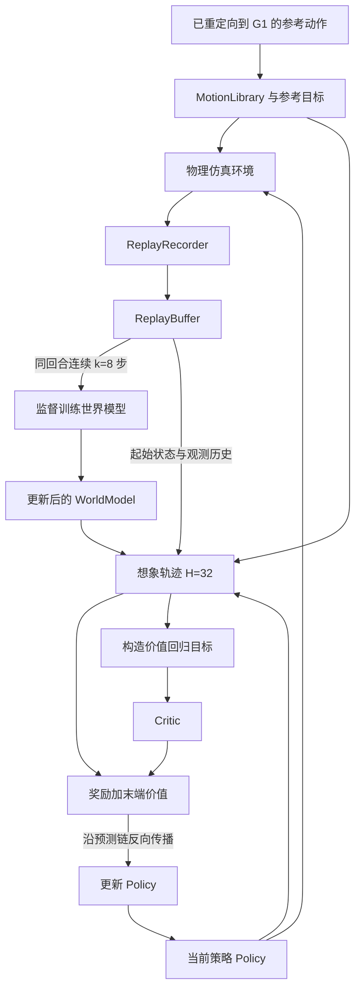

# SuperMimic-Reproduced：从初始化到训练、评测的全流程源码解析

核对日期：2026-11-03。仓库：`/home/ljp/human_learn/SuperMimic-Reproduced-main`。

本文解释这份仓库**当前代码实际怎样运行**，同时给出理解和需要留意的实现细节。它是一份独立复现，不能把论文的全部功能、实验结果直接视为本仓库已经实现或已经验证的结果。

**位置标注方式**：每一处主要说明都附“源码位置”，给出文件链接、函数或类名、核对时的行号。核心模块位于 `src/supermimic/`；短标签如 `training/loop.py` 省略了这一共同前缀，其完整仓库路径是 `src/supermimic/training/loop.py`。`scripts/`、`tests/` 则是仓库根目录下的独立目录。链接相对于本文件所在的 `docs/` 目录；`#L数字` 标识起始行。若阅读器不能跳到该行，可打开链接中的文件再搜索函数名。后续修改代码可能改变行号。

**证据范围**：本文基于本地源码阅读，并对经验池的短回合采样、终止标签索引做了独立 CPU 小例子核对；没有运行完整训练、GPU 仿真评测或真机实验。标为“我的理解”的内容是对设计目的的解释；标为“注意”的内容区分代码事实与尚需实验验证的影响。

## 目录

1. [先看全局：仓库究竟在训练什么](#s1)
2. [启动入口、配置与默认参数](#s2)
3. [Trainer 初始化的执行顺序](#s3)
4. [参考动作如何变成训练可用的数据](#s4)
5. [仿真环境怎样搭建](#s5)
6. [世界模型、策略和 Critic 怎样初始化](#s6)
7. [首次 reset 与后续回合如何选择起点](#s7)
8. [仿真采集与经验池的完整数据路径](#s8)
9. [40 步预采集、UTD 与训练调度](#s9)
10. [世界模型的 8 步监督训练](#s10)
11. [32 步想象轨迹与 Actor 更新](#s11)
12. [Critic 更新，以及有无 Critic 的真正区别](#s12)
13. [用一次抬腿后摔倒的例子串起流程](#s13)
14. [编译、多卡与显存开销](#s14)
15. [日志、检查点与断点续训](#s15)
16. [评测、可视化与部署边界](#s16)
17. [辅助脚本与测试覆盖](#s17)
18. [优先核对的问题，以及换机器人时怎么改](#s18)
19. [建议的源码阅读顺序与本文核对说明](#s19)

<a id="s1"></a>
## 1. 先看全局：仓库究竟在训练什么

这份仓库的核心循环是：**策略在物理仿真器里执行，采集状态变化；世界模型学习这些状态变化；策略再通过世界模型里的可微分预测提高回报；更新后的策略返回物理仿真器继续采集。**

这里有三个会被训练的对象：

| 对象 | 要回答的问题 | 训练依据 | 主要实现 |
|---|---|---|---|
| 世界模型 `WorldModel` | 当前状态执行某个动作后，机器人会怎样变化、是否可能终止？ | 仿真记录的状态转移与终止标签 | [world_model/world_model.py:40](../src/supermimic/world_model/world_model.py#L40) |
| 策略 `Policy`，即 Actor | 根据观测历史与参考动作，现在应该输出什么关节动作？ | 想象轨迹中的奖励，以及可选的末端价值 | [policy/nets.py:72](../src/supermimic/policy/nets.py#L72) |
| 价值网络 `Critic` | 从这个状态继续执行策略，后面还能获得多少回报？ | 想象轨迹构造的 TD(λ)/GAE 价值目标 | [imagination/policy_trainer.py:97](../src/supermimic/imagination/policy_trainer.py#L97) |



**源码位置**：[training/loop.py:148，`Trainer.run()`](../src/supermimic/training/loop.py#L148)，其中 162–179 行采集，181–204 行调度世界模型与策略更新；[imagination/policy_trainer.py:60，`update()`](../src/supermimic/imagination/policy_trainer.py#L60) 实现 Actor 与 Critic 更新。

有三个区别需要先记住：

- **参考动作库与经验池不同。** 参考动作表示“希望机器人做什么”；经验池表示“机器人实际做了什么”。世界模型的动力学监督来自后者。
- **本仓库的 Actor 使用 BPTT，不是 PPO。** Actor 的损失直接通过预测状态和奖励反向传播，没有 PPO 的概率比、旧策略概率或裁剪代理目标。使用 Critic、GAE 并不等于使用 PPO。
- **世界模型的作用不只是加速生成数据。** 它还提供动作对未来状态、未来奖励的导数，使 Actor 可以沿着动力学预测链获得梯度。

**源码位置**：[data/recorder.py:68，真实执行结果入池](../src/supermimic/data/recorder.py#L68)；[world_model/wm_trainer.py:45，动力学监督输入](../src/supermimic/world_model/wm_trainer.py#L45)；[imagination/policy_trainer.py:65，Actor 的 BPTT](../src/supermimic/imagination/policy_trainer.py#L65)。

<a id="s2"></a>
## 2. 启动入口、配置与默认参数

### 2.1 命令首先进入哪里

项目把命令 `sm-train` 注册到：

```text
sm-train
  → supermimic.scripts.train:main
  → tyro.cli(TrainConfig)
  → Trainer(cfg)
  → Trainer.run()
```

`tyro` 把命令行参数填入嵌套 dataclass。例如 `--env.num-envs 1024` 对应 `cfg.env.num_envs=1024`。没有传入的参数使用 dataclass 默认值。

**源码位置**：[pyproject.toml:25，命令注册](../pyproject.toml#L25)；[src/supermimic/scripts/train.py:43，`main()`](../src/supermimic/scripts/train.py#L43)；[config.py:52，`TrainConfig`](../src/supermimic/config.py#L52)。

多卡启动时，入口文件在导入训练配置及其依赖之前，先根据 `LOCAL_RANK` 设置 `CUDA_VISIBLE_DEVICES`，并尽可能划分 CPU 核心亲和性。这样每个进程能看到对应 GPU。`cfg.device` 并不能替代这一初始化步骤，因为仿真后端也有自己的设备初始化行为。

**源码位置**：[src/supermimic/scripts/train.py:10–36，GPU 与 CPU 绑定逻辑](../src/supermimic/scripts/train.py#L10)。

### 2.2 先分清四种“长度”

| 参数 | 默认值 | 表示什么 | 源码位置 |
|---|---:|---|---|
| 世界模型窗口 `wm_trainer.window` | 8 | 用连续 8 次仿真转移训练动力学，需要 9 个状态 | [wm_trainer.py:17](../src/supermimic/world_model/wm_trainer.py#L17) |
| 想象长度 `policy_trainer.horizon` | 32 | Actor 更新时，世界模型连续预测 32 次 | [policy_trainer.py:19](../src/supermimic/imagination/policy_trainer.py#L19) |
| 策略观测历史 `history` | 10 | 当前及过去的 10 帧本体观测 | [tracking_env_cfg.py:75](../src/supermimic/envs/tracking_env_cfg.py#L75)、[nets.py:23](../src/supermimic/policy/nets.py#L23) |
| 参考目标窗口 `future_frames` | 10 | 当前参考帧及随后 9 帧的目标特征 | [motion_library.py:226](../src/supermimic/envs/mdp/motion_library.py#L226) |

四者用途独立。尤其是：**`H=32` 不要求经验池里已经记录了未来 32 步，也不是部署时每次调用策略必须在线规划 32 步。**

### 2.3 会影响你理解流程的默认值

| 配置 | 默认值 | 理解方式 |
|---|---:|---|
| 每个进程的仿真环境数 | 4096 | 一次 `env.step()` 同时推进这些机器人 |
| 仿真积分步长 | 0.005 s | 物理积分频率 200 Hz |
| `decimation` | 4 | 每个策略动作对应 4 个物理子步 |
| 控制步长 | 0.02 s | 策略控制频率 50 Hz |
| 训练回合时限 | 10 s | 默认约 500 个控制步，失败或片段结束可更早终止 |
| 每个环境的经验池容量 | 1000 行 | 终止时额外写入状态行，因此不严格等于 1000 次物理转移 |
| 预采集门槛 | 40 次向量环境步 | 进入更新调度的门槛，不是有效窗口检查 |
| `updates_per_env_step` | 0.4 | 平均每 2.5 次向量环境步进行一轮训练更新 |
| 一轮世界模型更新 | 10 个 batch，每个 2048 条窗口 | 对应 10 次世界模型优化器更新 |
| 一轮 Actor 更新 | 4096 个起点，各展开 32 步 | 默认进行 1 次 Actor 优化器更新 |
| Critic 拟合 | 5 epochs × 4 minibatches | 默认进行 20 次 Critic 优化器更新 |
| 总训练迭代 | 320000 | 这里按向量环境步计数 |
| 日志 / 检查点间隔 | 50 / 4000 | 同样按向量环境步计数 |

**源码位置**：[config.py:24–48](../src/supermimic/config.py#L24)；[tracking_env_cfg.py:237–239](../src/supermimic/envs/tracking_env_cfg.py#L237)；[wm_trainer.py:17–24](../src/supermimic/world_model/wm_trainer.py#L17)；[policy_trainer.py:19–37](../src/supermimic/imagination/policy_trainer.py#L19)。

依赖由 `pyproject.toml` 和 `uv.lock` 管理。当前项目声明 Python `>=3.12,<3.13`，并将 `mjlab` 固定在提交 `8bb2bc9e187797689ec82c78c35019afd2fd0376`。机器人模型、执行器配置、环境管理器的部分实现来自这个外部依赖，不全部位于本仓库。

**源码位置**：[pyproject.toml:6–23，版本约束](../pyproject.toml#L6)；[pyproject.toml:42–58，依赖来源](../pyproject.toml#L42)。

<a id="s3"></a>
## 3. Trainer 初始化的执行顺序

`Trainer(cfg)` 创建训练所需对象，真正开始采集要等后面的 `run()`。可以按以下顺序读初始化函数。

| 顺序 | 代码做什么 | 为什么需要这一步 | 源码位置 |
|---:|---|---|---|
| 1 | 设置策略 `goal_dim=68×future_frames`，启用 anchor 时再加 9 | 让网络目标输入维度匹配环境 | [loop.py:31–32](../src/supermimic/training/loop.py#L31) |
| 2 | 初始化分布式，选择设备，多卡学习率乘 `sqrt(world_size)` | 建立各进程通信与优化器配置 | [loop.py:33–40](../src/supermimic/training/loop.py#L33) |
| 3 | 设随机种子 `seed+1000×rank` | 每个进程产生不同的采集数据 | [loop.py:41](../src/supermimic/training/loop.py#L41) |
| 4 | 创建日志目录，rank 0 写 `config.json`、建立 TensorBoard writer | 保存这次运行的配置与训练指标 | [loop.py:43–47](../src/supermimic/training/loop.py#L43) |
| 5 | 选择 `.pt` 打包动作库，或发现、筛选 `.npz` 文件 | 确定本次要跟踪的参考动作集合 | [loop.py:49–55](../src/supermimic/training/loop.py#L49) |
| 6 | 调用 `make_env()` | 创建仿真场景、机器人、管理器、动作库和记录器 | [loop.py:56–73](../src/supermimic/training/loop.py#L56) |
| 7 | 取出 motion command、library、recorder、buffer、robot | 后续训练直接使用这些共享对象 | [loop.py:74–79](../src/supermimic/training/loop.py#L74) |
| 8 | 创建可微分 G1 FK 和解析奖励/观测工具 | 为预测状态计算身体位置、奖励、观测 | [loop.py:81–82](../src/supermimic/training/loop.py#L81) |
| 9 | 创建世界模型、Policy、Critic；广播参数 | 保证多卡从同一组网络权重开始 | [loop.py:83–87](../src/supermimic/training/loop.py#L83) |
| 10 | 创建 `WorldModelTrainer` 与 `PolicyTrainer` | 建立三个优化器及编译函数包装 | [loop.py:88–89](../src/supermimic/training/loop.py#L88) |
| 11 | 初始化回报统计、迭代计数、UTD 累加器 | 为主循环准备状态 | [loop.py:94–101](../src/supermimic/training/loop.py#L94) |
| 12 | 如果给定 `resume`，加载检查点 | 恢复网络、优化器和部分采样器状态 | [loop.py:102–103](../src/supermimic/training/loop.py#L102) |

**我的理解**：这里没有一个“先把世界模型完全训练好，再开始训练策略”的独立阶段。默认只是先采集一小段数据，随后世界模型、Actor、Critic 在同一个循环里交替改进。随着 Actor 改变，访问到的状态也改变，世界模型就需要持续追踪新的数据分布。

**注意**：指定 `data.library` 后，代码会自动启用 `compact_library`，但这个赋值在写 `config.json` 之后。因而早期的 `config.json` 与实际采用的 compact 模式可能有差别；检查点中的 `config` 是保存时重新读取 `self.cfg` 得到的。

**源码位置**：[loop.py:46、49–51](../src/supermimic/training/loop.py#L46)；[loop.py:122，检查点配置](../src/supermimic/training/loop.py#L122)。

<a id="s4"></a>
## 4. 参考动作如何变成训练可用的数据

### 4.1 输入已经是 G1 动作，不是直接输入视频

仓库的数据转换器接收**已经重定向到 G1 的动作 CSV**。它没有在这条路径中实现“视频 → 人体姿态估计 → 人体到机器人重定向”。输入至少已经包含根部位姿和 29 个关节角。

转换器支持两类布局：

| 输入 | 原始表示 | 进入统一处理前的转换 |
|---|---|---|
| LAFAN 风格 CSV | 无表头，位置 3 + 四元数 4 + 关节角 29 | 位置按米，四元数 `xyzw`，关节角按弧度读取 |
| BONES 风格 CSV | 有表头，根部平移、欧拉角、关节角 | 厘米转米、角度转弧度、欧拉角转四元数，并按 G1 关节顺序读取 |

**源码位置**：[data/motion_convert.py:153，`csv_format()`](../src/supermimic/data/motion_convert.py#L153)；[data/motion_convert.py:160，`load_csv()`](../src/supermimic/data/motion_convert.py#L160)。

### 4.2 CSV → NPZ 的步骤

```text
读取根部位姿与关节角
  → 重采样到默认 50 Hz
  → 位置、关节角插值，四元数 SLERP
  → 估计根部线速度、角速度与关节速度
  → 用 MuJoCo 前向运动学计算各刚体的位姿和速度
  → 保存 NPZ
```

四元数在最终数据中使用 `wxyz`。角速度通过旋转变化计算，不能直接把四元数四个分量分别求导当成角速度。前向运动学在这里用于计算几何与速度信息，并不意味着这条参考动作已经通过动力学可行性验证。

**源码位置**：[motion_convert.py:186，`resample_motion()`](../src/supermimic/data/motion_convert.py#L186)；[motion_convert.py:242，`_so3_derivative()`](../src/supermimic/data/motion_convert.py#L242)；[motion_convert.py:265，`forward_kinematics()`](../src/supermimic/data/motion_convert.py#L265)；[motion_convert.py:307，`convert_csv_to_npz()`](../src/supermimic/data/motion_convert.py#L307)。

NPZ 保存 `fps`、`joint_pos`、`joint_vel`、`body_pos_w`、`body_quat_w`、`body_lin_vel_w`、`body_ang_vel_w`，以及名称和来源等信息。

批量脚本使用多进程转换，默认输入 30 Hz、输出 50 Hz；可以通过 `fps_map` 为不同片段指定输入帧率。**如果输入真实帧率填错，速度、动作时长和跟踪任务都会随之出错。**

**源码位置**：[scripts/data/csv_to_npz_batch.py:47，`main()` 参数与转换循环](../scripts/data/csv_to_npz_batch.py#L47)；[motion_convert.py:307–341，保存字段](../src/supermimic/data/motion_convert.py#L307)。

### 4.3 过滤与打包是额外步骤

`filter_bones_seed.py` 按动作名称及若干运动学规则筛选片段，例如持续悬空、明显穿地等。它输出带 `keep` 列的清单，**不会自动让训练忽略所有被标记的原始 NPZ**。训练发现文件或构建打包库时，需要实际传入过滤清单。

`build_library.py` 把选中的 NPZ 合并成 `.pt`，内容为参考状态、片段名称、起始索引和长度，参考状态用 fp16 存储。构建过程会把片段集合装入主机内存，因此打包也可能需要较多 RAM。

**源码位置**：[filter_bones_seed.py:48，名称过滤](../scripts/data/filter_bones_seed.py#L48)；[filter_bones_seed.py:56，运动学过滤](../scripts/data/filter_bones_seed.py#L56)；[build_library.py:18–37，打包](../scripts/data/build_library.py#L18)；[motion_library.py:252，`discover_npz()`](../src/supermimic/envs/mdp/motion_library.py#L252)。

**注意**：`data.library` 的优先级高于 `npz_dir`。走打包库分支时，不再通过 `discover_npz()` 应用 `clips/limit/manifest`；需要在构建 `.pt` 时确定片段集合。

**源码位置**：[training/loop.py:49–54](../src/supermimic/training/loop.py#L49)。

### 4.4 MotionLibrary 在内存中怎样组织数据

它把多个片段拼接成一个大数组，同时保存每条片段的 `clip_start`、`clip_len`、`clip_last` 和每帧所属的 `frame_clip`。这些边界信息避免“前一条动作结束后，直接把后一条动作当成连续未来”。

| 模式 | 常驻数据 | 获取身体参考信息时 |
|---|---|---|
| full | 参考状态、跟踪刚体位姿/速度、目标特征等 | 直接索引预存张量 |
| compact | 主要保存 71 维参考状态，默认 fp16 | 取出后转换为计算精度，用 FK 计算身体信息 |

compact 的意义是用一部分即时计算换取动作库显存节省。参考数据不需要求导，所以 compact 库计算参考 FK 时使用 `no_grad()`；预测机器人状态的 FK 则必须保留梯度。

**源码位置**：[motion_library.py:75，`MotionLibrary.__init__()`](../src/supermimic/envs/mdp/motion_library.py#L75)；[motion_library.py:141–168，存储与索引](../src/supermimic/envs/mdp/motion_library.py#L141)；[motion_library.py:182，`bodies()`](../src/supermimic/envs/mdp/motion_library.py#L182)。

### 4.5 参考目标的 680 维从哪里来

每个参考帧提取 68 维：

```text
关节角相对默认姿态 29
+ 关节速度 29
+ 根部坐标系下的重力方向 3
+ 根部坐标系下的角速度 3
+ 航向坐标系下的线速度 3
+ 根部高度 1
= 68
```

默认拼接当前参考帧到其后 9 帧，即 `10×68=680`。代码里的“future frames”包括当前参考帧，最大向前偏移是 9 个控制步。达到片段末尾时重复最后一帧，不跨入下一个片段。

**源码位置**：[motion_library.py:66，`goal_features()`](../src/supermimic/envs/mdp/motion_library.py#L66)；[motion_library.py:226，`goal_window()`](../src/supermimic/envs/mdp/motion_library.py#L226)。

**特别注意坐标系**：动作库的 71 维参考状态把根部角速度保存为**世界坐标系角速度**；经验池的 71 维仿真状态中，该项是 **MuJoCo 根部局部坐标系角速度**。二者维度相同，却不能直接互换。需要仿真布局时，应通过 `ref_qpos_qvel()` 完成转换。

**源码位置**：[motion_library.py:121–123，参考状态拼接](../src/supermimic/envs/mdp/motion_library.py#L121)；[motion_library.py:236，`ref_qpos_qvel()`](../src/supermimic/envs/mdp/motion_library.py#L236)；[world_model/state_spec.py:3–4，仿真状态约定](../src/supermimic/world_model/state_spec.py#L3)。

<a id="s5"></a>
## 5. 仿真环境怎样搭建

### 5.1 场景与管理器

`make_env_cfg()` 把机器人、观测、动作、参考动作命令、随机化事件、奖励、终止规则和记录器装进 `ManagerBasedRlEnvCfg`；`make_env()` 再创建 mjlab 的 `ManagerBasedRlEnv`。

场景采用平地和 G1 机器人，默认 29 个可控关节。机器人资产及驱动配置通过 `mjlab.asset_zoo.robots.get_g1_robot_cfg()` 获取。执行器增益等细节要进一步查看固定版本的 mjlab，不能仅凭本仓库推定。

**源码位置**：[envs/tracking_env_cfg.py:95，`make_env_cfg()`](../src/supermimic/envs/tracking_env_cfg.py#L95)；[tracking_env_cfg.py:227–249，环境组装与创建](../src/supermimic/envs/tracking_env_cfg.py#L227)。

本文对采集顺序的说明以仓库中注册的 recorder hook 和调用代码为依据。mjlab 管理器内部的全部调用顺序属于外部依赖实现，没有在本文中假定为本仓库自写逻辑。

### 5.2 策略实际能看到什么

单帧本体观测为 93 维：

| 内容 | 维度 | 默认观测噪声，均匀分布半宽 |
|---|---:|---:|
| 相对默认姿态的关节角，包含编码器偏置 | 29 | 0.01 rad |
| 关节速度 | 29 | 0.5 rad/s |
| 根部局部角速度 | 3 | 0.2 rad/s |
| 投影重力方向 | 3 | 0.05 |
| 上一次干净的策略动作 | 29 | 0 |
| 合计 | 93 | — |

默认保留 10 帧，形成 930 维 `obs["policy"]`。参考动作单独形成 680 维 `obs["goal"]`。

**源码位置**：[tracking_env_cfg.py:96–127，观测组](../src/supermimic/envs/tracking_env_cfg.py#L96)；[world_model/heads.py:30，`analytic_observation()`](../src/supermimic/world_model/heads.py#L30)。

历史展平采用 **term-major** 顺序：先拼 10 帧关节角，再拼 10 帧关节速度，依次类推。它与“先放完整第 1 帧 93 维，再放第 2 帧”的布局不同。部署或重写观测时，即使维度仍然是 930，顺序错了也会造成严重输入错配。

**源码位置**：[world_model/heads.py:57，`flatten_history_term_major()`](../src/supermimic/world_model/heads.py#L57)；[policy/nets.py:37，匹配该布局的缩放向量](../src/supermimic/policy/nets.py#L37)。

默认 Actor 不直接获得机器人全局位置、全局航向或根部线速度。Critic 可以使用更多训练时可得的信息，后面会说明。

可选 `anchor_obs=True` 时，在 goal 后追加参考锚点相对于机器人锚点的 3 维位置和 6 维旋转表示，goal 变成 689 维。这改变了策略的信息条件，比较训练结果时要明确注明。**我的理解**：额外的相对位姿能帮助策略发现累计位置/航向偏差，但部署时也必须有办法构建同样的观测。

**源码位置**：[tracking_env_cfg.py:116–122](../src/supermimic/envs/tracking_env_cfg.py#L116)；[world_model/heads.py:42，`anchor_relative_obs()`](../src/supermimic/world_model/heads.py#L42)；[training/loop.py:31–32](../src/supermimic/training/loop.py#L31)。

### 5.3 动作从网络输出到仿真执行

策略输出 29 维动作 `a_clean`，动作模块执行：

```text
a_exec = a_clean + GaussianNoise(std=0.1)
关节目标 = a_exec × G1_ACTION_SCALE + 默认关节位置偏置
→ 交给关节位置动作/执行器模块
→ 推进 4 个物理子步
```

如果动作配置提供了 `clip`，还会裁剪处理后的目标。策略输出层本身没有 `tanh`；不能因为叫“normalized action”就认为动作必然限制在 `[-1,1]`。网络里使用 `tanh` 的是 motion latent，见第 6 节。

**源码位置**：[envs/actions.py:33，`NoisyJointPositionAction.process_actions()`](../src/supermimic/envs/actions.py#L33)；[tracking_env_cfg.py:130–139，动作配置](../src/supermimic/envs/tracking_env_cfg.py#L130)；[policy/nets.py:58–69，latent 与动作输出](../src/supermimic/policy/nets.py#L58)。

干净动作和执行动作必须分开：

- 观测中的上一动作、动作变化惩罚使用干净动作。
- 世界模型训练使用真正送去执行的带噪动作 `a_exec`。

**我的理解**：如果用干净动作解释带噪动作造成的状态变化，世界模型会把一部分已知执行扰动误当成无法解释的动力学误差。保存 `a_exec` 可以减少这种监督歧义。

**源码位置**：[data/recorder.py:73–74](../src/supermimic/data/recorder.py#L73)；[world_model/wm_trainer.py:50](../src/supermimic/world_model/wm_trainer.py#L50)。

### 5.4 域随机化与 33 维 context

| 随机化内容 | 默认范围 | 重采样时机 |
|---|---|---|
| 躯干质心偏移 | x：±0.025 m；y、z：±0.05 m | 仿真启动时 |
| 29 个关节编码器偏置 | ±0.01 rad | 每次回合 reset |
| 足部摩擦系数 | 0.3–1.2，各足部目标几何共享采样值 | 每次回合 reset |

环境没有在这份默认配置中注册周期推力扰动。关闭域随机化时，评测足部摩擦固定为 1.0。

**源码位置**：[tracking_env_cfg.py:163–201，`events`](../src/supermimic/envs/tracking_env_cfg.py#L163)。

`SimContext.read()` 把这些实际参数组成：

```text
xi = [足部摩擦 1, 编码器偏置 29, 躯干质心偏移 3]，共 33 维
```

世界模型与 Critic 显式接收 `xi`，Actor 默认不直接接收。Actor 的观测历史可能帮助它适应不同动力学，但代码没有另设一个输出摩擦系数的辨识网络。

**源码位置**：[envs/sim_context.py:24，`SimContext.read()`](../src/supermimic/envs/sim_context.py#L24)；[world_model/world_model.py:52，动力学输入](../src/supermimic/world_model/world_model.py#L52)；[policy/nets.py:81、95，Actor/Critic 输入](../src/supermimic/policy/nets.py#L81)。

### 5.5 奖励具体在鼓励什么

奖励包含六个正跟踪项和两个惩罚项：

| 项目 | 权重 | 含义 |
|---|---:|---|
| 全局锚点位置 | 0.5 | 躯干位置接近参考 |
| 全局锚点朝向 | 0.5 | 躯干朝向接近参考 |
| 身体相对位置 | 1.0 | 跟踪身体姿态结构 |
| 身体相对朝向 | 1.0 | 各跟踪刚体朝向接近参考 |
| 身体全局线速度 | 1.0 | 各跟踪刚体线速度接近参考 |
| 身体全局角速度 | 1.0 | 各跟踪刚体角速度接近参考 |
| 动作变化平方和 | −0.1 | 降低连续动作的剧烈变化 |
| 关节限位超出量 | −2.0 | 惩罚超过软关节限位 |

正项主要采用 `exp(-误差平方/尺度平方)`，总奖励乘控制步长 `dt=0.02`。理想情况下六个正项之和为 5，单步理论最高奖励为 `5×0.02=0.1`。惩罚可能使奖励变负，因此归一化后的回报也不保证严格落在 `[0,1]`。

**源码位置**：[tracking_env_cfg.py:203–213，仿真侧奖励注册](../src/supermimic/envs/tracking_env_cfg.py#L203)；[envs/mdp/rewards.py:24，奖励参数](../src/supermimic/envs/mdp/rewards.py#L24)；[rewards.py:75–128，想象侧解析计算](../src/supermimic/envs/mdp/rewards.py#L75)。

这里有两个容易看错的细节：

1. 名字包含 `root` 的全局奖励，实际调用的是 **anchor** 奖励函数，本配置 anchor 是 `torso_link`；用于状态自由关节和终止判断的 root 是 `pelvis`。
2. 身体相对姿态奖励只把参考动作的 **xy 平移与 yaw 航向** 对齐到机器人，保留参考的高度、roll、pitch；但全局锚点和全局速度奖励仍然约束世界坐标系误差。

**源码位置**：[tracking_env_cfg.py:49–66，14 个跟踪刚体和 anchor/root 名称](../src/supermimic/envs/tracking_env_cfg.py#L49)；[rewards.py:46，`reanchor_reference()`](../src/supermimic/envs/mdp/rewards.py#L46)；[rewards.py:99–104，误差计算](../src/supermimic/envs/mdp/rewards.py#L99)。

环境没有添加 self-collision 奖励项。这只能说明没有该惩罚项，不能据此推断物理碰撞已被全部关闭。

### 5.6 什么情况下结束回合

| 情况 | 本地判断方式 | 在记录中属于什么 |
|---|---|---|
| 高度偏差过大 | pelvis 与参考 pelvis 高度差绝对值大于 0.25 m | 失败终止 `terminated` |
| 倾斜偏差过大 | 参考与机器人局部重力 z 分量之差绝对值大于 0.8 | 失败终止 `terminated` |
| 达到训练回合时限 | 默认 10 s | 超时 `time_out` |
| 到达参考片段末尾 | motion command 标记 `clip_end` | 超时类结束 `time_out` |

0.8 是这里定义的重力分量差阈值，不是“倾斜角超过 0.8 弧度”。失败判断也不是一律要求机器人直立，而是与对应参考姿态比较，因此参考动作可以包含非直立姿态。

**源码位置**：[envs/mdp/terminations.py:16–31](../src/supermimic/envs/mdp/terminations.py#L16)；[tracking_env_cfg.py:215–221，终止项分类](../src/supermimic/envs/tracking_env_cfg.py#L215)。

<a id="s6"></a>
## 6. 世界模型、策略和 Critic 怎样初始化

### 6.1 71 维仿真状态

`StateIO.read()` 从仿真器读取 `qpos` 和 `qvel`，拼成以下布局：

| 索引 | 内容 | 维度 |
|---|---|---:|
| `0:3` | 根部位置，减去该并行环境的 origin | 3 |
| `3:7` | 根部四元数 `wxyz` | 4 |
| `7:36` | 29 个关节位置 | 29 |
| `36:39` | 根部世界坐标系线速度 | 3 |
| `39:42` | 根部局部坐标系角速度 | 3 |
| `42:71` | 29 个关节速度 | 29 |

减去 origin 的目的，是消除并行环境在大场景中摆放位置不同造成的平移差异。它没有删除机器人相对于自身环境的真实移动。

**源码位置**：[envs/state_io.py:12–30，`StateIO`](../src/supermimic/envs/state_io.py#L12)；[world_model/state_spec.py:75，`split()`](../src/supermimic/world_model/state_spec.py#L75)。

### 6.2 动力学网络先转换输入，再预测残差

世界模型没有直接把原始 71 维状态原样送进 MLP。`StateSpec.canonical()` 去掉全局 xy 和全局航向依赖，构造：

```text
高度 1 + 去航向后的旋转 6D 表示 6 + 航向系线速度 3
+ 局部角速度 3 + 关节角 29 + 关节速度 29 = 71
```

这个 71 维是另一套特征布局。加上动作 29 维、归一化 context 33 维，动力学网络输入共 **133 维**。

动力学 MLP 本身不读取参考动作 goal；它预测给定状态、动作和物理参数下的运动后果。参考动作随后用于奖励与终止特征的计算。这样“实际会发生什么”和“是否符合想要的动作”由不同部分负责。

**源码位置**：[world_model/state_spec.py:78，`canonical()`](../src/supermimic/world_model/state_spec.py#L78)；[state_spec.py:88，`normalize_xi()`](../src/supermimic/world_model/state_spec.py#L88)；[world_model/dynamics.py:34–39，`DynamicsMLP`](../src/supermimic/world_model/dynamics.py#L34)。

动力学 MLP 的隐藏层为 `2048 → 2048 → 2048`，激活函数为 SiLU，输出 70 维残差：

```text
线速度增量 3 + 角速度增量 3 + 关节速度增量 29
+ 位置修正 3 + 旋转修正 3 + 关节位置修正 29 = 70
```

随后由 `integrate()` 更新速度，再按 `dt=0.02` 积分位置/旋转，并加入位置残差。例如：

```text
v_next = v + 旋转到世界坐标系的 dv
p_next = p + dt × v_next + 旋转到世界坐标系的 dp
joint_vel_next = joint_vel + d_joint_vel
joint_pos_next = joint_pos + dt × joint_vel_next + d_joint_pos
```

旋转使用四元数与旋转向量组合，并重新归一化。输入、输出、误差分别有自己的固定尺度，不能把三组尺度混为一谈。

**源码位置**：[world_model/dynamics.py:9，通用 `MLP`](../src/supermimic/world_model/dynamics.py#L9)；[world_model/state_spec.py:47–58，尺度配置](../src/supermimic/world_model/state_spec.py#L47)；[state_spec.py:93–107，`integrate()`](../src/supermimic/world_model/state_spec.py#L93)。

**初始化细节**：动力学网络最后一层权重和偏置设为 0。默认启用显式积分，因此初始预测是“按当前速度继续运动”，不是对所有状态都预测 `s_next=s`。`DynamicsMLP` 注释中的 “identity dynamics” 应结合积分代码理解；非零速度状态仍然会改变位置。

**我的理解**：这给网络一个简单运动先验，网络主要学习动作、接触、重力等造成的速度变化和积分修正。由于执行器控制逻辑固定在环境中，学习到的是该控制配置下，从归一化关节目标到下一控制步状态的转移关系。更换执行器增益后，不能默认这个世界模型仍然适用。

**源码位置**：[dynamics.py:18–20，零初始化](../src/supermimic/world_model/dynamics.py#L18)；[state_spec.py:100–107，速度与位置更新](../src/supermimic/world_model/state_spec.py#L100)。

### 6.3 终止概率网络很小，奖励与观测没有训练网络

`TerminationHead` 接收高度误差、倾斜误差及二者绝对值，总共 4 维，经过 `64 → 64 → 1` 的 MLP 输出 logit。想象时用 sigmoid 把它变为终止概率。

仿真器用硬阈值结束回合；想象训练用软概率构造可微分生存权重。**我的理解**：软概率让“动作让未来更可能失败”也能进入策略的梯度。

**源码位置**：[world_model/world_model.py:26–37，`TerminationHead`](../src/supermimic/world_model/world_model.py#L26)；[imagination/rollout.py:101–103，概率与生存权重](../src/supermimic/imagination/rollout.py#L101)。

奖励、观测和身体前向运动学则是解析函数：

```text
预测的 qpos/qvel
  → 可微分 FK 得到各身体部件位姿、速度
  → 与参考动作比较，计算奖励
  → 按传感器观测定义重新构造 93 维观测
```

所以本地世界模型训练的主要可学习部分是**动力学网络和终止头**。不能把“经验池里保存了奖励”理解成“代码还训练了一个奖励预测 MLP”。

**源码位置**：[world_model/world_model.py:41–48，模块组成](../src/supermimic/world_model/world_model.py#L41)；[world_model/heads.py:80，`AnalyticHeads`](../src/supermimic/world_model/heads.py#L80)；[kinematics/g1_fk.py:107，`G1Kinematics.forward()`](../src/supermimic/kinematics/g1_fk.py#L107)。

FK 本身不模拟接触动力学。它根据关节状态和机器人树结构算几何关系；接触导致下一状态如何改变，主要由学习到的动力学部分承担。这样才能从“手腕偏离参考”的奖励误差，沿 FK、预测状态、动作一直求导回 Actor。

### 6.4 Actor：参考编码器与动作解码器

```text
680 维 goal
  → MotionEncoder：2048 → 1024 → 512 → 256 → 32
  → tanh，得到 32 维 latent

32 维 latent + 930 维观测历史
  → Decoder：2048 → 1024 → 512 → 256 → 29
  → 29 维动作
```

输入采用固定的逐项缩放，不是运行过程中估计均值方差的 running normalizer。Decoder 最后一层使用很小的初始化增益 `0.01`，使初期输出较小；这并不保证一开始就能平衡或跟踪。

**源码位置**：[policy/nets.py:19，`PolicyCfg`](../src/supermimic/policy/nets.py#L19)；[nets.py:51，`MotionEncoder`](../src/supermimic/policy/nets.py#L51)；[nets.py:62，`Decoder`](../src/supermimic/policy/nets.py#L62)；[dynamics.py:21–23，最后一层初始化](../src/supermimic/world_model/dynamics.py#L21)。

目前 `Policy.encoders` 中实际注册的接口只有 `motion`。没有在这里实现速度指令接口及其蒸馏训练。

**源码位置**：[policy/nets.py:75–82](../src/supermimic/policy/nets.py#L75)；[README.md:47，未实现项](../README.md#L47)。

### 6.5 Critic：训练时使用更多信息

默认 Critic 输入为：

```text
canonical state 71 + goal 680 + normalized xi 33 + root error 4 = 788
→ 隐藏层 256 → 128 → 标量价值 V
```

4 维 root error 是参考航向坐标系下的位置误差 3 维，加 yaw 误差 1 维。Critic 用这些额外信息估计后续回报。Actor 的默认输入并没有因此增加，也不会在普通回放时调用 Critic。

**源码位置**：[policy/nets.py:85，`Critic`](../src/supermimic/policy/nets.py#L85)；[world_model/heads.py:146，`root_error_features()`](../src/supermimic/world_model/heads.py#L146)。

<a id="s7"></a>
## 7. 首次 reset 与后续回合如何选择起点

### 7.1 `run()` 开始先 reset 环境

训练循环在执行第一个策略动作前调用 `env.reset()`。motion command 选择参考帧，把该帧的根部位姿、根部速度、关节位置和关节速度写入机器人，并按配置加入 reset 噪声。

因此新回合通常可以从一个动作片段的中间开始，不是每次都从站立姿态或动作第 0 帧开始。**我的理解**：这种起点设计让策略能接触到动作各个阶段，避免只有前半段学好后才见得到后半段。

**源码位置**：[training/loop.py:152](../src/supermimic/training/loop.py#L152)；[envs/mdp/commands.py:284，`_resample_command()`](../src/supermimic/envs/mdp/commands.py#L284)；[commands.py:276，写入仿真状态](../src/supermimic/envs/mdp/commands.py#L276)。

默认 reset 噪声包括根部位置、姿态、线速度、角速度扰动，以及关节位置 ±0.1 rad。写入前，关节位置会裁剪到软限位。它与第 5 节的域随机化、每步动作噪声是三类不同的扰动。

**源码位置**：[tracking_env_cfg.py:142–155，reset 范围](../src/supermimic/envs/tracking_env_cfg.py#L142)；[commands.py:298–319，采样并应用扰动](../src/supermimic/envs/mdp/commands.py#L298)。

### 7.2 默认采用按回报选择起点的采样器

动作库将每条片段分成默认 50 帧、约 1 秒的 bin。command 记录训练回合中的奖励，为访问过的 bin 更新折扣后续回报估计 `bin_return`。

下次 reset 的 bin 采样概率由三部分组成：

```text
50% 均匀分配
+ 40% × softmax(-25 × bin_return / 10)
+ 10% 历史难度分布的移动平均
```

回报越低，通常表示那段动作越难，当前难度项就会给它更高概率。选中 bin 后，再随机选择其中一帧作为 reset 起点。`bin_return` 初值为 10，开始时各 bin 没有难度差别。

**源码位置**：[motion_library.py:160–168，bin 索引](../src/supermimic/envs/mdp/motion_library.py#L160)；[commands.py:69–79，采样器状态](../src/supermimic/envs/mdp/commands.py#L69)；[commands.py:207，回报估计](../src/supermimic/envs/mdp/commands.py#L207)；[commands.py:249–274，采样](../src/supermimic/envs/mdp/commands.py#L249)；[commands.py:411–419，比例与参数](../src/supermimic/envs/mdp/commands.py#L411)。

这里改变的是**仿真回合起点的分布**，不是把 ReplayBuffer 改成按误差优先采样的 prioritized replay。世界模型窗口仍然从有效窗口 mask 中等概率、有放回地抽样。

**源码位置**：[data/replay_buffer.py:115–121，`_sample_from_mask()`](../src/supermimic/data/replay_buffer.py#L115)。

### 7.3 其他采样模式与两个边界

`sampling_mode="uniform"` 从参考帧采样；`"start"` 从随机片段的第一帧开始。评测还会设置 `forced_frame`，指定每个环境下一个回合必须从哪条动作的第一帧开始。

**源码位置**：[commands.py:252–258，采样模式](../src/supermimic/envs/mdp/commands.py#L252)；[commands.py:293–296，强制起点](../src/supermimic/envs/mdp/commands.py#L293)；[eval/benchmark.py:67–72，评测使用方式](../src/supermimic/eval/benchmark.py#L67)。

**注意一**：默认起点采样只尽量留出至少 2 个参考步，并没有保证每个新回合都能产生 8 步动力学训练窗口。机器人也可能更早失败。

**注意二**：command 留有 `bootstrap_fn` 接口，用于时间截断后的回报估计；但当前训练代码没有给它绑定 Critic。当前默认走的是“舍弃离时间截断点太近的样本”的分支，默认剔除剩余步数小于 100 的部分。这与 Actor 目标里已经实现的 Critic bootstrap 是两件事。

**源码位置**：[commands.py:271，起点边界](../src/supermimic/envs/mdp/commands.py#L271)；[commands.py:79，`bootstrap_fn=None`](../src/supermimic/envs/mdp/commands.py#L79)；[commands.py:222–233，截断处理](../src/supermimic/envs/mdp/commands.py#L222)。

<a id="s8"></a>
## 8. 仿真采集与经验池的完整数据路径

### 8.1 每次训练迭代先执行一个真实仿真步

这里的“真实”指相对于世界模型而言的**物理仿真器结果**，不是实机数据。

```text
当前 obs[policy]、obs[goal]
  → Trainer.act()，不建立训练梯度图
  → Policy 输出干净动作
  → env.step(action)
  → 动作噪声、位置目标、物理积分
  → 仿真奖励、终止/超时判断、新观测
  → recorder hooks 保存本次转移
```

策略在物理仿真器里采集数据时使用 `@torch.no_grad()`。后面 Actor 的训练梯度不会穿过这次 MuJoCo 仿真，而是穿过学习到的世界模型。

**源码位置**：[training/loop.py:144–165，`act()` 与采集调用](../src/supermimic/training/loop.py#L144)。

### 8.2 一行经验保存什么

ReplayBuffer 按 `[环境编号, 时间槽]` 分配 GPU 环形存储。一个普通行保存 `s_t` 和从该状态出发的转移信息：

| 字段 | 含义 | 后面主要用于 |
|---|---|---|
| `s` | 当前仿真完整状态 `s_t` | 世界模型标签、想象起点、历史观测重建 |
| `a` | 干净策略动作 `a_t` | 历史上一动作与动作变化惩罚的上下文 |
| `a_exec` | 实际带噪执行动作 | 世界模型动力学输入 |
| `xi` | 本回合仿真参数 | 世界模型及 Critic 的条件输入 |
| `r` | 本次执行后的环境奖励 | 保留转移信息；当前世界模型损失不直接使用它 |
| `done` | 记录器传入的下一状态失败终止标签 | 终止头监督，索引问题见第 18 节 |
| `frame`、`clip` | 本次动作所对应的参考帧、片段 | 参考目标查询与记录 |
| `ep_id` | 该环境的回合编号 | 禁止窗口跨回合 |
| `terminal` | 本行是否仅用于存储末端状态 | 禁止把末端状态当作有后续动作的起点 |
| `ep_start` | 是否为新回合的起始行 | 历史上一动作处理 |
| `valid` | 该存储槽是否已写入 | 排除未填充区域 |

**源码位置**：[data/replay_buffer.py:39–80，存储与 `add()`](../src/supermimic/data/replay_buffer.py#L39)；[data/recorder.py:68–83，实际字段写入](../src/supermimic/data/recorder.py#L68)。

### 8.3 三个记录器 hook 为什么要分开

**reset 之后：`record_post_reset()`。** 只记住刚重置的 `s_0`、context 和参考帧，并标记回合开始。此时还没有执行动作，不能凭空产生一个有效转移。

**普通步结束：`record_post_step()`。** 对没有 reset 的环境，写入之前记住的状态、刚刚执行的动作和奖励；随后记住新的 `s_next`，供下一个普通行使用。

**reset 之前：`record_pre_reset()`。** 先写最后一次真实转移，再额外写一个 terminal 行保存 reset 前的最终状态，然后增加回合编号。额外行没有出发动作，动作和奖励位置填零；它的用途是作为最后一个状态标签，不能被当成又执行了一次零动作。

**源码位置**：[data/recorder.py:55–66，记忆与 reset 后 hook](../src/supermimic/data/recorder.py#L55)；[recorder.py:85–108，reset 前 hook](../src/supermimic/data/recorder.py#L85)；[recorder.py:110–119，普通步 hook](../src/supermimic/data/recorder.py#L110)。

例如一个回合执行三次动作后失败，概念上的存储为：

```text
行 0：s0，执行 a0 的信息
行 1：s1，执行 a1 的信息
行 2：s2，执行 a2 的信息，下一状态失败
行 3：s3，terminal=True，没有出发动作
下一回合：新 ep_id，重新从其初始状态记录
```

**terminal 与 done 不相同**：时间用完或片段结束，也会写 `terminal=True` 的末端行，以保护轨迹边界；但它们不是摔倒式失败，记录的失败标签可以仍是 `done=0`。

记录器读的是原始 `qpos/qvel`，奖励直接取 `env.reward_buf`。不要把历史设计文档中的“计划重算奖励”自动视为当前已执行的逻辑。

**源码位置**：[recorder.py:76–77，奖励/标签来源](../src/supermimic/data/recorder.py#L76)；[recorder.py:89–105，末端行的两个标志](../src/supermimic/data/recorder.py#L89)。

### 8.4 世界模型如何取得连续 8 步

`sample_windows(n, k)` 先调用 `window_mask(k)`，筛选满足以下条件的起点：

1. 从起点到起点后 `k` 个位置，总共 `k+1` 个状态行都已写入。
2. 这些行属于同一个环境、同一个 `ep_id`。
3. 前 `k` 行不能是 terminal 行；最后一个目标状态可以是 terminal 行。
4. 环形窗口不能错误跨过写指针，把新旧时间拼成一条轨迹。

随后有放回采样。默认返回：

```text
states : [9, 2048, 71]
a_exec : [8, 2048, 29]
xi     : [2048, 33]
done   : [8, 2048]
frame  : [8, 2048]
```

`k=8` 指 8 次转移，因而需要 9 个状态。窗口可以取自一个更长回合的中段，不一定从该回合的第一步开始。

**源码位置**：[replay_buffer.py:97，`window_mask()`](../src/supermimic/data/replay_buffer.py#L97)；[replay_buffer.py:124，`sample_windows()`](../src/supermimic/data/replay_buffer.py#L124)。

### 8.5 Actor 如何取得想象起点

Actor 使用另一条采样路径：`sample_starts(batch_size, history)`。它只要求采样到可用的非 terminal 起点，再向前查找同回合的历史状态及其上一动作。历史不足 10 帧时，用窗口内最早的有效回合状态回填；回合开始之前的上一动作按零处理。

它不读取真实的未来 32 步，也不重放经验池里未来的动作。未来动作由**当前 Actor** 在世界模型里逐步生成。

**源码位置**：[replay_buffer.py:140–167，`sample_starts()`](../src/supermimic/data/replay_buffer.py#L140)；[imagination/policy_trainer.py:62](../src/supermimic/imagination/policy_trainer.py#L62)；[imagination/rollout.py:98–101](../src/supermimic/imagination/rollout.py#L98)。

<a id="s9"></a>
## 9. 40 步预采集、UTD 与训练调度

### 9.1 主循环的逻辑伪代码

以下是按当前源码整理的逻辑概括，并非可直接替换源码的实现：

```python
obs = env.reset()

while iteration < total_iterations:
    action = policy_without_grad(obs)
    obs, reward, terminated, timeout = env.step(action)
    # recorder 由环境 hook 调用，经验已经入池
    update_episode_statistics()
    iteration += 1

    if iteration - start_iteration >= warmup_iterations:
        utd_acc += updates_per_env_step
        while utd_acc >= 1:
            utd_acc -= 1
            set_scheduled_learning_rates()
            world_model_trainer.update(buffer)   # 默认 10 次优化
            policy_trainer.update(buffer)       # 默认 1 次 Actor + 20 次 Critic 优化
            num_updates += 1

    maybe_write_logs()
    maybe_save_checkpoint()
```

**源码位置**：[training/loop.py:148–274，`run()`](../src/supermimic/training/loop.py#L148)。

### 9.2 默认第一次更新通常发生在第 42 次向量环境步

因为 UTD 累加器初始为 0，只有到达 warmup 门槛后才开始累加：

| 当前 iteration | 满足 40 步门槛？ | 加上 0.4 后的累加器 | 是否触发更新 |
|---:|---|---:|---|
| 39 | 否 | 0 | 否 |
| 40 | 是 | 0.4 | 否 |
| 41 | 是 | 0.8 | 否 |
| 42 | 是 | 1.2，更新后扣除 1 | 是 |

这是默认参数下的调度结果，不意味着在第 40 步就已经训练了一次。4096 个环境时，42 次 `env.step()` 对应约 `42×4096` 次物理控制转移；经验行数还可能因末端状态行而增加。

**源码位置**：[loop.py:101，累加器初始化](../src/supermimic/training/loop.py#L101)；[loop.py:179–198，计数与更新触发](../src/supermimic/training/loop.py#L179)。

### 9.3 40 步不能保证存在有效 8 步窗口

如果每个环境始终在 3 步内失败，那么即使不断 reset、累计采集 42 步，也没有任何回合包含 8 次连续转移。

本次用实际 `ReplayBuffer` 做了一个 CPU 小例子：14 个长度为 3 的回合，总计 42 次转移；`window_mask(8)` 的有效起点数量为 0，`sample_windows()` 抛出：

```text
RuntimeError: replay buffer has no sampleable rows yet
```

当前主循环没有用 `window_mask(k).any()` 做更新前检查，也没有为全体短回合自动缩短 `k` 或填充未来状态。并行环境较多时可能较容易出现合格窗口，但这是数据条件，不是程序保证。

**源码位置**：[loop.py:182–190，只有步数门槛](../src/supermimic/training/loop.py#L182)；[replay_buffer.py:115–121，无有效样本时的行为](../src/supermimic/data/replay_buffer.py#L115)。

**我的建议**：若后续修改训练代码，应以“存在合格窗口”为世界模型更新的必要条件，并让在线误差诊断使用同样的检查；不要把两个回合拼起来凑 8 步。本文仅记录问题，未修改训练实现。

### 9.4 余弦学习率衰减

默认初始学习率为 `2e-4`，在总迭代的 `250000/320000` 比例内余弦下降，最低为初始值的 `0.03` 倍。若总迭代仍为 320000，相当于约在 250000 步完成衰减；若修改总迭代数，衰减终点也按比例变化。

**源码位置**：[training/schedule.py:8，`cosine_lr()`](../src/supermimic/training/schedule.py#L8)；[config.py:44–45](../src/supermimic/config.py#L44)；[loop.py:186–188，应用学习率](../src/supermimic/training/loop.py#L186)。

<a id="s10"></a>
## 10. 世界模型的 8 步监督训练

### 10.1 训练的输入与正确答案分别是什么

从经验池采样后，可以把一条窗口写为：

```text
真实状态：s0, s1, s2, ..., s8
执行动作：a_exec0, a_exec1, ..., a_exec7
仿真参数：xi
终止标签：各目标状态是否发生失败终止
```

世界模型从真实 `s0` 起步，后续采用自己的预测状态递推：

```text
s_hat1 = F(s0,     a_exec0, xi)，比较 s_hat1 与 s1
s_hat2 = F(s_hat1, a_exec1, xi)，比较 s_hat2 与 s2
...
s_hat8 = F(s_hat7, a_exec7, xi)，比较 s_hat8 与 s8
```

第二步不会重新把真实 `s1` 当输入来替代 `s_hat1`。这叫多步自回归训练，能够把早期预测误差对后续状态的影响纳入损失。中间状态也没有逐步 `detach()`，梯度可以跨越这 8 次动力学调用。

**源码位置**：[world_model/world_model.py:77–103，`window_loss()`](../src/supermimic/world_model/world_model.py#L77)，尤其 85 行起点和 93–94 行递推。

### 10.2 状态误差不是直接比较四元数四个分量

状态损失构造 70 维误差：位置差 3、旋转向量误差 3、线速度差 3、角速度差 3、关节角差 29、关节速度差 29。四元数用相对旋转转为 3 维旋转向量比较。

各类误差按不同尺度归一化，默认分别为 `0.05 m、0.1 rad、0.5 m/s、1 rad/s、0.1 rad、2 rad/s`。例如同为数值 0.1，米和弧度对训练的意义不同，因此不能直接不加区分地平方求和。

窗口损失可概括为：

```text
L_world = 8 步的平均 [batch 平均的 70 维归一化误差平方和]
        + term_loss_weight × 8 步的平均终止 BCE
```

终止 BCE 使用预测下一状态计算出的终止 logit，因而该损失也能影响动力学预测，不只影响终止头。标签应该与预测目标状态对齐；当前实际采样的索引问题见第 18.1 节。

**源码位置**：[state_spec.py:111–119，`error_vector()`](../src/supermimic/world_model/state_spec.py#L111)；[world_model.py:65–72，`_loss_step()`](../src/supermimic/world_model/world_model.py#L65)；[world_model.py:95–103，损失聚合](../src/supermimic/world_model/world_model.py#L95)。

**注意指标量级**：训练的状态损失对 70 个维度取和；日志中的 `nse_1step/nse_kstep` 对 70 个维度取平均。不要直接把二者的数值当成同一种误差。

**源码位置**：[world_model.py:95–110](../src/supermimic/world_model/world_model.py#L95)；[state_spec.py:121–124](../src/supermimic/world_model/state_spec.py#L121)。

### 10.3 “比较”为什么能持续更新模型

比较产生可微分的损失；真正改变参数的是随后执行的优化步骤：

```text
采样窗口
  → 预测并计算损失
  → opt.zero_grad()
  → loss.backward()
  → 多卡时平均梯度
  → 梯度范数裁剪
  → Adam.step()
```

默认每次 `WorldModelTrainer.update()` 重复这一过程 10 次，每次重新采样 2048 条窗口。没有只比较、只记录误差却不更新网络的问题。

**源码位置**：[world_model/wm_trainer.py:34–39，优化器创建](../src/supermimic/world_model/wm_trainer.py#L34)；[wm_trainer.py:52–67，`update()`](../src/supermimic/world_model/wm_trainer.py#L52)。

参数更新方向大意是：让当前这批动作条件下的预测状态更接近仿真结果。后面 Actor 改变，收集到新状态、新动作，经验池内容滚动更新，世界模型继续在这些新样本上拟合，因此形成持续更新。

### 10.4 失败数据会让模型“学坏”吗

世界模型确实应该学会预测失败过程。例如同样的姿态下，某个抬腿动作会导致躯干倾倒，它应该预测“会倾倒”，而不是为了看起来成功而预测“保持站立”。

这里分工是：

- 世界模型学习动作造成的后果，包括失败后果。
- Actor 利用奖励和失败概率，更新动作选择，使未来结果更有利。

所以“世界模型能准确预测摔倒”是后续策略避开摔倒的一项必要信息，但它本身不等于 Actor 已经学会恢复平衡。世界模型只在已有数据覆盖范围附近更有依据，对极少见动作或接触状态的预测仍可能有误。

**源码位置**：[world_model.py:65–72，监督目标](../src/supermimic/world_model/world_model.py#L65)；[imagination/objective.py:10–20，Actor 的奖励目标](../src/supermimic/imagination/objective.py#L10)。

若一个失败回合不足 8 次转移，它不能单独进入当前固定 `k=8` 的世界模型窗口训练。它的非 terminal 状态仍可能成为 Actor 的想象起点，但默认主循环先更新世界模型；如果全池都没有合格窗口，流程仍会在世界模型采样处报错，而不会自动跳过去继续 Actor 训练。

**源码位置**：[replay_buffer.py:97、140，两种采样约束](../src/supermimic/data/replay_buffer.py#L97)；[training/loop.py:190–195，先世界模型后 Actor](../src/supermimic/training/loop.py#L190)。

<a id="s11"></a>
## 11. 32 步想象轨迹与 Actor 更新

### 11.1 先选起点，暂时冻结世界模型与 Critic 参数

`PolicyTrainer.update()` 默认从经验池抽取 4096 个起点，每个起点带有 10 帧历史、上一动作、context 和当前参考帧。然后设置：

```python
self.wm.requires_grad_(False)
self.critic.requires_grad_(False)
```

冻结的是这两个网络的**参数更新**，不是关闭整个前向过程的自动求导。输入中的动作、状态仍然可以携带梯度。

**源码位置**：[imagination/policy_trainer.py:60–68](../src/supermimic/imagination/policy_trainer.py#L60)。

**我的理解**：改进 Actor 时，需要把“环境会怎样响应动作”暂时固定住，否则优化器可能通过修改世界模型，让模型虚构一个更高回报的结果。这里要改变的是 Actor 选择的动作，而不是同时把动力学改成更容易获得奖励的样子。

### 11.2 起始观测由记录状态重新构建

想象模块对历史状态调用 `analytic_observation()`，重建与环境同布局的本体观测，并重新采样传感器噪声。这些噪声不必与采集当时恰好相同；保存的是物理状态与干净动作历史，而不是完整带噪传感器录制。

参考轨迹的未来帧是已知输入，代码提前查询 `H+1` 帧参考身体信息，以减少循环内重复查询/FK。机器人未来状态仍然由世界模型预测。

**源码位置**：[imagination/rollout.py:54–69，观测重建与噪声](../src/supermimic/imagination/rollout.py#L54)；[rollout.py:78–86，参考批量查询](../src/supermimic/imagination/rollout.py#L78)。

### 11.3 每一个想象步做什么

```text
当前预测状态、10 帧观测历史、当前目标窗口
  → Actor 输出 a_t
  → 世界模型预测 s_hat_(t+1)
  → 可微分 FK 计算预测身体状态
  → 用 s_hat_(t+1) 与本次参考帧 g_t 计算 r_(t+1)
  → 终止头输出概率 d_hat_(t+1)
  → 计算下一帧本体观测，更新历史
  → 参考帧前进，构建下一目标窗口
  → 重复，直到展开 32 步
```

本地代码的奖励时间约定是：**执行 `a_t` 到达 `s_(t+1)` 后，与此次执行使用的参考帧 `g_t` 比较**。之后再把参考帧推进到下一帧。重写环境或训练器时不要随意把其中一侧改成 `g_(t+1)`，否则会引入一帧错位。

**源码位置**：[imagination/rollout.py:98–118，展开循环](../src/supermimic/imagination/rollout.py#L98)；[imagination/compiled.py:37–48，`ImagStep._step()`](../src/supermimic/imagination/compiled.py#L37)；[world_model/heads.py:113–114，奖励时间约定](../src/supermimic/world_model/heads.py#L113)。

这条想象路径会加观测噪声，但没有像物理采集那样再给每一步动作加一份高斯执行噪声。世界模型直接接收 Actor 的当前输出。它与世界模型拟合时使用 `a_exec` 的路径不同。

**源码位置**：[rollout.py:100–101](../src/supermimic/imagination/rollout.py#L100)；[compiled.py:39](../src/supermimic/imagination/compiled.py#L39)。

### 11.4 预测会摔倒后，还会继续展开吗

会。代码按固定 `H` 展开，不在 `d_hat>0.5` 时跳出，也不会在想象中 reset。它使用生存权重：

```text
c_0 = 1
c_(t+1) = c_t × (1 - d_hat_(t+1))
```

例如预测连续两步终止概率分别是 0.1、0.2，那么后续生存权重变成 `0.9×0.8=0.72`。Actor 目标中，第 t 次转移的奖励乘的是执行前生存权重 `c_t`；该转移造成的终止概率会压低之后的奖励和末端价值。

**源码位置**：[rollout.py:73、98–115](../src/supermimic/imagination/rollout.py#L73)；[imagination/objective.py:15–19](../src/supermimic/imagination/objective.py#L15)。

**注意**：参考片段在想象期间结束时，参考帧被夹到最后一帧，之后继续跟踪最后姿态；它没有像真实环境那样在 clip end 立即按 timeout 结束。这是参考片段末端附近需要留意的一处建模差别。

**源码位置**：[rollout.py:80–81](../src/supermimic/imagination/rollout.py#L80)；[tracking_env_cfg.py:218，仿真 clip end](../src/supermimic/envs/tracking_env_cfg.py#L218)。

### 11.5 Actor 最终优化什么

带 Critic 的目标为：

```text
J = batch 平均 {
      Σ[t=0..H-1] gamma^t × c_t × r_(t+1)
      + gamma^H × c_H × V(s_H, goal_H, xi, root_error_H)
    }

Actor loss = -J / H
```

默认 `gamma=0.99`。第一部分评价接下来 32 步内的跟踪与动作质量；第二部分让 Actor 考虑这 32 步之后的后续价值。`/H` 对固定 H 不改变最优动作的方向，但会影响梯度尺度。

**源码位置**：[imagination/objective.py:10–20，`policy_objective()`](../src/supermimic/imagination/objective.py#L10)；[policy_trainer.py:69–75，末端价值与损失](../src/supermimic/imagination/policy_trainer.py#L69)。

梯度路径可以理解为：

```text
奖励/末端价值 J
  → 预测身体姿态与未来状态
  → 世界模型中的状态转移
  → 每一步 Actor 输出的动作
  → Actor 参数
```

Critic 参数虽然冻结，`V` 对末端状态的导数仍然存在；世界模型参数虽然冻结，预测状态对动作的导数仍然存在。若把整个想象过程包进 `torch.no_grad()`，或者在每步 `s_next.detach()`，就会切断所需的梯度路径。

**源码位置**：[policy_trainer.py:66–81，冻结、前向、反向与 Actor 优化](../src/supermimic/imagination/policy_trainer.py#L66)；[objective.py:11，末端价值保留状态梯度的约定](../src/supermimic/imagination/objective.py#L11)。

Actor 反向传播后，先做多卡梯度平均，再做范数裁剪和逐元素裁剪，最后 `Adam.step()`。随后恢复世界模型和 Critic 参数的 `requires_grad=True`，为它们自己的训练准备。

**源码位置**：[policy_trainer.py:76–83](../src/supermimic/imagination/policy_trainer.py#L76)。

### 11.6 为什么 H=32 不按关节数直接缩放

在默认 50 Hz 下，32 次控制转移对应约 **0.64 秒**；8 步世界模型监督窗口对应约 **0.16 秒**。动力学网络学习的是可反复调用的一步转移，所以可以在训练窗口长于或短于 8 步的场景使用；但 8 步误差较小并不能保证 32 步预测也同样准确。

**我的理解**：H 在可见未来范围、长链梯度质量、模型误差积累和计算成本之间取舍。减少关节数会改变网络维度和计算量，但机器人失稳、落脚、转身所需的时间尺度不一定按关节数量同比缩短。因此换成关节更少的机器人，应围绕控制频率、动作时间尺度、模型误差和最终仿真回报比较 H，而不是直接按关节数换算。

**源码位置**：[policy_trainer.py:20，H](../src/supermimic/imagination/policy_trainer.py#L20)；[tracking_env_cfg.py:237–238，控制步长来源](../src/supermimic/envs/tracking_env_cfg.py#L237)；[world_model/world_model.py:52，一步动力学接口](../src/supermimic/world_model/world_model.py#L52)。

<a id="s12"></a>
## 12. Critic 更新，以及有无 Critic 的真正区别

### 12.1 Critic 用什么训练数据

Actor 更新之后，Critic 使用**刚才已经生成的同一批想象轨迹**。代码没有用更新后的 Actor 重新展开一次。先把状态特征、goal、context、root error、奖励和终止概率从 Actor 梯度图中分离，再计算当前 Critic 对所有时刻的价值估计。

默认一批包含 `32×4096=131072` 个待拟合时间点；另有第 33 个状态的价值用于 bootstrap。

**源码位置**：[imagination/policy_trainer.py:97–110](../src/supermimic/imagination/policy_trainer.py#L97)。

### 12.2 价值标签怎样产生

代码的 `gae_targets()` 从后往前递推：

```text
R_H = V_H

R_t = r_(t+1)
      + gamma × (1 - d_hat_(t+1))
        × [(1-lambda) × V_(t+1) + lambda × R_(t+1)]
```

默认 `lambda=0.95`。它混合了短期 bootstrap 与较长的奖励累积，得到 Critic 的回归目标 `R_t`。在本次 Critic 的多个 epoch 中，目标只构造一次，保持固定。

**源码位置**：[imagination/objective.py:23–35，`gae_targets()`](../src/supermimic/imagination/objective.py#L23)；[policy_trainer.py:99–109，目标构造](../src/supermimic/imagination/policy_trainer.py#L99)。

Critic 最小化 `MSE(V_pred, R_target)`，每个 epoch 打乱样本，再分 4 个 minibatch，默认重复 5 个 epoch。因此默认是 20 次价值网络优化器更新。这里没有另外一个 target Critic 网络。

**源码位置**：[policy_trainer.py:110–125，回归循环](../src/supermimic/imagination/policy_trainer.py#L110)；[policy_trainer.py:41–47，训练器持有的网络和优化器](../src/supermimic/imagination/policy_trainer.py#L41)。

### 12.3 世界模型与 Critic 的分工

你之前理解的“世界模型预测出的轨迹也能帮助 Critic 更新”，在本地代码里确实成立。但它还有另一条直接影响 Actor 的路径：

| 路径 | 世界模型提供什么 | 影响哪部分 |
|---|---|---|
| 预测状态 → 解析奖励 → 对动作求导 | 未来 H 步的奖励与动力学梯度 | 直接更新 Actor |
| 预测轨迹 → TD(λ) 目标 | Critic 的回归训练数据 | 更新 Critic |
| Critic 在 H 步末端的价值与状态梯度 | H 步之后的价值估计 | 通过 Actor 目标的末端项影响 Actor |

**源码位置**：[policy_trainer.py:65–81，Actor 路径](../src/supermimic/imagination/policy_trainer.py#L65)；[policy_trainer.py:97–125，Critic 路径](../src/supermimic/imagination/policy_trainer.py#L97)。

### 12.4 无 Critic 消融去掉了什么

设置 `use_critic=False` 时：

- 仍然监督训练世界模型。
- 仍然展开 H 步预测，计算奖励、生存权重，并对 Actor 做 BPTT。
- Actor 目标不再包含末端 `V_H` 项。
- 跳过 Critic 回归更新。

因此这个开关表示“是否使用价值网络补偿有限想象长度”，不是“有没有监督信号”，也不是“有没有世界模型”。Actor 即使没有 Critic，仍然受到明确的奖励目标驱动。

**源码位置**：[policy_trainer.py:34，配置](../src/supermimic/imagination/policy_trainer.py#L34)；[policy_trainer.py:70–73，末端价值开关](../src/supermimic/imagination/policy_trainer.py#L70)；[policy_trainer.py:98，Critic 训练开关](../src/supermimic/imagination/policy_trainer.py#L98)。

**我的理解**：这一类消融要回答的是——在固定世界模型和 H 的条件下，额外估计 H 步以后的价值，能否改善学习速度和最终表现？如果较长的 H 已覆盖关键后果，Critic 的额外收益可能改变；如果 Critic 估值不准，也可能给 Actor 带来偏差。结果必须通过对照实验判断。

本仓库有相关配置开关，但 README 明确列出尚未完成完整 `H×critic` 消融及 PPO baseline。不能把“代码能设置”写成“仓库已经提供了完整消融结论”。

**源码位置**：[README.md:47](../README.md#L47)。

### 12.5 用梯度表核对三类训练

| 阶段 | 被优化的参数 | 输入/标签来源 | 梯度是否穿过世界模型 |
|---|---|---|---|
| 物理仿真采集 | 无 | 当前策略与物理环境 | 不建立 Actor 训练梯度 |
| 世界模型拟合 | 动力学网络、终止头 | 经验池真实窗口 | 是，用来更新世界模型参数 |
| Actor 更新 | 参考编码器、动作解码器 | 想象奖励与可选末端价值 | 是，但世界模型参数冻结 |
| Critic 更新 | 价值网络 | 已分离梯度的想象轨迹及价值目标 | 否，轨迹作为固定回归数据 |

**源码位置**：[loop.py:144](../src/supermimic/training/loop.py#L144)；[wm_trainer.py:52](../src/supermimic/world_model/wm_trainer.py#L52)；[policy_trainer.py:65–125](../src/supermimic/imagination/policy_trainer.py#L65)。

<a id="s13"></a>
## 13. 用一次抬腿后摔倒的例子串起流程

以下是机制示例，不是本次运行得到的机器人实验结果。假设机器人从参考动作中段开始尝试抬腿，在第 12 次控制转移后失稳并触发终止。

| 步骤 | 具体发生什么 | 对应位置 |
|---:|---|---|
| 1 | reset 选中某个参考帧，写入参考姿态/速度并加扰动 | [commands.py:284](../src/supermimic/envs/mdp/commands.py#L284) |
| 2 | 初期 Actor 根据本体历史和参考目标输出关节动作 | [loop.py:145](../src/supermimic/training/loop.py#L145) |
| 3 | 仿真执行带噪动作，身体逐渐倾斜，记录真实状态 | [actions.py:33](../src/supermimic/envs/actions.py#L33)、[recorder.py:110](../src/supermimic/data/recorder.py#L110) |
| 4 | 第 12 步失败；先保存最终转移及末端状态，再进入新回合 | [recorder.py:85](../src/supermimic/data/recorder.py#L85) |
| 5 | 世界模型可以抽到该回合的 8 步窗口，例如 `s4→…→s12` | [replay_buffer.py:124](../src/supermimic/data/replay_buffer.py#L124) |
| 6 | 用记录的执行动作递推，拟合包括倾倒在内的真实状态变化 | [world_model.py:93](../src/supermimic/world_model/world_model.py#L93) |
| 7 | Actor 从池中某个非末端状态出发，生成新的 32 步想象轨迹 | [policy_trainer.py:62–68](../src/supermimic/imagination/policy_trainer.py#L62) |
| 8 | 预测的姿态偏差、动作惩罚、失败概率和末端价值影响目标 | [compiled.py:39–45](../src/supermimic/imagination/compiled.py#L39)、[objective.py:10](../src/supermimic/imagination/objective.py#L10) |
| 9 | 梯度更新 Actor，下一轮真实采集使用更新后的动作规则 | [policy_trainer.py:76–81](../src/supermimic/imagination/policy_trainer.py#L76)、[loop.py:164](../src/supermimic/training/loop.py#L164) |
| 10 | 新采集可能更好，也可能暴露模型误差；数据继续反馈给世界模型 | [loop.py:161–198](../src/supermimic/training/loop.py#L161) |

这里没有人工标签告诉 Actor“第 5 步正确的髋关节角应该是多少”。参考轨迹定义想要的动作与奖励；动力学导数帮助 Actor 判断改变自身输出会怎样影响后果。

也不能保证“见过一次摔倒，下一轮就会纠正”。世界模型局部预测误差、终止概率误差、奖励设计和优化过程都会影响结果。实际进展应由物理仿真跟踪表现确认。

若把示例改成“每个回合第 3 步就失败”，则会回到第 9.3 节的窗口不足问题：当前代码没有自动把多个短回合合成 8 步。

<a id="s14"></a>
## 14. 编译、多卡与显存开销

### 14.1 哪些计算被 `torch.compile`

仓库重点编译两个局部计算：

| 部分 | 编译内容 | 目的 |
|---|---|---|
| 世界模型拟合 | 单步预测、状态误差、终止 BCE | 减少多步训练中的细碎算子开销 |
| 想象步 `ImagStep` | 动力学、FK、奖励、终止 logit、下一观测 | 把每步大量小张量操作交给编译器优化 |

默认使用静态形状 `dynamic=False`。这不表示整个 Python 主循环、所有采样逻辑和优化器步骤都融合成一个大计算图。第一次实际调用可能包含编译开销，不能用刚启动时的速度直接代表稳态速度。

**源码位置**：[world_model/world_model.py:74–75，`enable_compile()`](../src/supermimic/world_model/world_model.py#L74)；[imagination/compiled.py:28–48，`ImagStep`](../src/supermimic/imagination/compiled.py#L28)。

### 14.2 多卡是数据并行，每卡有自己的仿真器

每个 rank 独立持有自己的环境、经验池、参考库和 reset 采样器。网络在各 rank 上复制，初始化从 rank 0 广播。每次反向传播后，显式平均梯度，再裁剪和更新；没有套用 DDP wrapper。

因此默认 4 卡意味着：

```text
环境总数：4 × 4096 = 16384
每次世界模型 minibatch 的合计窗口数：4 × 2048
每次 Actor 更新的合计想象起点数：4 × 4096
```

它不是“把总共 4096 个环境分配给 4 张卡”。参考库和经验池也没有自动在显存间做分片。

**源码位置**：[training/distributed.py:1–9，设计约定](../src/supermimic/training/distributed.py#L1)；[distributed.py:24，进程组初始化](../src/supermimic/training/distributed.py#L24)；[distributed.py:50，`allreduce_grads()`](../src/supermimic/training/distributed.py#L50)；[distributed.py:67，`broadcast_params()`](../src/supermimic/training/distributed.py#L67)。

默认多卡学习率按 `sqrt(world_size)` 放大。比较单卡和多卡时，应同时记录 GPU 数、每卡环境数、总采集量、学习率和训练时间，不能只比较相同的 iteration 编号。

**源码位置**：[training/loop.py:35–40](../src/supermimic/training/loop.py#L35)。

### 14.3 经验池本身已经占用可观显存

按当前默认维度，每个存储槽主要包括 164 个 float32、3 个 int64、3 个 bool。默认 `4096×1000` 个槽的主体张量占用约：

```text
4096 × 1000 × (164×4 + 3×8 + 3) bytes
= 2,797,568,000 bytes
≈ 2.80 GB，约 2.61 GiB
```

这还没有包括动作库、仿真器状态、网络、Adam 状态、BPTT 激活、临时采样张量等。减小 `num_envs`、`replay_capacity`、Actor batch、H，作用在不同的显存部分；仅减小某一个参数不一定解决全部开销。

**源码位置**：[data/replay_buffer.py:40–60，实际分配](../src/supermimic/data/replay_buffer.py#L40)；[imagination/rollout.py:120–129，保留的想象轨迹](../src/supermimic/imagination/rollout.py#L120)。

### 14.4 两个性能相关注意点

`QuietSimulationCfg` 将 Warp 的 `warn_overflow` 设为 0，这是关闭输出提示，不是扩大接触缓存或修正溢出。若修改机器人、接触几何或动作后出现物理异常，需要结合 `nconmax/njmax` 配置核查，不能由“没有打印警告”推出容量足够。

**源码位置**：[tracking_env_cfg.py:40–46](../src/supermimic/envs/tracking_env_cfg.py#L40)；[tracking_env_cfg.py:237，容量配置](../src/supermimic/envs/tracking_env_cfg.py#L237)。

`bench_imagination.py` 测量的是特定想象前向/反向过程，`bench_sim_speed.py` 测量的是仿真采集吞吐。二者都不能直接替代包含世界模型拟合、Critic、多卡同步、日志和保存的完整训练吞吐。

**源码位置**：[scripts/bench_imagination.py:12](../scripts/bench_imagination.py#L12)；[scripts/bench_sim_speed.py:12](../scripts/bench_sim_speed.py#L12)；[training/loop.py:154–204，完整循环计时](../src/supermimic/training/loop.py#L154)。

<a id="s15"></a>
## 15. 日志、检查点与断点续训

### 15.1 日志分别回答什么问题

默认输出位于相对路径 `logs/<run_name>/`，TensorBoard 数据在其中的 `tb/`。训练配置文件在初始化阶段写入。

| 指标 | 实际含义 | 阅读时注意 |
|---|---|---|
| `train/episode_norm_return` | 完成回合的累计奖励，除以 `最大单步奖励×实际回合步数` | 受起点采样和提前结束影响，不等于整条参考动作覆盖率 |
| `train/episode_len` | 完成回合的实际步数统计 | 结合回报判断是否很早结束 |
| `wm/state_loss` | 多步状态误差的按维度求和损失 | 与 NSE 的按维度平均口径不同 |
| `wm/term_bce` | 终止概率监督损失 | 要先确认终止标签对齐 |
| `wm/term_acc` | 按 logit 正负得到的二分类准确率 | 失败标签稀少时，高准确率不代表失败概率校准好 |
| `wm/online_nse_1step/8step` | 从当前经验池另抽窗口的开环误差 | 不是严格隔离的测试集误差 |
| `policy/imag_objective` | Actor 的 J，包含可选末端价值 | 数值尺度与环境回报不同 |
| `policy/imag_return_undisc` | H 步生存加权、无折扣的想象奖励和 | 未归一化，不含末端 Critic 值 |
| `policy/imag_survival_H` | 预测生存至 H 步的平均权重 | 属于模型预测，不等于真实成功率 |
| `policy/critic_loss` | 最后一个 Critic minibatch 的 MSE | 不是所有 Critic minibatch 的平均损失 |
| `time/*`、`time/updates` | 分阶段计时、累计训练更新轮数 | 更新轮数与 optimizer step、环境 iteration 不同 |
| `sampler/entropy` | reset 起点分布的归一化熵 | 反映采样是否集中到少数 bin |

**源码位置**：[training/loop.py:206–258，日志](../src/supermimic/training/loop.py#L206)；[world_model.py:106–111，WM 指标](../src/supermimic/world_model/world_model.py#L106)；[policy_trainer.py:85–95、124–127，策略与 Critic 指标](../src/supermimic/imagination/policy_trainer.py#L85)。

例如默认 `H=32`、理想单步奖励 `0.1`，`imag_return_undisc` 的理论上界为 `3.2`，而不是 1。把它与 `train_ret=0.9` 直接比较，会造成误读。

在线 NSE 的 `online_error()` 仍然从整个有效经验池采样，代码没有建立一个与训练窗口严格不重叠的 held-out 集合。它能帮助监控近期采集分布上的预测质量，但不能独立证明对未见动作的泛化。

**源码位置**：[world_model/wm_trainer.py:70–73](../src/supermimic/world_model/wm_trainer.py#L70)；[data/replay_buffer.py:115–125](../src/supermimic/data/replay_buffer.py#L115)。

### 15.2 检查点保存什么

rank 0 默认每 4000 次环境迭代保存 `ckpt_latest.pt` 和带 iteration 编号的文件，正常结束时再次保存 latest。内容包括：

- 世界模型、Actor、Critic 权重。
- 三个 Adam 优化器的状态。
- iteration 和训练更新轮数。
- reset 采样器的 `bin_return`、`bin_memory`。
- 保存时的完整训练配置。

**源码位置**：[training/loop.py:107–125，`save()`](../src/supermimic/training/loop.py#L107)；[loop.py:260–274，保存时机](../src/supermimic/training/loop.py#L260)。

### 15.3 续训不是逐步完全重放

检查点不包含经验池、当前物理仿真状态、随机数完整状态、进行中的回合统计或 UTD 累加器。续训流程是：

```text
按本次命令行配置重新创建环境、动作库、网络与空经验池
  → 加载权重、优化器、采样器统计和 iteration
  → env.reset()
  → 重新采集 warmup 数据
  → 继续交替训练
```

`start_iteration` 会设置为恢复的 iteration，使预采集门槛相对于本次恢复重新计数。

**源码位置**：[loop.py:127–140，`load()`](../src/supermimic/training/loop.py#L127)；[loop.py:182，恢复后的 warmup 判断](../src/supermimic/training/loop.py#L182)。

**注意配置匹配**：训练续训时，`load()` 没有用检查点的 `config` 重建所有对象。新启动时的模型维度、动作库片段顺序、bin 数量等需要与检查点兼容；仅给 `--resume` 并不自动恢复所有原始命令行配置。多卡也只保存了 rank 0 的采样器统计，并非每个 rank 独立采样器的精确快照。

**源码位置**：[loop.py:29–103，先按当前配置构造](../src/supermimic/training/loop.py#L29)；[loop.py:108、120–122、127–139，保存/加载字段](../src/supermimic/training/loop.py#L108)。

<a id="s16"></a>
## 16. 评测、可视化与部署边界

### 16.1 检查点如何进入评测

```text
scripts/eval_benchmark.py
  → discover_npz() 选择评测片段
  → load_policy_from_checkpoint() 构造并加载 Policy
  → run_benchmark() 创建评测环境
  → 每条动作从第一帧执行一次
  → summarize() 汇总
  → save_results() 写 JSON
```

评测构造并执行的是 Actor，不构造一个用于在线规划的世界模型，也不调用 Critic 来决定动作。检查点可以保存多个网络，但普通回放的控制路径只需要 Policy 的前向推理。

**源码位置**：[scripts/eval_benchmark.py:16–32](../scripts/eval_benchmark.py#L16)；[eval/benchmark.py:33–40，策略加载](../src/supermimic/eval/benchmark.py#L33)；[benchmark.py:80–82，动作生成](../src/supermimic/eval/benchmark.py#L80)。

评测关闭动作噪声、观测噪声、reset 噪声和域随机化，足部摩擦固定 1.0，关闭经验记录。回合时限设得很长，让片段结束或失败来决定终止；多个环境按队列分配不同片段。

**源码位置**：[benchmark.py:44–59，环境参数](../src/supermimic/eval/benchmark.py#L44)；[benchmark.py:67–114，片段队列](../src/supermimic/eval/benchmark.py#L67)。

### 16.2 本地 normalized return 的分母必须看清

当前代码计算：

```text
本地 norm_return = 实际已执行步的奖励总和 / (0.1 × 实际已执行步数)
```

它相当于实际执行期间的平均跟踪奖励归一化，**分母不是原本应该完成的整条动作长度**。

举一个只为说明口径的例子：某动作计划执行 1000 个控制步，机器人只执行 100 步便失败，这 100 步累计奖励为 9。

| 分母口径 | 结果 | 体现什么 |
|---|---:|---|
| 当前本地实现：`9/(0.1×100)` | 0.90 | 已执行部分的平均奖励 |
| 若按完整 1000 步归一化：`9/(0.1×1000)` | 0.09 | 包含未完成部分影响的整段回报 |

这说明本地回报较高，也可能伴随提前失败。评测同时保存 `failed`、`fail_step`、`steps`、`frames`，应该一起看。

**源码位置**：[eval/benchmark.py:92–100，实际分母与失败字段](../src/supermimic/eval/benchmark.py#L92)。

仓库的论文规格转录还强调“整回合归一化、提前终止得分低”。因此和论文数值对齐前，需核对分母是否采用完整回合长度，不能仅因为 README 写了遵循论文协议，就默认所有指标口径一致。本文明确给出本地实现，不把另一种分母假装成当前代码行为。

**对应文档位置**：[docs/PAPER_SPEC.md:217，评测规格](PAPER_SPEC.md#L217)；**实际实现位置**：[benchmark.py:97](../src/supermimic/eval/benchmark.py#L97)。

汇总还区分“每条 clip 等权平均”和“按实际执行 steps 加权平均”。后者的权重仍是实际执行长度，不是预定长度。

**源码位置**：[benchmark.py:119–129，`summarize()`](../src/supermimic/eval/benchmark.py#L119)。

### 16.3 大规模评测不只是调小 num_envs

当前 `run_benchmark()` 创建的是默认 full 动作库，没有传入 compact 模式，也没有直接使用训练的 `.pt` 打包库。即使把并行环境数调小，若仍传入全部 NPZ，动作库本身仍可能很大。

可以用 `--clip-list` 划分评测集合，再合并输出；分片应保证不重复、不遗漏。当前合并脚本主要拼接结果，不负责替你证明分片覆盖正确。

**源码位置**：[benchmark.py:46–60](../src/supermimic/eval/benchmark.py#L46)；[scripts/eval_benchmark.py:16–19，`clip_list`](../scripts/eval_benchmark.py#L16)；[scripts/merge_benchmark_shards.py:16，合并](../scripts/merge_benchmark_shards.py#L16)。

### 16.4 交互回放与视频生成

`scripts/play.py` 负责加载策略、创建回放环境，并接入 native 或 viser viewer。它使用的 `RslRlVecEnvWrapper` 是接口适配；出现这个名字不代表训练主流程使用了 rsl_rl PPO。

`record_rollout.py` 按确定性回放方式记录机器人和参考动作的 `qpos`。`render_rollout.py` 再在 CPU MuJoCo 渲染场景里回放这些位姿，生成包含参考 ghost 的视频。渲染已有轨迹不会重新训练或优化策略。

**源码位置**：[scripts/play.py:28，`_DictPolicy`](../scripts/play.py#L28)；[play.py:39，回放入口](../scripts/play.py#L39)；[scripts/media/record_rollout.py:26](../scripts/media/record_rollout.py#L26)；[scripts/media/render_rollout.py:79](../scripts/media/render_rollout.py#L79)。

**注意视频的边界**：轨迹录制不把终止后自动 reset 的状态当成动作后续画面。不能根据视频里没有显示完整摔倒、复位过程，就认定该条动作没有触发终止。

**源码位置**：[record_rollout.py:57–77，停止、截断和保存逻辑](../scripts/media/record_rollout.py#L57)。

### 16.5 仓库实现到哪里，实机还差什么

当前仓库实现了仿真训练、仿真评测和可视化；README 列出的未完成项包括 ONNX 导出和真机部署。源码里也没有把 MPC 接到 Policy 输出后的控制路径。

**源码位置**：[README.md:47，未完成项](../README.md#L47)；[eval/benchmark.py:81–82，现有推理控制路径](../src/supermimic/eval/benchmark.py#L81)。

如果以后迁移到实机，需要另行完成观测历史构建、关节顺序与单位对齐、目标动作输入、推理接口、动作缩放、驱动控制周期等工作。世界模型与 Critic 通常可以只留在训练侧，但 Actor 仍然需要与训练一致的参考 goal；它并不会脱离目标输入自动决定要模仿什么。

**我的理解**：SuperMimic 主要改变策略如何学出来。部署后的反馈控制能力来自已经训练好的 Actor 及底层控制器，不是因为它每个控制周期都在线运行 H=32 的训练展开。若另加 MPC，那是新的控制组合，需要定义谁输出什么、怎样处理控制约束并做闭环验证；本仓库尚未替你完成这部分。

<a id="s17"></a>
## 17. 辅助脚本与测试覆盖

### 17.1 除主训练外，各脚本负责什么

| 文件与入口位置 | 用途 | 使用时的边界 |
|---|---|---|
| [scripts/data/csv_to_npz_batch.py:47](../scripts/data/csv_to_npz_batch.py#L47) | 批量转换已重定向 CSV | 输入帧率、格式、关节顺序必须正确 |
| [scripts/data/filter_bones_seed.py:146](../scripts/data/filter_bones_seed.py#L146) | 名称和运动学筛选 | 输出清单，训练端还要采用该清单 |
| [scripts/data/build_library.py:18](../scripts/data/build_library.py#L18) | 构建 fp16 紧凑库 | 训练的库集合在这里确定 |
| [scripts/eval_benchmark.py:16](../scripts/eval_benchmark.py#L16) | 整条动作评测并写 JSON | 分清回报分母、失败与执行长度 |
| [scripts/merge_benchmark_shards.py:16](../scripts/merge_benchmark_shards.py#L16) | 合并分片结果 | 自行确认没有重叠和遗漏 |
| [scripts/play.py:39](../scripts/play.py#L39) | 交互式策略回放 | 是仿真 viewer，不是真机接口 |
| [scripts/diag_drift.py:34](../scripts/diag_drift.py#L34) | 诊断长动作的 xy/yaw 漂移及速度偏差 | 用于解释跟踪问题，不能替代全部评测 |
| [scripts/eval_push.py:58](../scripts/eval_push.py#L58) | 在构造的 T-pose 任务中测试扰动恢复 | 扰动采用根部水平速度注入，不是持续施加某个牛顿值的力 |
| [scripts/bench_imagination.py:12](../scripts/bench_imagination.py#L12) | 比较想象计算的 eager/compile 性能 | 局部性能测试，不是端到端收敛速度 |
| [scripts/bench_sim_speed.py:12](../scripts/bench_sim_speed.py#L12) | 测试仿真吞吐、记录器影响 | 不包含完整世界模型和 Actor 更新成本 |
| [scripts/tb_tail.py:14](../scripts/tb_tail.py#L14) | 读取 TensorBoard 标量 | 用于查看现有日志 |
| [scripts/media/record_rollout.py:26](../scripts/media/record_rollout.py#L26) | 保存 robot/reference 位姿轨迹 | 不录制终止后的 reset 状态作为后续动作 |
| [scripts/media/render_rollout.py:79](../scripts/media/render_rollout.py#L79) | 渲染视频与参考 ghost | 依赖渲染环境和 ffmpeg |
| [scripts/pull_and_eval.sh:1](../scripts/pull_and_eval.sh#L1) | 远程拉取检查点并周期评测的辅助脚本 | 含特定环境的路径与连接配置，不能原样视为通用入口；本文未执行 |

`eval_push.py` 自己构造 T-pose 参考，并使用脚本定义的恢复判据。读它的结果时，应明确任务、注入速度和恢复条件；不能把它视为已经完成实机抗推实验。

**源码位置**：[eval_push.py:21，参考动作构造](../scripts/eval_push.py#L21)；[eval_push.py:58–97，扰动评测](../scripts/eval_push.py#L58)。

### 17.2 已有测试覆盖哪些关键契约

| 测试文件 | 主要覆盖 | 为什么重要 |
|---|---|---|
| [tests/test_motion_convert.py:30](../tests/test_motion_convert.py#L30) | 重采样、速度、FK 和关节顺序 | 数据转换错误会传播到所有监督目标 |
| [tests/test_g1_fk.py:53](../tests/test_g1_fk.py#L53) | FK 与 MuJoCo 一致性、CPU/GPU、一阶可微性、旋转处理 | 想象奖励不仅要数值正确，还要能反传 |
| [tests/test_motion_library_compact.py:14](../tests/test_motion_library_compact.py#L14) | full/compact 库的一致性 | 检查节省显存是否改变参考信息 |
| [tests/test_env_smoke.py:30](../tests/test_env_smoke.py#L30) | 观测维度、环境步、经验窗口、状态读写、context、片段边界 | 检查环境与训练侧的数据契约 |
| [tests/test_analytic_heads.py:59](../tests/test_analytic_heads.py#L59) | 解析奖励、观测、终止和 anchor 特征对拍 | 避免真实环境与想象环境使用不同目标 |
| [tests/test_world_model.py:19](../tests/test_world_model.py#L19) | 状态表示、积分、窗口拟合与梯度 | 检查模型能否学习局部真实转移 |
| [tests/test_imagination.py:13](../tests/test_imagination.py#L13) | 手算价值目标与短训练、保存/加载烟测 | 检查核心训练链路能否贯通 |

不少测试依赖 CUDA、mjlab 或本地数据；缺条件时可能 skip。测试命令结束不等于完整训练已验证，要看实际执行和跳过的数量。

当前 `test_env_smoke.py` 的经验窗口检查没有覆盖第 18.1 节那种“最后转移行与末端行都带 done”的时间标签对齐情况。因此已有窗口形状测试不能排除该问题。

**源码位置**：[tests/test_env_smoke.py:57–73，当前经验池检查](../tests/test_env_smoke.py#L57)。

### 17.3 如何按阶段运行，避免把命令混成一次操作

以下是阅读源码后整理的使用示例，**本文没有执行安装、转换、训练或评测**。命令按仓库根目录为工作目录编写；文件名和数据路径需要对应你的实际文件。

环境准备及已有测试入口：

```bash
cd /home/ljp/human_learn/SuperMimic-Reproduced-main
uv sync --group dev
env -u PYTHONPATH uv run pytest tests -q
```

**依据位置**：[README.md:49–55，项目安装与测试说明](../README.md#L49)。

数据转换示例，输入必须已经是 G1 CSV；`input-fps` 需按实际来源填写：

```bash
uv run python scripts/data/csv_to_npz_batch.py \
  --input-dir data/csv/lafan1 \
  --output-dir data/npz/lafan1 \
  --input-fps 30 --output-fps 50
```

**参数位置**：[scripts/data/csv_to_npz_batch.py:47–57](../scripts/data/csv_to_npz_batch.py#L47)。

先选择一个确实存在的片段进行较小规模训练，例如已有 `walk1_subject1.npz` 时：

```bash
env -u PYTHONPATH uv run sm-train \
  --run-name walk_source_check \
  --data.npz-dir data/npz/lafan1 \
  --data.clips walk1_subject1 \
  --env.num-envs 1024
```

这里只减小仿真环境数，世界模型/Actor batch 和 H 仍采用默认值。若显存不足，需要分别考虑相应训练 batch 和展开长度，见第 14 节。这个命令也没有自动缩短总训练时间。

**参数位置**：[config.py:15–48](../src/supermimic/config.py#L15)；[src/supermimic/scripts/train.py:1–3，原入口示例](../src/supermimic/scripts/train.py#L1)。

训练得到检查点后，对同一片段评测：

```bash
env -u PYTHONPATH uv run python scripts/eval_benchmark.py \
  --ckpt logs/walk_source_check/ckpt_latest.pt \
  --npz-dir data/npz/lafan1 \
  --clips walk1_subject1 \
  --num-envs 1
```

**参数位置**：[scripts/eval_benchmark.py:16](../scripts/eval_benchmark.py#L16)。

<a id="s18"></a>
## 18. 优先核对的问题，以及换机器人时怎么改

### 18.1 已定位：终止标签的存储与采样索引不一致

这是本次源码核对中值得优先处理的问题。需要同时看两个位置：

1. `ReplayRecorder._write_rows()` 把 `done_next` 写在**本次转移的起始状态行**。最后一次动作导致失败时，该转移行写 `done=1`；额外的 terminal 行也写 `done=1`。
2. `ReplayBuffer.sample_windows()` 却用 `self.done[ee[1:], tt[1:]]` 取标签，即读取**目标状态所在行**的 done。

**源码位置**：[data/recorder.py:68–90，转移行的 done](../src/supermimic/data/recorder.py#L68)；[recorder.py:95–105，额外末端行](../src/supermimic/data/recorder.py#L95)；[data/replay_buffer.py:129–136，特别是第 135 行](../src/supermimic/data/replay_buffer.py#L129)。

构造一个只执行 8 次转移、到 `s8` 才失败的回合，末尾记录如下：

| 行中的状态 | 从该状态出发的转移 | 记录的 done | terminal |
|---|---|---:|---|
| `s6` | `s6→s7`，未失败 | 0 | False |
| `s7` | `s7→s8`，到达失败状态 | 1 | False |
| `s8` | 无出发转移，只是末端状态 | 1 | True |

按 recorder 的这种写入约定构造数据，并调用仓库实际的 `sample_windows(1, 8)`，本次 CPU 核对得到：

```text
预测目标状态：     s1 s2 s3 s4 s5 s6 s7 s8
应该对应的失败标签：0  0  0  0  0  0  0  1
当前采样返回标签：  0  0  0  0  0  0  1  1
```

也就是说，`s7` 的监督标签提前变成了失败。这不是“8 步窗口跨回合”的问题，而是同一个合法窗口内部，状态标签与转移标签的时间约定不一致。

**建议的修正方向，本文未实施**：保留当前“转移行保存下一状态 done”的约定时，采样应取与动作相同的前 k 行 done，即按 `ee[:-1], tt[:-1]` 对齐；随后增加包含普通步、最后失败步和 timeout 的边界测试。若改成“每行保存该行状态自己的 done”，则必须连同记录器一起统一修改，不能只改注释。

本次确认的是该索引行为；它对完整训练的终止概率、稳定性和最终回报造成多大影响，仍需修正前后的实际对照实验，本文不作未经验证的量化结论。

### 18.2 已确认：有效窗口检查不能用总步数或总行数替代

第 9.3 节说明了预采集门槛的问题。还有一处相同风险：在线误差诊断只检查 `buffer.size>2048`，然后固定采样 `k=8`，没有确认可用 8 步窗口是否存在。

因此即使修改主训练为更短窗口，如果日志诊断仍固定 8 步，也可能在诊断阶段报错。后续修改时应一起处理采样可行性与诊断窗口配置。

**源码位置**：[training/loop.py:233–237](../src/supermimic/training/loop.py#L233)；[world_model/wm_trainer.py:70–73](../src/supermimic/world_model/wm_trainer.py#L70)。

### 18.3 一些配置不是改一个值就会全局同步

| 想修改什么 | 当前代码的关联关系/限制 | 应检查的源码位置 |
|---|---|---|
| 参考目标帧数 K | Trainer 会根据 `env.future_frames` 更新 Policy goal_dim，但没有同时设置 `policy_trainer.future_frames` | [loop.py:31–32](../src/supermimic/training/loop.py#L31)、[policy_trainer.py:23、68](../src/supermimic/imagination/policy_trainer.py#L23) |
| 观测历史长度 | 环境参数、Policy 缩放向量、想象历史都有配置；Decoder 的 `obs_dim` 默认仍写成 930 | [tracking_env_cfg.py:75](../src/supermimic/envs/tracking_env_cfg.py#L75)、[nets.py:23、63](../src/supermimic/policy/nets.py#L23)、[policy_trainer.py:22](../src/supermimic/imagination/policy_trainer.py#L22) |
| 关闭观测噪声 | `env.obs_noise` 与 `policy_trainer.obs_noise` 分别控制物理采集和想象，不自动绑定 | [loop.py:63](../src/supermimic/training/loop.py#L63)、[policy_trainer.py:35、68](../src/supermimic/imagination/policy_trainer.py#L35) |
| 修改奖励权重、尺度 | 仿真环境注册奖励与 `AnalyticHeads` 使用的 `TrackingRewardCfg` 是两套配置来源 | [tracking_env_cfg.py:203](../src/supermimic/envs/tracking_env_cfg.py#L203)、[heads.py:91–99](../src/supermimic/world_model/heads.py#L91)、[rewards.py:24](../src/supermimic/envs/mdp/rewards.py#L24) |
| 修改控制频率 | 仿真 timestep/decimation、状态积分 dt、奖励 dt、动作数据帧率需同步；评测上界 0.1 和部分脚本的 50 Hz 也写死 | [tracking_env_cfg.py:237](../src/supermimic/envs/tracking_env_cfg.py#L237)、[state_spec.py:48](../src/supermimic/world_model/state_spec.py#L48)、[rewards.py:39](../src/supermimic/envs/mdp/rewards.py#L39)、[benchmark.py:65](../src/supermimic/eval/benchmark.py#L65) |
| 修改物理失败阈值 | 环境阈值与世界模型配置分开；世界模型的 threshold 参数在终止头中用作特征缩放，不直接修改环境规则 | [tracking_env_cfg.py:85–86、219–220](../src/supermimic/envs/tracking_env_cfg.py#L85)、[world_model.py:29–37](../src/supermimic/world_model/world_model.py#L29) |
| 单独设置 Critic 学习率 | 初始化时读取 `critic_lr`，但每次调度的 `PolicyTrainer.set_lr()` 又把 Actor 和 Critic 都设为同一个传入 lr | [policy_trainer.py:43–53](../src/supermimic/imagination/policy_trainer.py#L43)、[loop.py:188](../src/supermimic/training/loop.py#L188) |
| 延长训练回合 | command 的奖励日志最多保留 `max_logged_steps=1024`，默认 10 s 未超过，但大幅延长回合时需核对 | [commands.py:72](../src/supermimic/envs/mdp/commands.py#L72)、[commands.py:202–205](../src/supermimic/envs/mdp/commands.py#L202)、[commands.py:420](../src/supermimic/envs/mdp/commands.py#L420) |
| 使用新的训练动作集合续训 | bin 数量和顺序与采样器状态绑定；load 不自动转换 | [loop.py:135–136](../src/supermimic/training/loop.py#L135) |

**我的理解**：这类仓库最容易出错的地方之一，是“真实仿真”和“想象仿真”分别写了一套相同概念的配置。只改一边，Actor 就可能在与实际任务不同的奖励、观测或时间尺度上优化。第 17 节的解析 heads 对拍测试，正是在保护这些契约。

### 18.4 更少关节的机器人：先改数据与接口，再考虑 H

这份实现多处针对 G1 的 29 关节写死，并不是只换一个 XML 就能完整适配的通用机器人训练器。

若新机器人有 n 个关节，仍采用相同类型的浮动基座与特征定义，维度会变为：

| 量 | 当前 G1 | 同类定义下的 n 关节形式 |
|---|---:|---:|
| `qpos` | 36 | `n+7` |
| `qvel` | 35 | `n+6` |
| 完整状态 | 71 | `2n+13` |
| 动作 | 29 | `n` |
| 单帧本体观测 | 93 | `3n+6` |
| 单帧 goal 特征 | 68 | `2n+10` |
| 动力学残差 | 70 | `2n+12` |
| context，假设仍为 1 摩擦+n 编码器偏置+3 CoM | 33 | `n+4` |

这些是按现有字段定义推导的维度公式，**不是当前代码已经支持的自动维度配置**。若更换传感器或 context 定义，还需要重新推导。

**推导依据位置**：[state_io.py:7–9](../src/supermimic/envs/state_io.py#L7)；[state_spec.py:3–12、40–43](../src/supermimic/world_model/state_spec.py#L3)；[heads.py:20–22](../src/supermimic/world_model/heads.py#L20)；[motion_library.py:66–72](../src/supermimic/envs/mdp/motion_library.py#L66)；[sim_context.py:1–8](../src/supermimic/envs/sim_context.py#L1)。

建议按下面的依赖顺序适配：

1. **机器人资产与控制**：核对关节顺序、限位、执行器、动作尺度、接触几何与身体名称。位置：[tracking_env_cfg.py:18、49–67、130–139](../src/supermimic/envs/tracking_env_cfg.py#L18)。
2. **参考数据**：重新获得与新机器人匹配的重定向动作，修改 CSV 关节映射及转换模型；原 G1 NPZ 不能直接当成新机器人参考。位置：[motion_convert.py:75–82](../src/supermimic/data/motion_convert.py#L75)、[motion_convert.py:160–183](../src/supermimic/data/motion_convert.py#L160)。
3. **状态、观测、goal、context 及所有切片**：统一维度与坐标系，包含 recorder 中的 29 维动作和 terminal 占位。位置：[state_io.py:12](../src/supermimic/envs/state_io.py#L12)、[recorder.py:38、94](../src/supermimic/data/recorder.py#L38)、[heads.py:25–39](../src/supermimic/world_model/heads.py#L25)。
4. **可微分 FK**：核对新模型是否满足当前支持的关节结构，并对拍位置、速度与梯度。位置：[kinematics/g1_fk.py:48–97](../src/supermimic/kinematics/g1_fk.py#L48)、[tests/test_g1_fk.py:53](../tests/test_g1_fk.py#L53)。
5. **网络结构与尺度**：改动力学输入输出、Policy/ Critic 输入、noise 向量及误差尺度；维度数改变还会影响按维度求和的状态损失量级。位置：[dynamics.py:34](../src/supermimic/world_model/dynamics.py#L34)、[nets.py:13–15、63、88](../src/supermimic/policy/nets.py#L13)、[rollout.py:18](../src/supermimic/imagination/rollout.py#L18)、[state_spec.py:47–70](../src/supermimic/world_model/state_spec.py#L47)。
6. **训练时间尺度**：先让物理环境和想象模型的 dt 一致，再比较 k、H、batch 和网络容量。H 更应对应需要考虑多长时间的未来，而不是对应多少个关节。位置：[state_spec.py:48](../src/supermimic/world_model/state_spec.py#L48)、[policy_trainer.py:20–25](../src/supermimic/imagination/policy_trainer.py#L20)。

例如控制频率从 50 Hz 变成 100 Hz，若希望仍看到约 0.64 秒未来，H 的对应值会从 32 变成约 64，而不是因为控制更快就自动减小。这只是保持物理时间范围的换算，最终仍要验证模型误差、训练成本和控制表现。

### 18.5 评价复现质量时应分开看的几件事

| 观察到的现象 | 能说明什么 | 不能单独推出什么 | 相关位置 |
|---|---|---|---|
| 8 步世界模型 NSE 较低 | 当前经验分布上的短期预测较准 | 32 步梯度可靠、所有新动作都准确 | [wm_trainer.py:70](../src/supermimic/world_model/wm_trainer.py#L70) |
| 想象回报升高 | Actor 在当前模型里的目标改善 | 物理仿真回报一定改善 | [policy_trainer.py:85](../src/supermimic/imagination/policy_trainer.py#L85) |
| 本地 benchmark 回报较高 | 已执行部分平均奖励较高 | 整条动作全部完成 | [benchmark.py:97–99](../src/supermimic/eval/benchmark.py#L97) |
| 加 anchor 后回报改善 | 更多相对位姿信息对该配置有帮助 | 与不含 anchor 的实验具有相同观测条件 | [tracking_env_cfg.py:116](../src/supermimic/envs/tracking_env_cfg.py#L116) |
| viewer 能流畅播放 | 该仿真回放流程工作 | 真机驱动、时延与状态估计已实现 | [scripts/play.py:39](../scripts/play.py#L39) |

这些是根据数据来源和控制路径得出的解释边界。判断训练是否真正进步，应把动力学误差、想象指标、确定性仿真回报、失败数与执行长度放在一起分析。

<a id="s19"></a>
## 19. 建议的源码阅读顺序与本文核对说明

### 19.1 按调用链阅读

第一次通读时，可以按这个顺序打开文件：

```text
pyproject.toml：找到 sm-train 的注册位置
  → src/supermimic/scripts/train.py：命令行与 GPU 初始化
  → src/supermimic/config.py：默认参数
  → src/supermimic/training/loop.py：先看 __init__，再看 run
      → envs/tracking_env_cfg.py：环境组成
      → envs/mdp/motion_library.py：参考数据与目标
      → envs/mdp/commands.py：reset、参考推进、难度采样
      → data/recorder.py：物理数据怎样写入
      → data/replay_buffer.py：两种训练怎样采样
      → world_model/wm_trainer.py：世界模型训练入口
      → world_model/world_model.py：8 步损失
      → world_model/state_spec.py：状态、坐标系、积分与误差
      → imagination/policy_trainer.py：Actor/Critic 更新入口
      → imagination/rollout.py：32 步展开
      → imagination/compiled.py：一个想象步的完整计算
      → world_model/heads.py + envs/mdp/rewards.py：解析观测与奖励
      → kinematics/g1_fk.py + rotations.py：可微分几何基础
      → imagination/objective.py：Actor 目标与价值目标
      → policy/nets.py：网络结构
  → src/supermimic/eval/benchmark.py：最终如何评价 Actor
```

这里最适合反复对照的是三组接口：

- **记录器与经验池**：某字段到底表示 `t` 还是 `t+1`，是否跨回合。
- **物理环境与解析 heads**：观测、奖励、终止规则、动作和坐标系是否一致。
- **世界模型与 Actor 更新**：当前究竟在更新哪个网络，梯度在哪里保留、在哪里分离。

对应主入口：[Trainer.__init__:29](../src/supermimic/training/loop.py#L29)、[Trainer.run:148](../src/supermimic/training/loop.py#L148)、[WorldModelTrainer.update:52](../src/supermimic/world_model/wm_trainer.py#L52)、[PolicyTrainer.update:60](../src/supermimic/imagination/policy_trainer.py#L60)。

### 19.2 仓库文档怎样配合使用

| 文档 | 更适合回答的问题 |
|---|---|
| [README.md](../README.md) | 项目范围、作者记录的结果、使用入口 |
| [PAPER_SPEC.md](PAPER_SPEC.md) | 仓库作者如何转录论文规格 |
| [REPRODUCTION_PLAN.md](REPRODUCTION_PLAN.md) | 作者当时怎样安排设计与实现选择 |
| [REVIEW_LOG.md](REVIEW_LOG.md) | 历史检查、问题与修改记录 |
| [EXPERIMENTS.md](EXPERIMENTS.md) | 作者记录的实验配置、现象与数值 |
| [SuperMimic_复现思路与世界模型加速原理.md](SuperMimic_复现思路与世界模型加速原理.md) | 已有的复现思路与算法原理说明 |
| 本文 | 当前代码从入口到训练评测怎样实际连接，各解释对应哪里 |

当计划、注释、历史日志与实际函数行为不一致时，理解“现在运行会发生什么”应以当前代码为准；理解“原本想实现什么”再参考设计文档。本文对未接入的 sampler bootstrap、终止标签索引、回报分母等问题采用了这一原则。

### 19.3 本次实际做了哪些核对

本次阅读了配置、入口、环境、数据转换、动作库、记录器、经验池、FK、世界模型、Actor/Critic、训练调度、多卡、检查点、评测及主要辅助脚本，并核对了相关测试。

额外执行的独立 CPU 核对为：

- 按 recorder 约定构造“第 8 次转移才失败”的回合，用实际 ReplayBuffer 验证终止标签的采样索引。
- 构造 14 个各含 3 次转移的短回合，验证总计 42 次转移仍可没有任何 `k=8` 有效窗口。
- 根据默认 UTD 调度计算第一次训练更新的触发迭代，并按经验池实际字段计算主体存储量。

这些核对不依赖完整物理仿真，也不能替代训练实验。本次所使用的默认 Python 环境未发现 `mjlab`，本地仓库未带 `data/`、`logs/` 或 `.venv/`；没有据此推断你机器上的其他 Python/Conda 环境是否可运行该项目。

文档的目录锚点、文件链接、引用行号和代码块结构经过检查；同时对照编写前后的源码文件指纹，确认训练及辅助源码未被改动。

本文新增为独立说明文件，未改动训练源码、超参数、已有解析文档或仓库实验结果。文中出现的待修正方向属于后续建议，不能视为已经实施。
