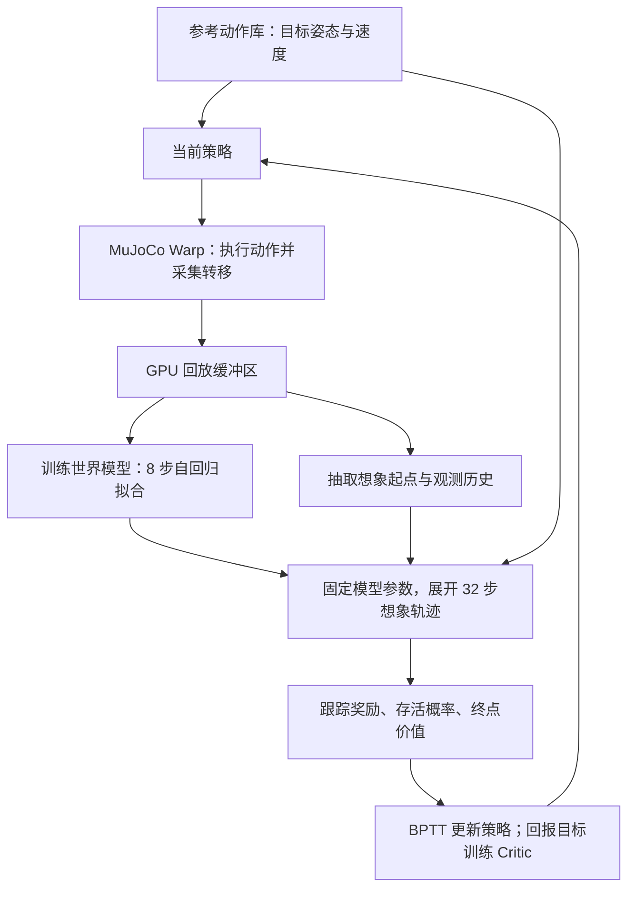

# SuperMimic：仓库复现思路、世界模型区别与加速原理

整理日期：2026-11-01。阅读对象：希望理解这个仓库如何训练 G1 动作跟踪策略，以及世界模型为什么能加速训练的读者。

本文以当前仓库源码为依据，结合 [SuperMimic 论文](https://arxiv.org/abs/2610.28480)、工作区中的论文 PDF，以及仓库的 [论文规格](PAPER_SPEC.md)、[复现计划](REPRODUCTION_PLAN.md)和[实验记录](EXPERIMENTS.md)。下文的训练成绩与耗时是**论文或仓库作者报告的数据，本次没有重新训练或测量**。旧计划与源码不一致时，以当前源码描述实际实现。

## 1. 先理解它到底在做什么

**这个仓库用一个可微的机器人动力学模型，替代策略训练阶段的大量物理仿真，并通过模型反向传播，直接优化动作跟踪策略。**

这里的“世界”很具体：一台 G1、平地接触、给定的控制器和若干随机化参数。世界模型要回答的是：

> 给定机器人当前的姿态、速度，以及下一步关节控制命令，20 毫秒后机器人会处于什么状态？

策略要回答的则是：

> 给定最近的本体传感器观测和接下来要跟踪的参考动作，现在应该给 29 个关节什么目标位置？

两者的分工如下。

| 组件 | 作用 | 如何获得能力 |
|---|---|---|
| 物理仿真器 MuJoCo Warp | 提供动作执行后的状态与失败标签 | 根据物理模型计算 |
| 世界模型 | 快速预测动作后果，并提供对状态、动作的导数 | 拟合仿真器采集的数据 |
| 跟踪策略 | 输出当前关节控制命令 | 通过世界模型中的预测回报训练 |
| Critic，价值网络 | 估计短预测窗口之后还能获得多少回报 | 用想象轨迹中的回报目标训练 |
| 参考动作库 | 提供“希望机器人做什么”的目标 | 读取已经重定向到 G1 的动作数据 |

参考动作和世界模型训练数据是两回事。参考动作给出目标姿态与速度；世界模型需要的是包含控制输入的状态转移，例如 `(当前状态, 执行动作, 下一状态)`。本仓库主要从**策略在仿真器中的执行**获得这些转移，包括跟踪不准和摔倒的情况。

另外，策略中的 **32 维 `z` 是参考动作的编码**，用于表达当前想做的动作；世界模型演化的是显式物理状态。不能把这个 `z` 当成 Dreamer 一类方法中的世界状态潜变量。

## 2. 仓库如何把论文复现出来

### 2.1 复用仿真底座，自己实现学习算法

仓库复用 `mjlab / MuJoCo Warp` 的 G1 资产、执行器、并行环境和域随机化能力，再实现动作库、状态记录、动力学模型、可微运动学、策略训练器与评测。训练主循环没有调用现成的 PPO runner。

整体流程可以直接对应到 [training/loop.py](../src/supermimic/training/loop.py) 的 `Trainer.run()`：



世界模型和策略在一个循环中交替改善。训练初期只有短暂的数据预热，随后持续收集当前策略的数据、更新模型、更新策略。

### 2.2 先建立统一的动作与控制接口

数据管线把 LAFAN1、BONES-SEED 中已经重定向到 G1 的动作转成 **50 Hz** 参考序列。对于 BONES-SEED，还要统一厘米/米、角度/弧度、旋转表示和关节顺序，并过滤依赖楼梯、椅子等外部支撑或存在明显几何异常的动作。

数据入口是 [scripts/data/](../scripts/data/)；运行时动作库是 [motion_library.py](../src/supermimic/envs/mdp/motion_library.py)。全量数据采用紧凑表示：存参考状态，需要跟踪刚体的位置和速度时再做 FK，即正向运动学计算。

一次控制步长为 `0.02 s`。物理仿真采用 `0.005 s × 4` 个子步，世界模型直接预测一个控制步后的结果。策略输出归一化关节位置设定点，经动作缩放、默认姿态偏置后进入位置执行器。它学到的状态转移因此包含了**这套执行器、控制周期与接触设置共同作用的结果**。

### 2.3 区分世界模型能看到什么、策略能看到什么

| 变量 | 本仓库默认维度 | 内容 |
|---|---:|---|
| 状态 `s` | 71 | 根位置 3、根四元数 4、关节位置 29、根线速度 3、根角速度 3、关节速度 29 |
| 动作 `a` | 29 | 29 个关节的归一化位置设定点 |
| 仿真上下文 `ξ` | 33 | 足部摩擦 1、关节编码器偏置 29、躯干质心偏移 3 |
| 单帧本体观测 `o` | 93 | 关节位置 29、关节速度 29、基座角速度 3、投影重力 3、上一时刻动作 29 |
| 观测历史 | 930 | 最近 10 帧的本体观测 |
| 参考目标 `g` | 680 | 当前参考帧及后续共 10 帧，每帧 68 维 |
| 动作编码 `z` | 32 | 目标编码器的输出，经过 `tanh` |
| Critic 附加根部误差 | 4 | 根位置误差 3、偏航误差 1 |

每帧 68 维目标由参考关节位置、关节速度、投影重力、基座角速度、航向系线速度和高度组成。这是仓库对论文未明确给出的目标特征内容所作的选择。

**训练世界模型时能读到的完整状态和 `ξ`，并没有全部提供给执行策略。** 默认策略依赖本体观测历史和参考目标，不直接读取当前全局位置、偏航或真实摩擦系数。Critic 可以使用额外信息，因为执行策略时不需要它。

网络连接见 [policy/nets.py](../src/supermimic/policy/nets.py)：

```text
参考目标 680 维
    → MotionEncoder，隐藏层 2048 → 1024 → 512 → 256
    → tanh → z，32 维

z 32 维 + 观测历史 930 维
    → Decoder，隐藏层 2048 → 1024 → 512 → 256
    → 动作，29 维
```

### 2.4 采集物理仿真数据：给世界模型提供监督

当前策略产生干净动作 `a`；采集时执行 `a_exec = a + ε`，默认动作噪声标准差为 `0.1`。缓冲区同时保存两种动作：

- `a_exec`：用于动力学拟合，因为它才是实际产生下一状态的输入。
- `a`：用于策略的历史动作观测和动作平滑项，保持与想象训练中的定义一致。

实现见 [actions.py](../src/supermimic/envs/actions.py)、[recorder.py](../src/supermimic/data/recorder.py) 和 [replay_buffer.py](../src/supermimic/data/replay_buffer.py)。缓冲区按环境保存最近约 1000 行记录，并处理回合边界。机器人失败后，会在重置前额外保存终止状态，避免把“摔倒前的状态 → 重置后的站立状态”误当成自然动力学。

随机化条件也随数据记录。若相同状态和动作在不同摩擦下产生不同结果，模型可以利用 `ξ` 区分；传感器噪声则在观测生成后单独加入。这让动力学网络可以采用**确定性的条件模型**，不必把这些已知随机来源全部压进一个隐变量分布里。

### 2.5 拟合世界模型：连续预测 8 步

世界模型每次从回放中抽取连续窗口，起点使用仿真记录状态，随后连续使用自己的预测状态，并输入当时实际执行的动作：

```text
真实 s0 + 记录动作 a_exec,0 → 预测 s1
预测 s1 + 记录动作 a_exec,1 → 预测 s2
……
预测 s7 + 记录动作 a_exec,7 → 预测 s8
```

中间不会每一步都换回真实状态，因此训练会暴露短期误差累积。这里 `k=8` 对应 `0.16 s`。

本仓库的损失可概括为：

$$
L_{\mathrm{WM}}=
\frac{1}{k}\sum_{j=1}^{k}
\mathbb{E}_{\mathrm{batch}}
\left[
\sum_{i=1}^{70} e_{j,i}^{2}
+\lambda_d\,\mathrm{BCE}(\hat d_j,d_j)
\right].
$$

`e` 是按不同物理量尺度归一化后的状态误差；姿态误差用 3 维旋转向量表示，所以误差维数是 70。默认终止损失权重为 1。**奖励与观测由解析函数计算，不需要对应的学习损失。**

默认一次世界模型更新包含 `10` 个 batch，每个 batch 为 `2048` 个八步窗口。对应 [world_model.py](../src/supermimic/world_model/world_model.py) 的 `window_loss()` 和 [wm_trainer.py](../src/supermimic/world_model/wm_trainer.py)。

### 2.6 在模型里训练策略：展开 32 步并反向传播

策略训练重新抽取回放起点与观测历史；之后每一步都由当前策略产生新动作，世界模型预测新状态，可微奖励函数评价跟踪效果。默认 `H=32`，也就是 `0.64 s` 的想象窗口。

策略最大化：

$$
J(\theta)=\mathbb{E}\left[
\sum_{t=0}^{H-1}\gamma^t c_t\hat r_{t+1}
+\gamma^H c_H V_\psi(\hat s_H,g_H,\xi)
\right],
\qquad c_{t+1}=c_t(1-\hat d_{t+1}),\quad c_0=1.
$$

上式为便于阅读省略了本仓库 Critic 的状态规范化与额外 4 维根部误差输入。

其中：

- 跟踪奖励鼓励未来几步接近参考动作，并惩罚动作突变和关节越界。
- `c_t` 是软存活权重。越容易失败的轨迹，后续收益越小。
- `V` 补上 32 步之后的价值，让短窗口也能考虑后续平衡与恢复。

关键实现见 [policy_trainer.py](../src/supermimic/imagination/policy_trainer.py)：

```python
self.wm.requires_grad_(False)
self.critic.requires_grad_(False)
ro = imagine(...)
J = policy_objective(...)
loss = -J / cfg.horizon
loss.backward()
self.opt.step()
```

这里冻结的是世界模型和 Critic 的**参数更新**，状态、动作到回报的梯度仍然存在。若把整个想象过程放进 `torch.no_grad()`，策略就失去了学习路径。

随后冻结想象轨迹目标，用 TD(λ)/GAE 式回报训练 Critic；默认 `γ=0.99`、`λ=0.95`，做 `5 × 4` 个 minibatch 更新。实现见 [objective.py](../src/supermimic/imagination/objective.py)。

### 2.7 在训练调度上兼顾数据、难动作和计算预算

默认每执行一个并行仿真步，累加 `0.4` 的更新额度；额度达到 1 时执行一次世界模型更新和一次策略/Critic 更新。因此大约每 `2.5` 个并行仿真步触发一轮学习。**这个 UTD=0.4 是更新调度比例，不是“40% 数据来自世界模型”，也不是每步只做 0.4 次优化器调用。**

训练重置起点来自参考动作的 1 秒分桶，混合：

- 50% 均匀采样，保持动作覆盖。
- 40% 按低回报优先采样，倾向当前困难的片段。
- 10% 按历史困难权重采样，继续复习曾经困难的片段。

对应 [commands.py](../src/supermimic/envs/mdp/commands.py)。这种调度让仿真数据更多落在当前有学习价值的区域。

## 3. 这个世界模型具体有什么特点

### 3.1 显式物理状态上的 MLP，而非视频预测网络

动力学网络实际接收：

```text
规范化状态特征 71 + 动作 29 + 仿真上下文 33 = 133 维
    → Linear + SiLU，2048
    → Linear + SiLU，2048
    → Linear + SiLU，2048
    → 70 维状态更新量
    → 显式积分，得到下一时刻 71 维状态
```

动力学 MLP 约有 881 万参数。它不需要解码图像，也不需要通过视觉编码器推断关节角或根部速度。源码见 [dynamics.py](../src/supermimic/world_model/dynamics.py) 和 [state_spec.py](../src/supermimic/world_model/state_spec.py)。

它仍然需要学习接触、摩擦、惯性、执行器响应等复杂关系，只是预测对象和使用场景更集中。

### 3.2 利用对称性，减少需要重复学习的情况

网络输入去掉全局水平位置与绝对航向，将根线速度转到航向坐标系，再表达去航向后的根姿态。

在均匀平地上，机器人朝北走与朝东走往往对应相同的局部动力学；在场地左侧与右侧做同一个动作，也无需分别学习。航向规范化让这些情况共享模型能力。预测后再把增量变回世界坐标，仍能计算全局轨迹误差。

这个设计依赖当前环境的平移与航向对称性。若任务加入台阶、墙面、局部障碍物，状态中就需要额外表达环境信息。

### 3.3 预测增量，并带一个简单的积分先验

当前源码的输出分为速度增量和位置/姿态修正，示意为：

$$
v_{t+1}=v_t+\Delta v,\qquad
p_{t+1}=p_t+\Delta t\,v_{t+1}+\Delta p.
$$

根姿态用旋转向量更新四元数并归一化；关节位置也由新速度积分加修正量得到。最后一层零初始化时，默认表现为**匀速外推**。

这给网络一个合理的短步预测起点，同时保留修正空间。它不是刚体动力学的精确解析解，也不保证动量或接触约束严格成立。

### 3.4 已知的观测和奖励直接计算，终止学习为概率

世界模型中的不同部分采用不同实现：

| 部分 | 当前实现 | 目的 |
|---|---|---|
| 下一状态 | 大 MLP + 积分 | 学动作引起的动力学变化 |
| 本体观测 | 从状态、偏置和上一动作解析计算 | 复现传感器输入定义 |
| 刚体位置与速度 | 可微 FK | 从关节状态获得跟踪所需的身体量 |
| 奖励 | 对预测身体量套用跟踪奖励公式 | 直接评价姿态、速度、动作平滑性等 |
| 终止概率 | 隐藏层 `(64, 64)` 的小 MLP | 将硬失败条件变成可求导的风险信号 |

奖励采用 6 项跟踪奖励和 2 项惩罚，覆盖根部/锚点位姿、身体位姿、身体线角速度、动作变化和关节限位；仿真终止检查骨盆高度误差与倾斜误差。论文允许各 head 学习或解析计算，以上具体组合是本仓库的实现。

解析奖励避免了“奖励网络自身估计错误”这一层误差，但**奖励仍然作用于预测状态**，动力学预测不准时，想象回报依然可能失真。

可微 FK 的作用尤其容易误解：它计算给定姿态下身体各部分在哪里、速度是多少；它不求解碰撞和接触力。接触对下一状态的影响由动力学网络学习。源码见 [g1_fk.py](../src/supermimic/kinematics/g1_fk.py)、[heads.py](../src/supermimic/world_model/heads.py) 和 [rewards.py](../src/supermimic/envs/mdp/rewards.py)。

## 4. 与其他“世界模型”路线有什么区别

下面比较的是建模对象与使用方式。不同方法覆盖的任务、观测和数据条件不同，表格不代表统一基准下的速度排名。

| 路线 | 模型主要表示什么 | 如何使用模型改善行为 | 与本仓库的关键区别 |
|---|---|---|---|
| **本仓库的 SuperMimic** | G1 显式状态、动作、已知仿真上下文 | 32 步 BPTT + Critic | 专注固定机器人动作跟踪，模型与策略在线交替训练 |
| **Dreamer，尤其原版** | 从观测学习紧凑潜状态及其演化 | 潜空间想象中的 actor–critic；原版也使用解析梯度 | SuperMimic 可直接获得物理状态，省去了这部分表征学习；“能反向传播”并非它独有 |
| **TD-MPC / TD-MPC2** | 面向回报与价值预测的潜空间模型 | 结合价值估计进行短时轨迹优化与模型预测控制 | SuperMimic 将优化结果训练进前馈策略，执行动作时无需每步搜索候选轨迹 |
| **Robotic World Model，RWM / RWM-U** | 面向机器人观测和动态的神经模拟器 | RWM 使用 MBPO-PPO；RWM-U 使用带不确定性惩罚的 MOPO-PPO | SuperMimic 的策略更新直接利用动力学导数；本仓库没有对应的不确定性惩罚机制 |
| **SHAC / 可微物理仿真** | 由可微物理引擎提供状态演化 | 对仿真轨迹做短时反向传播，Critic 补充远期价值 | SuperMimic 的梯度来自学到的近似模型，不要求原物理引擎可微 |
| **Genie 一类视频世界模型** | 视觉场景、视频 token 与动作条件下的未来帧 | 生成可交互视觉环境，可进一步用于行为学习 | 本仓库只预测控制所需的低维状态，不承担通用视觉生成任务 |

对照依据：[Dreamer 原论文](https://arxiv.org/abs/1912.01603)、[TD-MPC2 原论文](https://arxiv.org/abs/2310.16828)、[RWM 原论文](https://arxiv.org/html/2501.10100v5)、[RWM-U 原论文](https://arxiv.org/abs/2504.16680)、[SHAC 作者项目页](https://short-horizon-actor-critic.github.io/)、[Genie 原论文](https://arxiv.org/abs/2402.15391)。

有三点值得单独区分：

1. **世界模型方法并不都在预测视频。** Dreamer 和 TD-MPC 系列也会利用紧凑表示，不能把 SuperMimic 的优势概括为“其他模型都在渲染图像”。Dreamer 系列也不限于视觉输入。
2. **拥有世界模型不等于使用动力学梯度训练策略。** RWM 的 PPO 路线主要利用模型提供训练轨迹；本仓库进一步把回报对动作的导数用于策略更新。这是直接相关的区别。[RWM §3.3](https://arxiv.org/html/2501.10100v5)
3. **可微模型训练策略已有前作。** Dreamer、SHAC，以及论文讨论的 SuperTrack、ControlVAE 等都与这一路线相关。SuperMimic 的重点是把共享动力学、短窗口梯度、机器人可部署观测和大动作库训练组合起来，并分析计算效率；不能把 BPTT 本身归为它首次提出的创新。[Dreamer](https://arxiv.org/abs/1912.01603)、[SuperMimic §2](https://arxiv.org/abs/2610.28480)

## 5. 为什么能快：需要同时看每步成本和所需步数

### 5.1 第一个来源：神经网络预测避免重复求解完整物理过程

真实仿真一步需要处理刚体运动、碰撞检测、接触约束和求解器迭代。本仓库每个控制步还要进行 4 个物理子步。

世界模型把这些过程对最终状态的影响拟合成固定维度的神经网络映射。策略想象时，主要计算矩阵乘法、积分、FK 和奖励函数；大量样本可以批量执行，密集线性层也适合 GPU 张量计算。

论文在 H100 上报告：实际使用的 `2k–16k` 并行规模下，世界模型 rollout 吞吐超过 MuJoCo Warp 的 10 倍；`64k` 时约为 62 倍。**这是 rollout 吞吐，不是整套训练速度，也不是本机测得的倍数。**[SuperMimic §4.2、Fig. 5(a)](https://arxiv.org/abs/2610.28480)

### 5.2 第二个来源：梯度提供更直接的动作改进方向

PPO 根据采样动作的优势估计更新策略，把环境状态转移视为黑盒。本仓库通过链式法则传播动作后果：

```text
策略参数 θ
  → 关节动作 a_t
  → 预测状态 s_(t+1)
  → 后续动作与状态
  → 跟踪奖励、失败风险、终点价值
```

例如，一个落地动作使躯干前倾过大，模型中的梯度可以给出“当前几个关节命令朝哪个方向微调，能改善后续跟踪”的局部信息。这比仅根据整段结果好坏来调整动作分布，提供了更直接的训练信号。

论文用 PPO-WM 作机制对照：双方都能使用世界模型生成轨迹，在 LAFAN1 的 walk/run/sprint 子任务上，SuperMimic 达到 PPO-WM 最佳训练回报所需的想象步数约少 **64 倍**。这支持“梯度利用方式也有贡献”，而不只是模型运行快。[SuperMimic Fig. 5(b)](https://arxiv.org/abs/2610.28480)

这里的解析梯度是**学到的近似模型的梯度**。低方差不等于没有偏差；状态预测准确，也不自动保证导数准确。模型误差较大时，策略可能利用模型的漏洞。

### 5.3 第三个来源：不同动作共享同一套身体动力学

走路、转身、跳跃和舞蹈的目标轨迹不同，但执行它们的关节、执行器和接触系统相同。因此动力学函数不必按动作类别重新训练一个模型。

本仓库的动力学 MLP 只读取 `状态 + 动作 + ξ`，不直接读取参考动作。参考动作主要进入策略、奖励和终止判断：**改变“想做什么”，通常不改变“相同状态和输入会怎样运动”的物理规律。**

这解释了为什么更多动作数据可以共同改善模型，而不是完全重复学习。它不意味着数据量无限扩大也没有成本：新动作仍可能引入此前没有覆盖的接触状态和高速运动区域。

### 5.4 第四个来源：短预测窗口与 Critic 控制计算量

`H=32` 只展开 `0.64 s`，无需对整条几秒、几分钟的动作建反向传播图。Critic 估计窗口外的回报，使策略可以在较短窗口内学习。

较短窗口减少了中间激活存储、反向传播成本和模型误差累积。`k=8` 的训练窗口与 `H=32` 的策略窗口则是一种经验折中；八步预测误差小不能单独证明三十二步甚至更长时间都可靠。

### 5.5 第五个来源：参考动作与奖励让任务更容易学习

参考动作提供了密集目标，训练可以从动作中间的参考姿态附近重置，奖励每一步都能评价身体姿态和速度偏差。策略不用从零发现“怎样才算跳跃”或等待很久才得到一个成功信号。

这是对本仓库训练条件的解释：模型、任务定义和重置机制共同降低了学习难度。把同样的方法移到稀疏奖励、未知物体或复杂视觉任务上，速度优势需要重新验证。

### 5.6 第六个来源：工程实现把理论优势变成实际吞吐

| 优化 | 当前实现或仓库记录 | 解决的问题 |
|---|---|---|
| 编译单个想象步 | `ImagStep` 将动力学、FK、奖励、终止、观测组合后交给 `torch.compile` | 减少大量小算子的启动与调度开销，并编译相关反向计算 |
| 编译世界模型损失步骤 | `WorldModel.enable_compile()` | 降低八步拟合中的重复调用开销 |
| 批量准备参考量 | `imagine()` 预先批量获取整段参考状态并做 FK | 减少逐步重复处理目标的成本 |
| 紧凑动作库存 GPU | 每帧 71 个数用 fp16 存储，取出时转成计算精度；全库约 6.74 GB | 降低存储和搬运成本，身体量按需计算 |
| 减少 CPU/GPU 同步 | WM 的 minibatch 指标先留在设备端，更新结束再转为 Python 数值 | 减少 CPU 等待以及多卡间的连锁等待 |
| 数据并行 | 每卡独立仿真器与回放，模型参数共享更新，梯度显式 all-reduce | 增加每轮可利用的数据与总吞吐 |
| 控制仿真日志开销 | 在内核/图构建前关闭频繁触发的 overflow 输出 | 避免早期不稳定策略的设备打印拖慢采集 |

这里的 fp16 指**参考动作库的存储格式**，不能推导为整套训练都用 fp16。逐步 `torch.compile` 也不能理解为整个训练循环都被一次性编译或捕获成 CUDA Graph。

仓库作者记录的实测包括：

- 想象前向加反向，`batch=2048、H=32`：从 `1.48 s` 降到 `0.33 s`，约 **4.5 倍**；首次编译约 `210 s`。
- 5090 上，4096 个环境、包含回放记录器的仿真采集：约 **200,845 env-steps/s**。
- 四卡配置的汇总吞吐约为单卡的 **3.6 倍**，作者报告扩展效率约 **91%**。

来源：[EXPERIMENTS.md 的速度优化与多卡记录](EXPERIMENTS.md)。实现见 [compiled.py](../src/supermimic/imagination/compiled.py)、[rollout.py](../src/supermimic/imagination/rollout.py)、[distributed.py](../src/supermimic/training/distributed.py)。

`0.33 s` 是想象前向/反向微基准，[bench_imagination.py](../scripts/bench_imagination.py) 没有计入完整的世界模型训练和 Critic 更新，也不使用终点 Critic。它与仿真的 `env-steps/s` 不是相同计时范围，不能直接相除来复现论文的 rollout 加速比。多卡吞吐效率也不等于达到同一回报的训练时间必然缩短相同比例。

### 5.7 “1000 倍”应该怎样理解

论文的宣传数字比较的是训练预算：SONIC 报告的 `128 × L40 × 168 h`，与 SuperMimic 在 `1 × H100 × 3 h` 达到所比较性能的预算。粗算分别是 `21,504 GPU·h` 和 `3 GPU·h`，比例约 `7168`，论文保守表述为超过 1000 倍。两边 GPU 型号和训练数据量不同；这个比较不等于同硬件、同数据、同实现下的纯算法加速。[SuperMimic §4.1，Compute accounting](https://arxiv.org/abs/2610.28480)

训练总时间需要把几项相加：

$$
T_{\mathrm{train}}\approx
T_{\mathrm{sim\ collection}}+
T_{\mathrm{WM\ fit}}+
T_{\mathrm{imagination+BPTT}}+
T_{\mathrm{critic}}+
T_{\mathrm{overhead}}.
$$

因此，rollout 快 10 倍、某个对照中步数少 64 倍、编译快 4.5 倍，是不同口径、部分重叠的收益，**不能直接连乘得到一个通用训练加速倍数**。论文的 3 小时涵盖训练循环，检查点评测另算；也不能据此认为下载、预处理和工程准备均包含在内。

## 6. 这份复现做到了什么，还有哪些边界

### 6.1 核心方法已经形成完整实现

从源码可以确认，仓库已经连通物理仿真采集、回放、八步世界模型拟合、三十二步 BPTT、Critic、困难片段重置采样、多卡梯度同步和整段动作评测。

测试覆盖 FK 与 MuJoCo 的数值比较、解析奖励/观测比较、状态规范化、回放窗口、GAE 和训练 smoke test。仓库作者报告过 FK 与解析 head 的对拍结果；这些用于检查实现一致性，并不等价于验证所有动作的控制性能。相关代码在 [tests/](../tests/)。

### 6.2 与论文数值的关系要按条件阅读

| 项目 | 本仓库作者报告 | 论文报告 / 对比条件 |
|---|---|---|
| BONES-SEED 默认本体观测 | 4×5090，7.1 h，约 28.4 GPU·h；回报约 0.93；过滤后 145/129,491 失败 | 1×H100，3 h；25/129,514 失败；2×H100，9.8 h 为 0 失败 |
| LAFAN1 整条长动作，默认本体观测 | 回报约 0.56–0.59，3–9/40 失败 | 论文 Fig. 4(a) 为 0.82，单 H100 约 1.2 h；长片段评测细节仍需对齐 |
| LAFAN1 加 9 维锚点相对观测 | 单 5090，约 3.3 h，回报 0.904 | 额外输入了状态相对信息，不能作为原观测条件下达标的证据 |
| 世界模型八步归一化误差 | README 报告约 0.0065–0.0099 | 论文约 0.007–0.011；需确认归一化尺度与取样方式才能严格比较 |

表中数据来源：[仓库 README](../README.md)、[实验日志](EXPERIMENTS.md)、[论文 §4 与 Appendix F](https://arxiv.org/abs/2610.28480)。日志中，校准后 129,491 条集合的 clip 平均回报为 `0.932`、步数加权为 `0.925`；README 用约 `0.930` 概述。因此这里统一写“约 0.93”，不把不同平均方式混为一个精确数字。

需要同时保留以下事实：

- 原始全量评测集合为 129,943 条、495 次失败。后来按关键词再排除 452 条，其中包含 350 次失败，得到 129,491 条、145 次失败。这是**评测集合变化**，并非该次操作让策略学会了这些动作。
- 129,491 条与论文的 129,514 条仍不完全相同，动作组成也有差异。比如复现报告的 54 条 flip 全部失败，论文单卡结果的 44 条 flip 中失败 1 条。
- 默认观测在长动作上有累计位置和偏航漂移，仓库通过额外锚点观测验证了改善效果。这是当前复现的重要限制，不能仅凭该结果断言论文方法在所有长动作上都必然失败。
- 主 BONES-SEED benchmark 是训练动作集合上的覆盖评测，不能把低失败率直接解释为对未见动作的泛化能力。[论文 Appendix F.2](https://arxiv.org/abs/2610.28480)

### 6.3 论文没有规定的细节，仓库作了自己的选择

| 事项 | 当前仓库的具体处理 | 阅读时的含义 |
|---|---|---|
| 状态表示与归一化 | 航向规范化、名义尺度、显式积分与修正项 | 不能都视为论文唯一指定的实现 |
| 参考目标内容 | 每帧 68 维、10 帧共 680 维 | 论文明确未来帧数量，具体特征内容由复现确定 |
| Head 组合 | 解析观测/奖励 + 学习终止概率 | 属于论文允许的实现选择 |
| Critic 输入 | 增加 4 维根部位置/偏航误差 | 让规范化输入后的 Critic 仍能感知全局漂移 |
| 域随机化时机 | 摩擦、编码器偏置按 reset；质心偏移按 startup | 质心设置为 startup 有性能方面的工程考虑 |
| 全量训练批量 | 报告的主实验每卡想象 batch 为 2048 | 与论文表中的默认 4096 不同，受显存约束 |
| 更新总长度 | 将外层 iteration 解释为一次并行仿真步 | 计划本身记录了论文调度口径的解读空间 |

更完整的选择依据见 [REPRODUCTION_PLAN.md 的 D1–D20](REPRODUCTION_PLAN.md)，实际变化以 [EXPERIMENTS.md](EXPERIMENTS.md) 与源码为准。

### 6.4 几个需要按源码解释的细节

**回报归一化。** 当前 [benchmark.py](../src/supermimic/eval/benchmark.py) 使用 `累计奖励 / (0.1 × 实际执行步数)`。提前失败会单独记为失败，但分母不是原动作完整长度，因此“提前失败一定按缺失的剩余时长降低回报”并不由当前公式保证。若要严格对齐论文中“提前结束会得到低分”的说明，需要进一步核对双方分母与汇总方式。本文保留仓库报告的回报，并同时展示失败率。

**学习率衰减。** README/日志出现“100k 停止时学习率尚未衰减”的表述，而当前 [schedule.py](../src/supermimic/training/schedule.py) 从开始就按余弦曲线衰减，在 250k 达到初始值的 0.03。按默认公式，100k 时约为初始值的 0.665。准确说法应是“尚未完成既定衰减过程”；历史实验的真实学习率仍以当时配置和日志为准。

**难度采样的超时处理。** 计划讨论过用 Critic 为超时回合补全回报，但当前 `commands.py` 中的 `bootstrap_fn` 默认是 `None`，训练器没有将其接入。因此实际使用的是跳过临近超时样本的后备路径。它与策略想象目标中已经实现的 Critic 自举是两处不同机制。

**模型误差指标。** `normalized_sq_error()` 对按尺度归一化后的误差平方取均值；不同位置、角度、速度分量使用不同尺度。`0.0065` 不能直接读成“位置误差 0.65%”，也不能仅凭与论文数值接近就认定预测精度完全复现。当前 `online_error()` 从回放中抽取窗口，不是严格独立的保留测试集。

### 6.5 使用范围与尚未完成的部分

当前实现面向固定 G1、平地、给定执行器与参考动作跟踪。增加负载、改变控制器或地形、引入操作物体后，模型输入与训练覆盖都可能需要调整。软终止、短窗口、在线补充数据有助于缓解模型误差，但不能保证策略永远不会利用模型的不准确区域。

仓库 README 明确列出的未完成项包括：速度接口及蒸馏、PPO 对照基线、完整的 horizon×Critic 消融、ONNX 导出、真机部署。因此它已经复现核心训练方法与较大规模的仿真结果，尚不能视为论文所有实验和真机结论的完整复现。

训练结束后，当前评测路径只加载并运行策略，世界模型和 Critic 不在动作执行链路上。实际运行的是 `参考目标 + 本体历史 → encoder/decoder → 关节目标`。所以“训练需要大模型与想象 rollout”和“执行时只需策略前向”是可以同时成立的。[benchmark.py 的策略加载与执行](../src/supermimic/eval/benchmark.py)

## 7. 建议的源码阅读顺序

| 顺序 | 文件 | 阅读重点 |
|---:|---|---|
| 1 | [training/loop.py](../src/supermimic/training/loop.py) | 三阶段闭环如何调度，UTD 如何落地 |
| 2 | [world_model/state_spec.py](../src/supermimic/world_model/state_spec.py) | 71 维状态、坐标规范化、70 维增量与误差 |
| 3 | [world_model/world_model.py](../src/supermimic/world_model/world_model.py) | 一步预测与八步自回归损失 |
| 4 | [world_model/heads.py](../src/supermimic/world_model/heads.py) | 哪些量解析计算，哪些量学习 |
| 5 | [imagination/rollout.py](../src/supermimic/imagination/rollout.py) | 策略如何在预测状态里连续执行 |
| 6 | [imagination/objective.py](../src/supermimic/imagination/objective.py) | 存活加权回报与 Critic 自举公式 |
| 7 | [imagination/policy_trainer.py](../src/supermimic/imagination/policy_trainer.py) | 冻结参数、保留输入梯度、更新策略与 Critic |
| 8 | [imagination/compiled.py](../src/supermimic/imagination/compiled.py) | 单步图编译如何减少算子开销 |
| 9 | [EXPERIMENTS.md](EXPERIMENTS.md) | 方法落地后的速度、失败情况与观测限制 |

带着这条因果链读代码最容易把握设计：**从仿真学习共同的身体动力学 → 用模型廉价地产生短轨迹 → 沿轨迹传播回报梯度 → 用 Critic 补充更远的价值 → 再到仿真中采集新数据校正模型。** 速度提升来自这套闭环与具体任务条件的配合。
